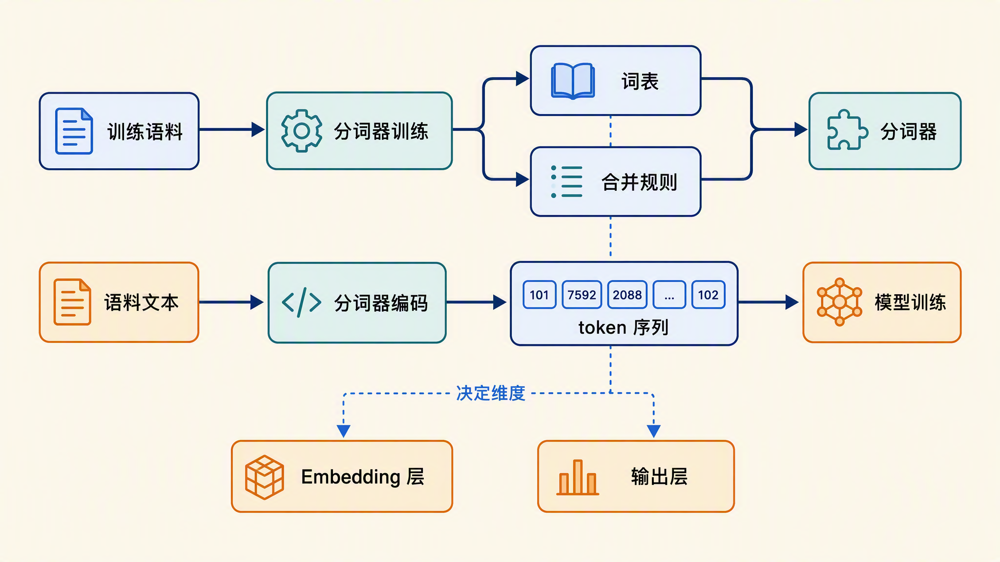
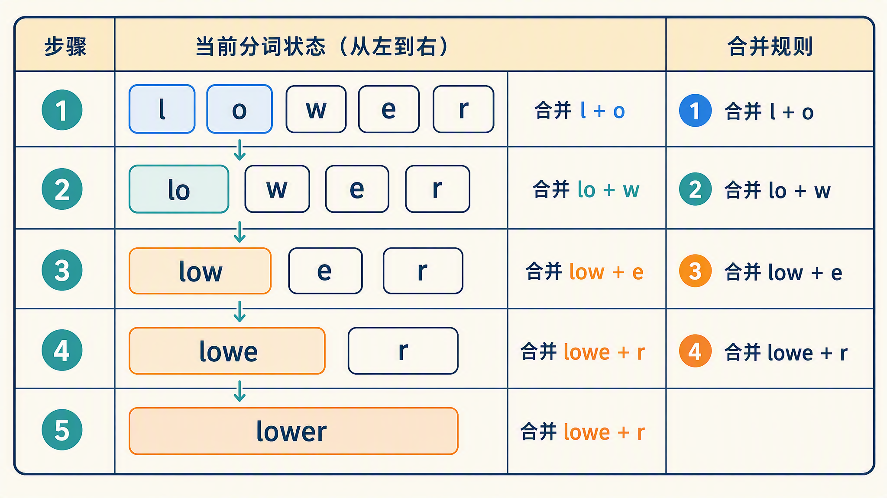
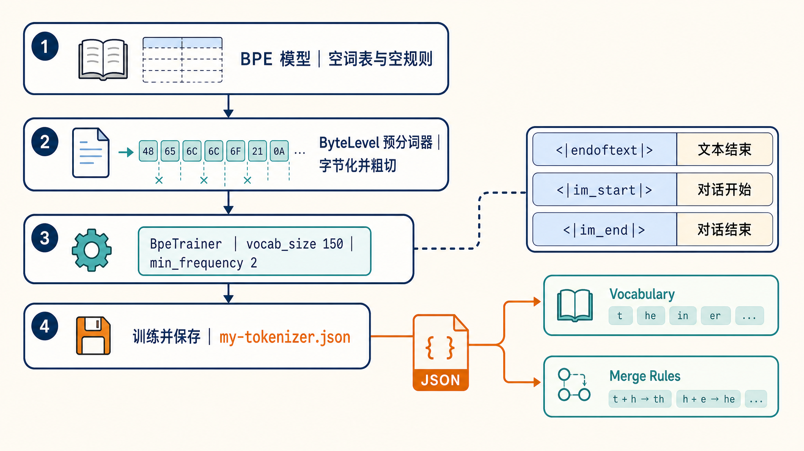
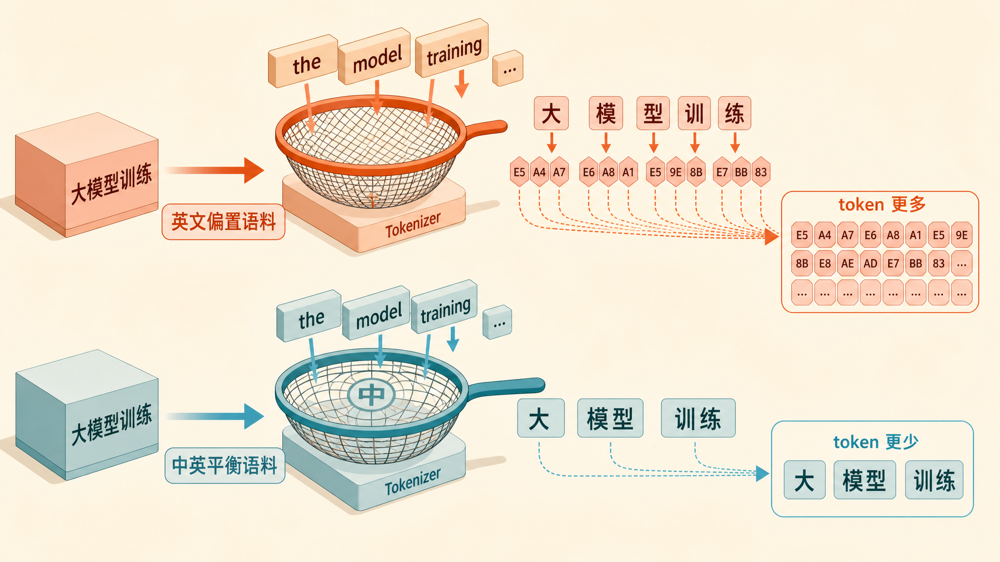
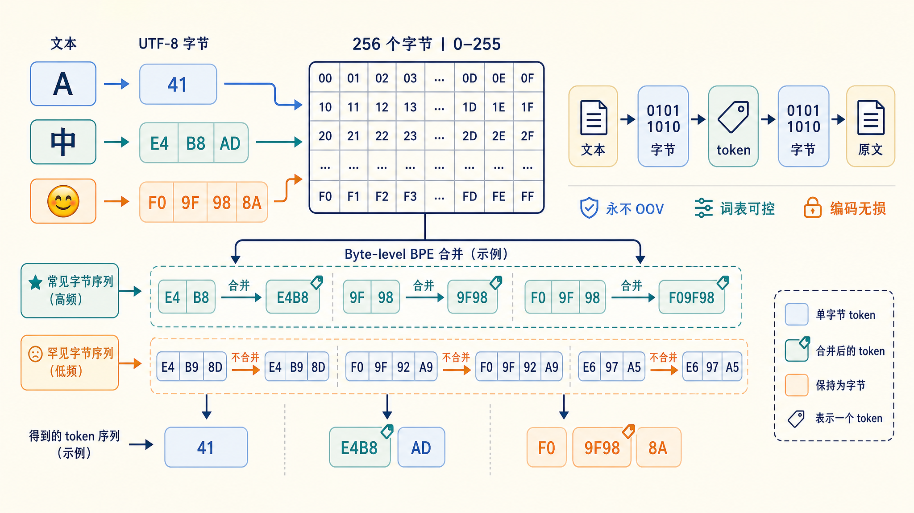

# 学习大模型训练的分词器：从语料到词表

在上一篇中，我们把训练语料的来龙去脉走了一遍：从 Common Crawl 这样的互联网快照开始，经过过滤、去重、质量打分，最后得到一份干净的高质量语料。不过这份语料还不能直接喂给模型，中间还差一道工序，那就是分词。

在《大模型推理》系列的第二篇里，我们曾学习过怎么用现成的分词器把文本切成 token，当时是站在使用者的角度。今天我们换个位置，站到分词器的制造者这边，看看分词器本身是怎么训练出来的，并亲手用 Hugging Face `tokenizers` 库训练一个属于自己的分词器。

## 分词器的训练

我们之前讲过，分词器的主体是一张**词表**，模型能认识的所有 token 都在里面。训练一个分词器，产出的其实是两份东西：

* **词表（Vocabulary）**：每个 token 对应一个编号，比如 Qwen3 的词表里 `world` 是 14615、`你好` 是 108386
* **合并规则（Merge Rules）**：一串有序的合并操作，编码新文本时按顺序套用，决定相邻的字符合并成哪个 token

这两份东西都不是人工编写的，而是训练算法从语料里学出来的。值得注意的是，词表有双重身份：它既是分词器的组成部分，又直接决定了模型 embedding 层（把 token 编号映射成向量的第一层）的形状。它不定下来，模型 embedding 层和输出层的大小就没法定。所以说，训练分词器是模型训练的第一步。

训练分词器和训练模型的关系如下图所示：



## BPE 算法回顾

上一节说了，词表和合并规则是从语料里学出来的，那具体用什么算法学呢？主流的答案就是 **字节对编码（Byte Pair Encoding，简称 BPE）**。这个算法在推理系列第二篇详细讲过，这里快速回顾一遍。BPE 最早是一个数据压缩算法，2016 年 Sennrich 等人在论文[《Neural Machine Translation of Rare Words with Subword Units》](https://arxiv.org/abs/1508.07909)里把它引入 NLP，用来解决稀有词的翻译问题，后来就成了大模型分词的标准做法之一。

BPE 算法的核心思想是：从最小的单位开始，反复把语料中出现频率最高的相邻对合并成一个新单位，直到词表攒够为止。具体步骤是：

1. **初始化**：把语料拆成最小单位（字符或字节），这就是初始词表
2. **统计**：数一遍语料里所有相邻单位对的出现频率
3. **合并**：把频率最高的那一对合并成一个新的单位，加入词表
4. **重复**：回到第 2 步，直到词表大小达到设定的 `vocab_size`

拿一个小例子走一遍。假设语料里 `low` 出现了很多次，`lower` 也出现了不少次。第一轮统计下来，`l` 和 `o` 这对邻居出现最多，合并成 `lo`；下一轮 `lo` 和 `w` 出现最多，合并成 `low`；再往后 `low` 和 `e` 合成 `lowe`，最后可能整个 `lower` 都成了词表里的一个 token：



合并的每一步都被记录下来，形成合并规则。编码新文本时，先拆成最小单位，再按规则顺序套用这些合并，文本就被切成了词表里的 token。这个词表里既会有 `low` 这样完整的单词，也会有 `er`、`ing` 这类词根词缀，还会有单字符兜底。

> 这个算法本质上是在做一件事：用固定大小的词表，尽可能高效地表示训练语料。语料里常见的片段会被合成大 token，罕见的片段就只能拆小了表示。所以词表里藏着语料的统计特征，语料是什么，词表就是什么。

## 从零训练一个 BPE 分词器

理论讲完，接下来我们亲手训练一个。我们这里使用 Hugging Face 的 [`tokenizers`](https://huggingface.co/docs/tokenizers/quicktour) 库，它底层是 Rust 实现，速度很快，也是 `transformers` 里 `AutoTokenizer` 背后常用的后端。先安装：

```bash
$ pip install tokenizers
```

### 准备语料

真实场景里训练分词器的语料是 GB 甚至 TB 级的文本，通常就是模型预训练语料本身或它的一个采样。这里我们用小语料演示，准备一份以英文为主、夹了几句中文的文本，英文部分重复多次、中文只重复几次，模拟语料里英文占绝对多数的真实情况：

```python
english = [
    "The quick brown fox jumps over the lazy dog.",
    "The tokenizer is trained on the training corpus.",
    "Training a tokenizer is the first step of training a language model.",
    "Large language models are trained on massive amounts of text data.",
    "The trainer merges the most frequent pairs of tokens.",
]
chinese = [
    "大模型训练需要高质量的数据。",
    "训练分词器是训练模型的第一步。",
]

# 英文重复 200 次、中文只重复 5 次，模拟英文为主的语料
corpus = english * 200 + chinese * 5
```

> 生产环境一般用 `tokenizer.train(files=["corpus.txt"], ...)` 直接读文件，或者用 `train_from_iterator` 流式喂入一个数据集迭代器，避免把全部语料读进内存。这里为了方便观察，用列表加重复来模拟。

### 训练并保存

训练代码就十几行，核心是把模型、预分词器、训练器三个组件拼起来：

```python
from tokenizers import Tokenizer
from tokenizers.models import BPE
from tokenizers.trainers import BpeTrainer
from tokenizers import pre_tokenizers, decoders

# 1. 新建一个空的分词器，底层算法选 BPE
tokenizer = Tokenizer(BPE())

# 2. 预分词器：先把文本按空格切成粗块，BPE 只在块内做合并
tokenizer.pre_tokenizer = pre_tokenizers.ByteLevel(add_prefix_space=False)
tokenizer.decoder = decoders.ByteLevel()

# 3. 训练器：设置词表大小和特殊 token
trainer = BpeTrainer(
    vocab_size=150,
    min_frequency=2,
    special_tokens=["<|endoftext|>", "<|im_start|>", "<|im_end|>"],
)

# 4. 训练并保存
tokenizer.train_from_iterator(corpus, trainer=trainer)
tokenizer.save("my-tokenizer.json")

print("词表大小:", tokenizer.get_vocab_size())
```

逐块解释一下：

1. **BPE 模型**：`Tokenizer(BPE())` 创建一个空的分词器，词表和合并规则都是待训练状态。这里传的其实是底层切词算法，除了 `BPE` 还可以选 `WordPiece`（BERT 用的）、`Unigram` 和 `WordLevel`（最朴素的按整词切分），算法换了，对应的训练器也要跟着换
2. **预分词器（Pre-tokenizer）**：在 BPE 合并之前先粗切一刀。这里用的 `ByteLevel` 是 GPT-2 的做法，把文本转成字节序列并按空格切块，空格本身会变成一个特殊字节，在 token 里显示为 `Ġ`
3. **[`BpeTrainer`](https://huggingface.co/docs/tokenizers/en/api/trainers#tokenizers.trainers.BpeTrainer)**：训练器，几个关键参数：`vocab_size` 是目标词表大小；`min_frequency` 是合并的最低频率门槛，出现不到这么多次的相邻对不参与合并；`special_tokens` 是特殊 token，它们不参与训练统计，直接插入词表，像 `<|endoftext|>` 表示文本结束，`<|im_start|>` 和 `<|im_end|>` 是对话格式里常用的起止标记
4. **训练与保存**：`train_from_iterator` 完成前面讲的统计-合并循环，产出的 `my-tokenizer.json` 是一个自包含文件，词表和合并规则都在里面



我们将词表的头部和尾部各打印几个，看看训练完的词表长什么样：

```python
vocab = tokenizer.get_vocab()
items = sorted(vocab.items(), key=lambda kv: kv[1])

print("--- 词表头部 ---")
for token, idx in items[:10]:
    print(idx, repr(token))

print("--- 词表尾部 ---")
for token, idx in items[-5:]:
    print(idx, repr(token))
```

这里的 `get_vocab()` 返回的字典不保证顺序，因此按 id 排序再看，输出如下：

```text
--- 词表头部 ---
0 '<|endoftext|>'
1 '<|im_start|>'
2 '<|im_end|>'
3 '.'
4 'L'
5 'T'
6 'a'
7 'b'
8 'c'
9 'd'
--- 词表尾部 ---
145 'Ġqu'
146 'Ġbr'
147 'Ġco'
148 'Ġju'
149 'Ġpair'
```

可以看到，特殊 token 排在了词表最前面，占用了 0 到 2 号；接下来是语料里出现过的 69 个单字节，按字节值排序（`.` 是 46、`L` 是 76、`a` 是 97）；从 72 号开始就是训练过程中合并出来的多字符 token 了，比如尾部的 `Ġpair` 来自高频词 `pairs`，`Ġ` 开头表示它是从一个词的开头切出来的。

## 词表大小对分词的影响

`vocab_size` 是训练分词器时最重要的一个超参数。我们把同一份语料分别训练成 150 和 300 两个词表大小的分词器，看看同一句话会切出什么差别。

先用刚才训练好的 150 词表分词器编码一句话。为了看得直观，把每个 token 逐个解码出来：

```python
text = "Training a tokenizer is the first step. 大模型训练"
enc = tokenizer.encode(text)
print([tokenizer.decode([i]) for i in enc.ids])
print("token 数:", len(enc.tokens))
```

150 词表下的切分结果：

```text
['Train', 'ing', ' a', ' tokenizer', ' is', ' the', ' f', 'ir', 'st',
  ' st', 'ep', '.', ' ', '�', '�', '�', '�', '�', '�', '�', '�', '�', '�', '�', '�', '�', '�', '�']
token 数: 28
```

再把 `vocab_size` 改成 300 重新训练一个，同样的编码代码，结果是：

```text
['Training', ' a', ' tokenizer', ' is', ' the', ' first', ' step', '.', ' ', '大', '模型', '训练']
token 数: 12
```

> 300 只是目标大小，这份小语料实际学不满：几轮之后没有满足 `min_frequency` 的相邻对可以合并，训练就提前停了，最终词表停在 253。真实模型能学满十几万的大词表，靠的是海量的训练语料。

两种切法的对比很清楚：

1. **英文部分**：小词表把 `Training` 切成了 `Train` + `ing`，`first` 碎成了 ` f`、`ir`、`st` 三段；大词表里它们都是完整的 token。词表越大，常见词越容易整体入表，切出来的序列越短
2. **中文部分**：小词表里中文变成了 15 个 `�`，一个汉字是 3 个字节，每个字节都是单独的 token，字都拼不完整，所以解码时只能显示成这样的替换符。而大词表里出现了 `大`、`模型`、`训练` 这样的完整中文 token
3. **序列长度**：同一句话从 28 个 token 降到 12 个

另外，还有一点要注意的是，有的 token 带着前导空格（` a`、` the`），这是 `ByteLevel` 预分词器把空格并进了后面的词，带空格和不带空格是两个不同的 token。

### 词表大小的权衡

词表不是越大越好，这里有一笔账要算。

大词表的好处很直接：同样的文本切出来的 token 更少，序列更短。序列短了，训练和推理的注意力计算都省，因为注意力的开销随序列长度平方增长。

代价在模型的两端。模型第一层是 **embedding 层**，大小是词表大小乘隐藏维度；最后一层输出头通常和 embedding 共享形状，也是词表大小乘隐藏维度。假设词表从 5 万涨到 15 万，以 4096 的隐藏维度算，embedding 加输出头就多了大约 8 亿参数（10 万行乘 4096 维，首尾各一份，相当于 0.8B），这对于几 B 规模的模型来说可不是小数目。另外，稀有 token 在语料里出现次数少，它们的 embedding 训练不充分，表示质量差，因此不能无限制地扩大词表。

不过，主流模型的词表规模这几年明显在涨：

| 模型 | 词表大小 | 分词方案 |
| ---- | ---- | ---- |
| GPT-2（2019） | 50,257 | 字节级 BPE |
| Llama 2（2023） | 32,000 | SentencePiece BPE |
| Mistral 7B v0.3（2024） | 32,768 | SentencePiece BPE |
| Llama 3（2024） | 128,256 | 字节级 BPE |
| Gemma 2（2024） | 256,128 | SentencePiece |
| DeepSeek-V3（2024） | 129,280 | 字节级 BPE |
| GLM-4（2024） | 151,552 | 字节级 BPE |
| Qwen2.5（2024） | 151,665 | 字节级 BPE |
| Kimi K2（2025） | 163,840 | 字节级 BPE |

> 表中数字来自各模型的官方配置。部分模型的配置包含对齐用的填充位，实际可用的词表条目会略少一点。

词表涨上去的直接动机是压缩率。Llama 3 相比 Llama 2 词表翻了四倍，Meta 在[模型介绍](https://github.com/meta-llama/llama3/blob/main/MODEL_CARD.md)里明确说这是为了提高 token 压缩率，同样一段文本用更少的 token 表示。

从这张表里我们还能看出两个有意思的点。一是分词方案的换代：2023 年之后的新模型几乎清一色转向字节级 BPE，SentencePiece 只在老牌模型上还留着，它是 Google 开源的分词工具库，思路同样是统计式的子词切分。

二是词表大小和模型的目标市场明显相关：Mistral 只有 3 万出头，基本不管多语言；以中文为主场的 Qwen、GLM、Kimi 都在 15 万上下，因为要专门收录中文字和词；Gemma 2 的 25.6 万最大，谷歌的多语言覆盖诉求最强。

## 多语言与中文的坑

前面 demo 里小词表把中文碎成字节的现象，在真实模型身上也发生过，而且是个有名的坑。

BPE 的词表是从语料里学出来的，语料的构成直接决定词表的构成。如果训练分词器时用的语料 99% 是英文，中文样本只有零星一点，那么中文字符的出现频率根本不够触发合并，结果就是：常见英文单词整体是一个 token，而一个中文字要么单独成 token，要么干脆碎成 2~3 个字节 token。

这带来两个实际后果：

* **压缩率低**：同样语义的内容，中文要花掉比英文多好几倍的 token。上下文窗口是按 token 算的，中文用户实际能用掉的窗口就缩水了，推理成本也更高
* **学习不充分**：字节级的中文 token 本身没有语义，模型要从碎片里重新拼出字和词的概念，等于平白多了一道学习负担

所以国产模型在训练分词器时，都会在语料里加重中文的比例。Qwen 的做法是在词表里专门收录大量常用中文字和词，[官方文档](https://qwen.readthedocs.io/en/stable/getting_started/concepts.html)里有一个经验数字：中文文本大约 1.5 到 1.8 个字符对应 1 个 token。这个压缩率就是靠词表里专门收录中文换来的。



> 想知道一个模型的分词器对中文友不友好，有个简单的土办法：拿一句中文去 `encode`，数一下 token 数和字符数的比例。接近一个字一个 token 甚至一个字多个 token，说明词表里的中文覆盖很有限。

## 字节级 BPE 为什么成为主流

前面的表格里，GPT-2、Llama 3、Qwen2.5 清一色都是**字节级 BPE（Byte-level BPE）**，这个选择现在几乎已经是行业默认。那么为什么大家都选字节级呢？

先看不这么做的麻烦。如果最小单位是 Unicode 字符，初始词表就要面对十几万个字符，而且永远覆盖不全：新出的 emoji、罕见汉字、乱码，都可能不在初始词表里。不在词表里的字符就成了 **OOV（Out-of-Vocabulary，词表外）** 问题，传统做法是统一映射成一个 `[UNK]` 未知 token，信息直接丢掉。

SentencePiece BPE 走的就是这条字符级路线：把整个文本当作连续的字符流，直接在字符上跑合并。它也支持 byte fallback 选项给词表加上 256 个字节 token 兜底，遇到没见过的字符就拆成字节而不是 `[UNK]`。

字节级 BPE 的做法则是直接用字节做最小单位：文本先按 UTF-8 编码成字节流，初始词表固定就是 256 个字节，一个不多一个不少，任何字符都能表示成若干个字节的组合，合并过程照旧，常见的字节序列会被合成一个 token，冷门的就保持字节形态。字节 token 在两条路线里的地位完全不同：byte fallback 里，字节只在兜底时登场，训练数据里几乎见不到，学得半生不熟；字节级 BPE 里，字节是初始词表，高频的字节组合（比如常见汉字的那三个字节）会被合并成正式 token，得到充分训练。一个是备用通道，一个是主力通道，对非英文文本的压缩率就完全不一样了。这样设计下来，字节级 BPE 的好处有三个：

1. **永不 OOV**：256 个字节可以表示任何文本，词表再小也有兜底
2. **词表可控**：初始词表只有 256，剩下的额度全部交给语料统计去分配
3. **编码无损**：编码再解码能精确还原原文，包括空格和大小写

GPT-2 在 2019 年用了这个方案之后，后来的主流模型基本都沿用了。我们上面 demo 里 `ByteLevel` 预分词器做的就是这件事，所以它能把训练语料里几乎没出现过的中文也编码出来，只是切得比较碎。碎但不错，这就是字节兜底的价值。



## 小结

今天我们从使用者的位置走到了制造者的位置，把分词器的训练过程完整走了一遍：

1. **分词器是训练产物**：词表和合并规则都是从语料里学出来的，词表还同时决定了模型 embedding 层的大小
2. **BPE 的训练思想**：从最小单位开始，反复合并最高频的相邻对，直到词表攒够 `vocab_size`
3. **动手实战**：用 `tokenizers` 库的 `BpeTrainer` 训练了自己的分词器，关键参数是 `vocab_size`、`min_frequency` 和 `special_tokens`
4. **词表大小的权衡**：大词表序列短、省算力，但 embedding 和输出头参数变多，稀有 token 学不充分；主流模型词表从 GPT-2 的 5 万一路涨到了 Qwen2.5 的 15 万
5. **中文的坑**：词表反映语料构成，英文语料训出的分词器会把中文切得很碎，国产模型因此都会加重中文语料比例
6. **字节级 BPE**：以 256 个字节为初始词表，任何字符都有兜底表示，不会 OOV，这是它成为主流的原因

到这里，语料已经准备好，分词器也训练出来了，任何文本都能变成一串 token 序列。接下来的问题是：模型拿到这串序列之后，到底学什么？答案是一个简单到有点出人意料的目标：给定前面的 token，预测下一个，这就是 **Next Token Prediction**。

## 参考

* [Hugging Face tokenizers 官方文档：快速入门](https://huggingface.co/docs/tokenizers/quicktour)
* [Hugging Face tokenizers API：BpeTrainer](https://huggingface.co/docs/tokenizers/en/api/trainers#tokenizers.trainers.BpeTrainer)
* [BPE 分词论文：Neural Machine Translation of Rare Words with Subword Units](https://arxiv.org/abs/1508.07909)
* [Qwen 官方文档：Key Concepts](https://qwen.readthedocs.io/en/stable/getting_started/concepts.html)
* [Llama 3 Model Card](https://github.com/meta-llama/llama3/blob/main/MODEL_CARD.md)
