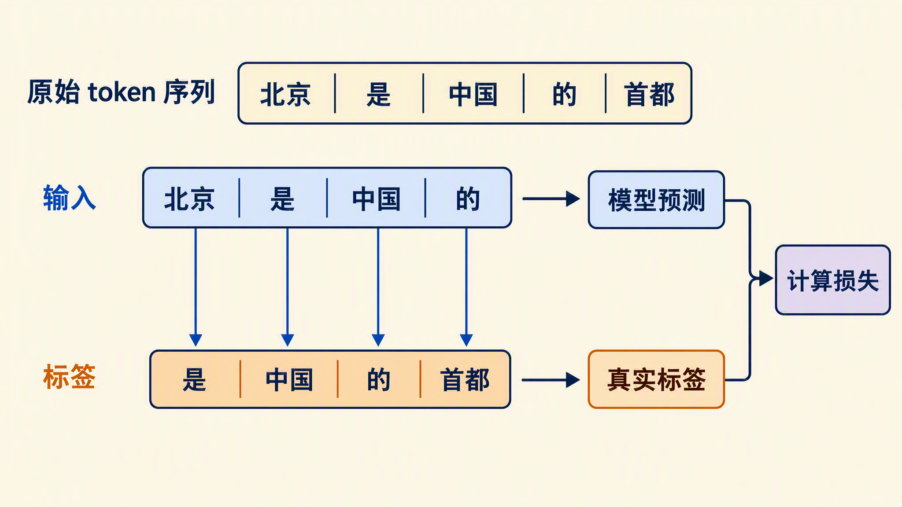
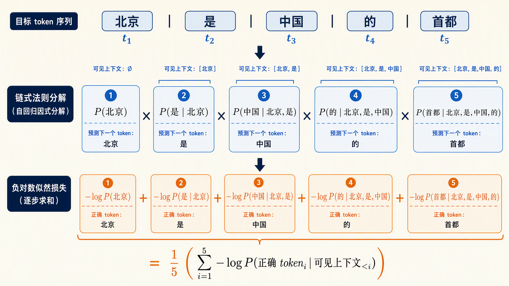
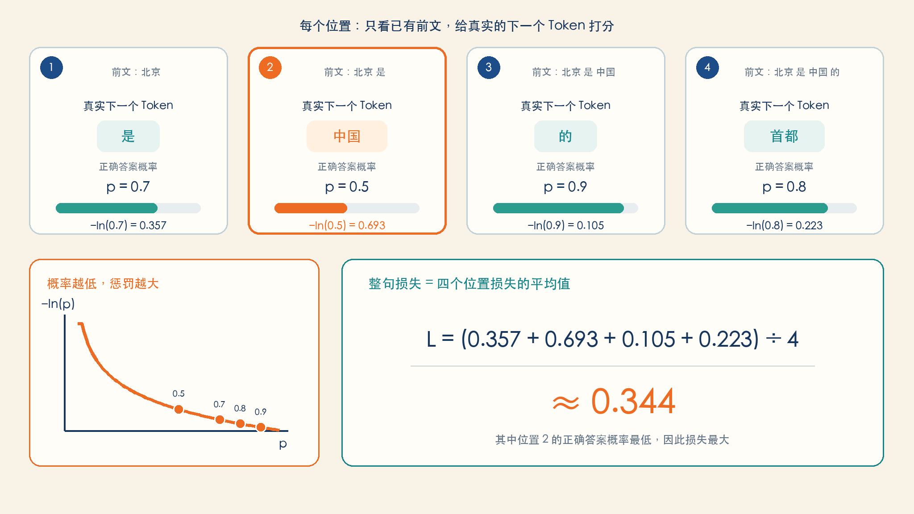
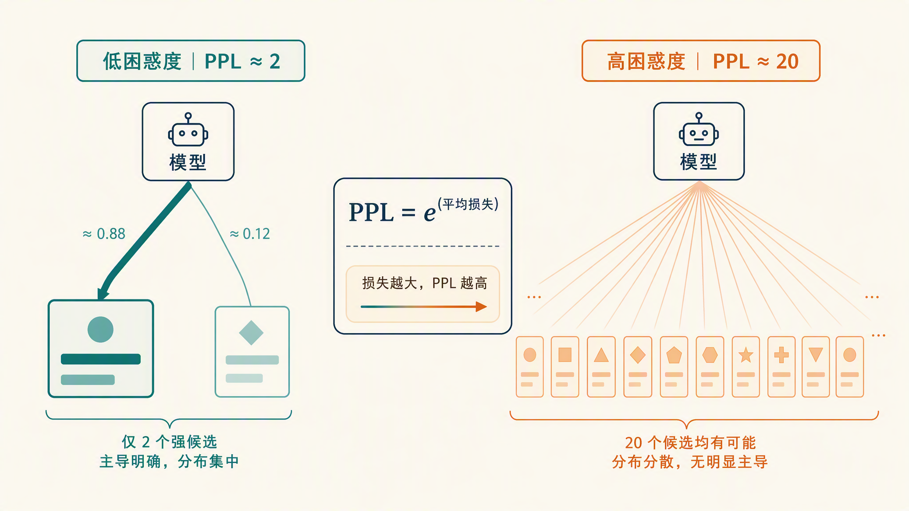
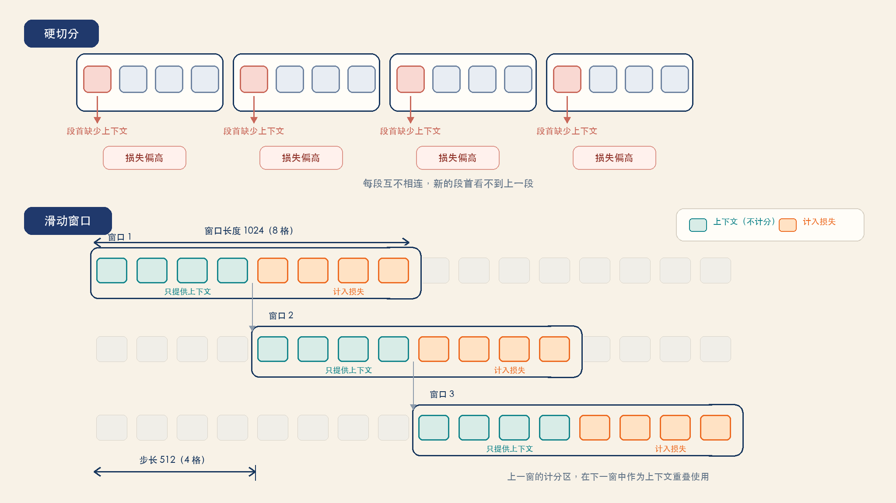
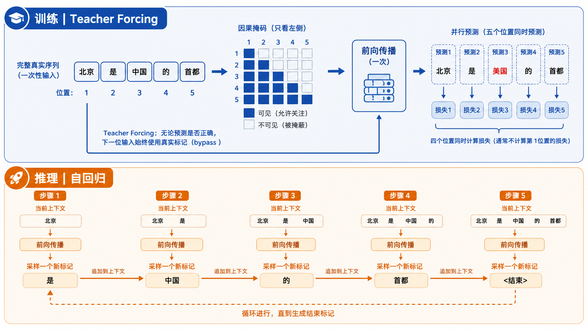
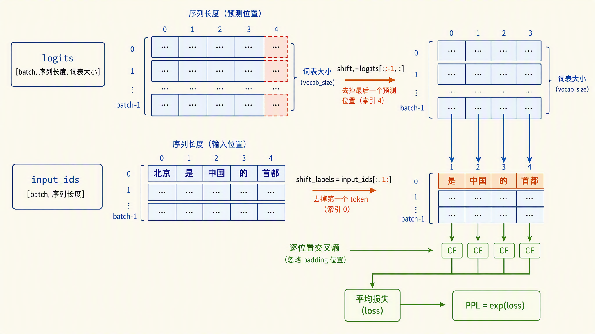

# 学习大模型训练的目标函数：Next Token Prediction

在上一篇中，我们动手训练了一个自己的 BPE 分词器，把原始文本切成了 token 序列。至此，训练数据准备阶段的工作就完成了：海量的原始文本，经过清洗和分词，变成了一条条由整数 id 组成的 token 序列。

接下来的问题是：数据准备好了，训练到底在优化什么呢？今天我们就来学习大模型训练的核心，也是整个大模型技术的起点：**下一词预测（Next Token Prediction）**：给定前面的 token，预测下一个 token 是什么。我们会把这个目标形式化，亲手算一遍交叉熵损失和困惑度，最后用 Qwen3-0.6B 跑一个真实的例子。


## 自监督学习

在讲 Next Token Prediction 之前，先要理解它属于哪一类学习方法。

传统的监督学习需要人工标注的数据。比如训练一个情感分类模型，要先有人把成千上万条评论逐条标上正面或负面。标注是昂贵的，规模上不去，数据量就被卡住了。

大模型走的是另一条路：**自监督学习（Self-Supervised Learning）**，指的是标签不需要人工提供，而是从数据本身自动生成的一种学习方式。对文本来说，这个标签就是文本自身：给定前 t 个 token，第 t+1 个 token 就是现成的标准答案。

任意一段文字都能这样变成训练样本。拿「北京是中国的首都」这句话，分词后得到一串 token，然后错开一位，输入和标签就都有了：



可以看到，整个过程没有任何人工参与。互联网上的每一行文字都是潜在的训练数据，标注成本是零。这正是大模型能消化整个互联网语料的关键：[GPT-3](https://arxiv.org/abs/2005.14165) 的训练语料有 3000 亿 token，[Qwen3](https://arxiv.org/abs/2505.09388) 的预训练语料达到了 36 万亿 token，这个量级的数据只有自监督的方式才供得起。

## 从联合概率到链式法则

在学习具体的 Next Token Prediction 之前，先补一点概率论的基础知识。

首先是**联合概率（Joint Probability）**，指多个事件同时发生的概率。比如第一个 token 是「北京」、第二个 token 是「是」，这两件事同时发生的概率，就是一个联合概率。

其次是**条件概率（Conditional Probability）**，指在某个事件已经发生的前提下，另一个事件发生的概率，记作 P(B|A)，读作在 A 发生的条件下 B 发生的概率。比如已经看到「北京」，下一个词是「是」的概率，就记作 P（是|北京）。

这两个概念之间有一个基本关系：

```text
P(A, B) = P(A) × P(B|A)
```

两件事同时发生的概率，等于第一件事发生的概率，乘上第一件事已经发生的前提下第二件事发生的概率。把这个关系推广到任意多个事件，就是**链式法则（Chain Rule）**：一串事件同时发生的概率，等于第一个事件的概率，依次乘上在前面的都已发生的前提下后一个事件的概率。拿「北京 是 中国」三个 token 举例：

```text
P(北京, 是, 中国) = P(北京) × P(是|北京) × P(中国|北京,是)
```

链式法则按什么顺序拆都成立。对文本我们选择从左到右拆，恰好符合语言天然的书写方向，这就是下一节形式化的出发点。

## Next Token Prediction 形式化

有了上面的基础，现在把训练目标写清楚。假设一段文本分词后是 token 序列 x₁, x₂, ..., xₙ，模型的任务是学习这个序列的概率分布。套用链式法则，整段序列的联合概率可以拆成一连串条件概率的乘积：

```text
P(x₁, x₂, ..., xₙ) = P(x₁) × P(x₂|x₁) × P(x₃|x₁,x₂) × ... × P(xₙ|x₁,...,xₙ₋₁)
```

每一项 P(xₜ₊₁ | x₁,...,xₜ) 的含义是：给定前 t 个 token，第 t+1 个位置出现某个 token 的概率。这些概率由模型给出，而模型本质上是一个巨大的函数，它的全部权重参数通常记作 θ，所以更准确的说法是：模型给出的概率写作 P_θ(xₜ₊₁ | x₁,...,xₜ)，同一段前文，θ 不同，给出的概率就不同。训练的目标就是调整 θ，让模型在真实文本上给出的这些条件概率尽可能大，也就是最大化整段文本的概率。

实际优化时不用概率本身，而是取负对数，把乘法变成加法。于是训练目标等价于最小化下面这个损失：

```text
L = - Σₜ log P_θ(xₜ₊₁ | x₁,...,xₜ)
```

这么做有两个原因：一是工程上的，一段文本的概率是成百上千个小数连乘，很快就会小到浮点数都表示不了了，取对数后乘法变成加法，数值上稳定得多；二是优化上的，乘积的梯度处理起来麻烦，对数把连乘拆成逐项相加，每一项只依赖对应位置的预测，求导干净。

> 为什么这两个目标是等价的？因为 log 是单调递增函数，它不改变最大值的位置：让概率最大的 θ，恰好也是让对数概率最大的 θ。所以最大化概率连乘，等价于最大化对数之和；再添个负号，最大化就翻成最小化，和梯度下降的方向约定对齐。

这个式子有一个正式的名字，叫**负对数似然（Negative Log-Likelihood，简称 NLL）**。我们可以这样理解它：每个位置上都算一个 `-log(正确 token 的概率)`，再把所有位置加起来。实际实现里通常还会除以位置数取平均，避免损失随序列长短漂移。

可能有同学会好奇，一堆对数加在一起，为什么能叫损失呢？回到损失的本义：损失衡量的是预测离真实答案有多远。这里每个位置上的真实答案就是下一个正确的 token，而模型对它的预测就是它给这个 token 的概率。完美的预测是概率 1，此时 `-log(1) = 0`，损失为零；预测越差，给正确 token 的概率越小，这一项就越大。所以整段文本的损失越小，说明模型把这段文本建模得越好。

我们还可以换一个视角来看每个位置的预测：模型在词表上输出一个概率分布，从里面挑出正确的 token，这本质上是一个词表大小的分类问题，而衡量分类问题的标准损失是交叉熵。因此这个式子还有另一个更常见的名字：**交叉熵损失（Cross-Entropy Loss）**。交叉熵的定义是衡量两个概率分布之间的差距，这里一个分布是模型输出的，另一个是真实答案。真实答案是一个 one-hot 分布，正确 token 的概率是 1，其余全是 0，代入定义后其他项全部消掉，剩下的就是 `-log(模型给正确 token 的概率)`，和 NLL 的每一项完全一致。



> 这种逐个 token 依赖前文的建模方式，叫做**自回归（Autoregressive）**建模。推理系列里讲过，生成时模型也是一个 token 一个 token 往外蹦的，训练和推理在这一点上完全一致。

## 手算交叉熵损失

模型在每个位置输出的是词表大小的 logits，logits 是模型最后一层输出的原始分数，经过 softmax 归一化后变成概率。假设在某个位置上，模型给正确 token 的概率是 0.7，取自然对数：

```text
loss = -ln(0.7) ≈ 0.357
```

概率越接近 1，损失越接近 0；概率越接近 0，损失趋向无穷大。模型如果给正确答案只打了 0.01 的概率，这一个位置的损失就有 4.6，惩罚是很重的。

把「北京是中国的首都」这句话的四个预测位置都算一遍，假设模型在各位置给正确 token 的概率如下：

| 位置 | 已有前文 | 真实的下一个 token | 模型给的概率 | 损失 -ln(p) |
| ---- | ---- | ---- | ---- | ---- |
| 1 | 北京 | 是 | 0.7 | 0.357 |
| 2 | 北京 是 | 中国 | 0.5 | 0.693 |
| 3 | 北京 是 中国 | 的 | 0.9 | 0.105 |
| 4 | 北京 是 中国 的 | 首都 | 0.8 | 0.223 |

整句的损失是四个位置的平均：

```text
L = (0.357 + 0.693 + 0.105 + 0.223) / 4 ≈ 0.344
```

可以看到，位置 2 的预测最差，模型对「中国」只给了 0.5 的概率，损失也最大。训练做的事情，就是通过反向传播调整参数，让这样的损失在整个训练语料上一点点降下去。



## 困惑度：损失的另一种读法

损失本身是个抽象的数字，不好直观感受。语言模型领域更常用的评估指标是**困惑度（Perplexity，简称 PPL）**，它的定义很简单，就是平均损失取 e 的指数：

```text
PPL = e ^ (平均损失)
```

上面例子里平均损失是 0.344，代入得到：

```text
PPL = e ^ 0.344 ≈ 1.41
```

困惑度有一个很好用的直觉解释：它大致相当于模型在预测下一个 token 时，平均要在多少个候选之间犹豫。PPL 是 1.41，说明模型基本是确定的；PPL 是 20，说明模型每次预测都像在 20 个候选词里均匀乱猜。PPL 越低越好，最好就是 1（永远百分百确定），往上不封顶。

因为 PPL 只是损失的单调变换，它和损失包含的信息完全一样，但胜在可解释。



Hugging Face transformers 的官方文档里有一篇专门介绍了怎么在长文本上计算 PPL，这也是评估语言模型时的标准做法：

* https://huggingface.co/docs/transformers/perplexity

由于模型的上下文长度是有限的，一篇长文档塞不进一次前向，最直接的切法是按最大长度切成几段，每段独立算损失再平均。这个切法的问题出在段首：每段开头的预测拿不到前文，模型只能凭空猜，损失被推高，整篇文档的 PPL 就被算大了。文档里推荐的做法是滑动窗口：让窗口带着步长往前滑，比如窗口长 1024、步长 512，每次只统计窗口后半段的损失，前半段不算分、只负责提供前文。这样每个被打分的 token 都见过足够长的上下文，算出来的 PPL 更接近模型真实的建模能力。



## Teacher Forcing：所有位置一次算完

到这里，训练目标和损失函数都定义清楚了。不过纸上的公式要落到代码里，还有一个实现问题没解决：损失要在每个位置上都算一遍，而第 t 个位置的预测依赖前 t-1 个 token 做输入。训练时这些输入从哪来？是让模型像推理那样逐 token 生成、串行地一个位置一个位置算下去吗？

答案是不用，秘诀是 **Teacher Forcing（教师强制）**，指的是训练时不管模型上一步预测得对不对，下一位置的输入一律使用真实的前文。这个概念最早来自 1989 年 Williams 和 Zipser 训练循环神经网络的工作，后来被沿用到了 Transformer 时代。

以「北京是中国的首都」为例。模型可能在「北京 是」之后没预测出「中国」，而是给出了「美国」。如果像推理那样把错误结果接龙下去，后面的上下文就全乱了。Teacher Forcing 的做法是直接无视这个错误，下一步照样喂真实的「中国」继续算。

这个设计带来两个好处。一是训练稳定，误差不会沿着序列累积放大。二是所有位置的损失可以并行计算：把整段 token 序列一次性送进模型，配合因果掩码保证每个位置只能看到自己前面的 token，一次前向就能拿到所有位置的预测分布，损失一口气全算出来。

训练和推理的对比如下图所示：



> 这正好解释了推理系列里讲过的一个现象：推理时的 Prefill 阶段可以并行处理整段 prompt，而 Decode 阶段只能逐 token 串行生成。Prefill 之所以能并行，本质上和训练一样，因为 prompt 的每个 token 都是已知的真实输入；Decode 串行，是因为下一个 token 还没生成出来，没有真实输入可用。

## 动手环节

接下来，我们用 Hugging Face transformers 加载 Qwen/Qwen3-0.6B，亲手给一句话算每个位置的损失，再算出整句 PPL。

```python
import torch
import torch.nn.functional as F
from transformers import AutoModelForCausalLM, AutoTokenizer

model_id = "Qwen/Qwen3-0.6B"
tokenizer = AutoTokenizer.from_pretrained(model_id)
model = AutoModelForCausalLM.from_pretrained(model_id, dtype="auto")

text = "北京是中国的首都，位于中国北方"
inputs = tokenizer(text, return_tensors="pt").to(model.device)

with torch.no_grad():
    outputs = model(**inputs)
logits = outputs.logits  # 形状 [batch, 序列长度, 词表大小]

# 位置 t 的输出预测的是位置 t+1 的 token，错开一位对齐
shift_logits = logits[:, :-1, :]
shift_labels = inputs["input_ids"][:, 1:]

# 逐位置计算交叉熵，先不做平均
losses = F.cross_entropy(shift_logits[0], shift_labels[0], reduction="none")

# 逐个位置打印 token 和它的损失
tokens = [tokenizer.decode([i]) for i in shift_labels[0]]
for tok, loss in zip(tokens, losses):
    print(f"{tok}\t{loss.item():.4f}")

avg_loss = losses.mean()
print("平均损失:", avg_loss.item())
print("整句 PPL:", torch.exp(avg_loss).item())
```

逐块解释一下这段代码：

1. **加载模型**：`AutoModelForCausalLM` 加载的是带语言模型头的完整模型，`dtype="auto"` 让它按权重文件本身的精度加载
2. **`with torch.no_grad()`**：告诉 PyTorch 这次前向只做计算、不记录梯度。这里我们只想看看损失是多少，不打算更新参数；不关掉梯度跟踪的话，PyTorch 会为每个中间结果保存反向传播要用的信息，白白吃掉一大块内存
3. **错开一位**：`logits` 里第 t 个位置的输出是对第 t+1 个 token 的预测，所以把 logits 砍掉最后一个、标签砍掉第一个，两者就对齐了。注意这里喂给模型的始终是完整的真实序列，错开对齐后逐位置算损失，全程只有一次前向，这就是上一节讲的 Teacher Forcing 在代码里的样子
4. **`reduction="none"`**：默认情况下 `F.cross_entropy` 会直接返回所有位置的平均损失，这里要它逐位置返回，才能看到每个 token 各自的损失
5. **平均损失和 PPL**：`losses.mean()` 是所有位置的平均，`torch.exp` 取 e 的指数，就是整句的困惑度



运行结果如下：

```text
是中国	17.5000
的	1.6328
首都	1.8281
，	0.2832
位于	2.3906
中国	0.5625
北方	2.0625
平均损失: 3.75
整句 PPL: 42.5
```

我们对照前面的概念看几个点：

1. **每个位置的损失就是 `-ln(正确 token 的概率)`**：比如「，」的损失只有 0.28，说明模型给它的概率约 76%，这个位置模型相当确定；「中国」损失 0.56，概率约 57%
2. **第一个预测位置损失最大**：只看到「北京」就要猜下一个词，前文信息最少，17.5 的损失意味着模型给正确答案的概率几乎为零。越往后前文越足，损失整体往下走，这符合直觉
3. **PPL 是平均损失的 e 指数**：`exp(3.75) ≈ 42.5`，说明模型在这句话上平均要在 40 多个候选之间犹豫，比前面手算例子里假设的 1.41 高得多，那是教科书式的理想情况，真实文本要难得多

其实 transformers 提供了更简便的写法，把 `labels` 直接传进去，模型内部会自动做刚才的错开对齐并返回平均损失：

```python
with torch.no_grad():
    loss = model(**inputs, labels=inputs["input_ids"]).loss
print("平均损失:", loss.item())
print("整句 PPL:", torch.exp(loss).item())
```

输出和手动版一致：

```text
平均损失: 3.7509357929229736
整句 PPL: 42.560890197753906
```

两种写法算出的结果基本上是一样的（尾数差异来自浮点累加顺序）。第一种写法的好处是能看到逐位置的明细，做训练脚本或调试时经常需要这个粒度。

## 小结

今天我们学习了大模型训练的目标函数，老规矩，最后来总结一下：

1. **自监督学习**：标签从数据本身自动生成，下一个 token 就是标准答案，标注成本为零，这是大模型能消化整个互联网语料的关键
2. **Next Token Prediction**：给定前 t 个 token，最大化第 t+1 个正确 token 的概率；整段文本的损失是每个位置的 `-log(正确 token 概率)` 之和
3. **交叉熵损失**：正确 token 的概率越接近 1 损失越小，越接近 0 惩罚越重，我们手算了四个位置的完整例子
4. **困惑度 PPL**：平均损失取 e 的指数，直觉上是模型平均在多少个候选之间犹豫，是评估语言模型的经典指标
5. **Teacher Forcing**：训练时一律喂真实前文，所有位置的损失一次前向并行算出，这也解释了为什么推理的 Prefill 能并行而 Decode 只能串行
6. **动手实践**：用 transformers 加载 Qwen3-0.6B，逐位置算出了交叉熵损失和整句 PPL，验证了理论公式

现在损失已经算出来了，它是一个标量，告诉我们模型当前做得有多差。但光知道差还不够，训练的真正难点在于：怎么根据这个标量，去更新模型里几十亿甚至上千亿个参数，每个参数又该往哪个方向调、调多少？这就是反向传播和优化器要回答的问题，我们下一篇继续。

## 参考

* [GPT-3 论文：Language Models are Few-Shot Learners](https://arxiv.org/abs/2005.14165)
* [Qwen3 技术报告](https://arxiv.org/abs/2505.09388)
* [Hugging Face transformers 官方文档：Perplexity](https://huggingface.co/docs/transformers/perplexity)
* [Hugging Face transformers GitHub 仓库](https://github.com/huggingface/transformers)
* [Qwen3-0.6B 模型页面](https://huggingface.co/Qwen/Qwen3-0.6B)
* [Machine Learning Mastery：What is Teacher Forcing](https://www.machinelearningmastery.com/teacher-forcing-for-recurrent-neural-networks/)
* [Sebastian Raschka：Next-Token Prediction FAQ](https://sebastianraschka.com/faq/docs/next-token-prediction.html)
