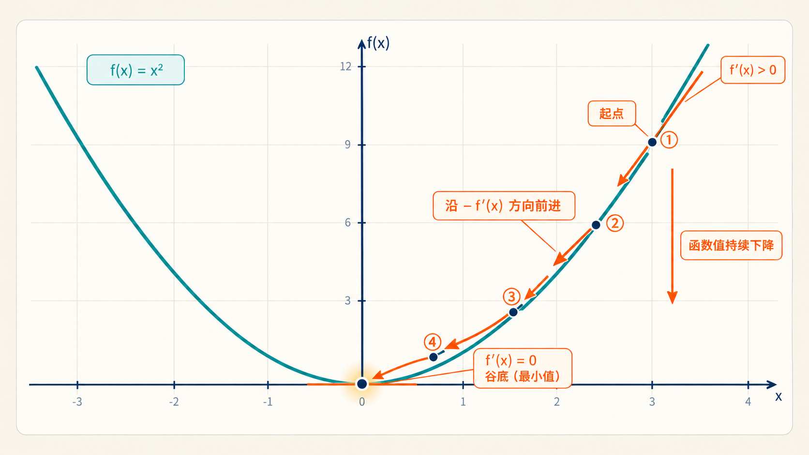
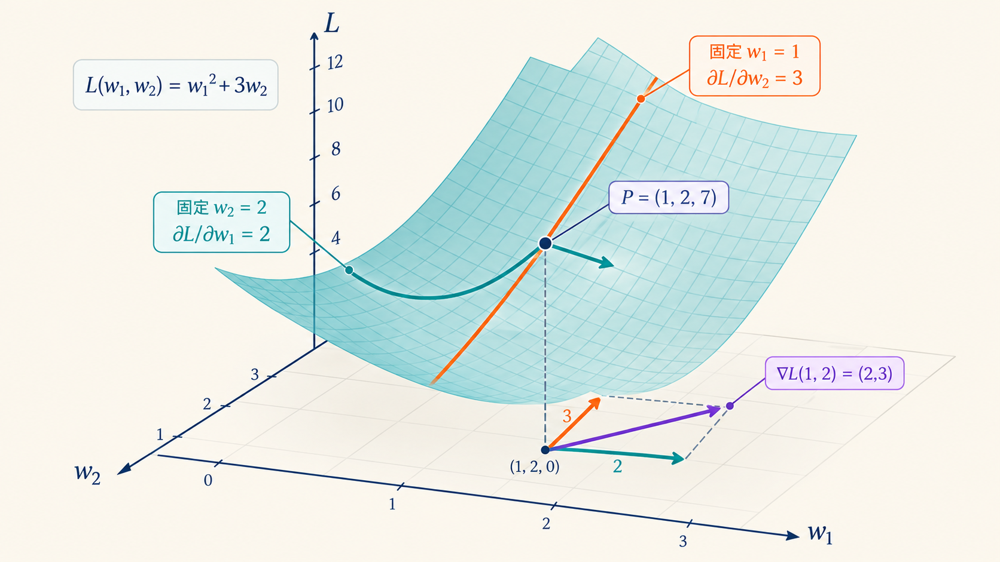
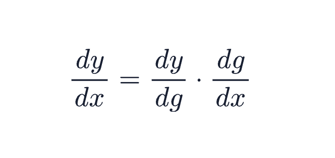
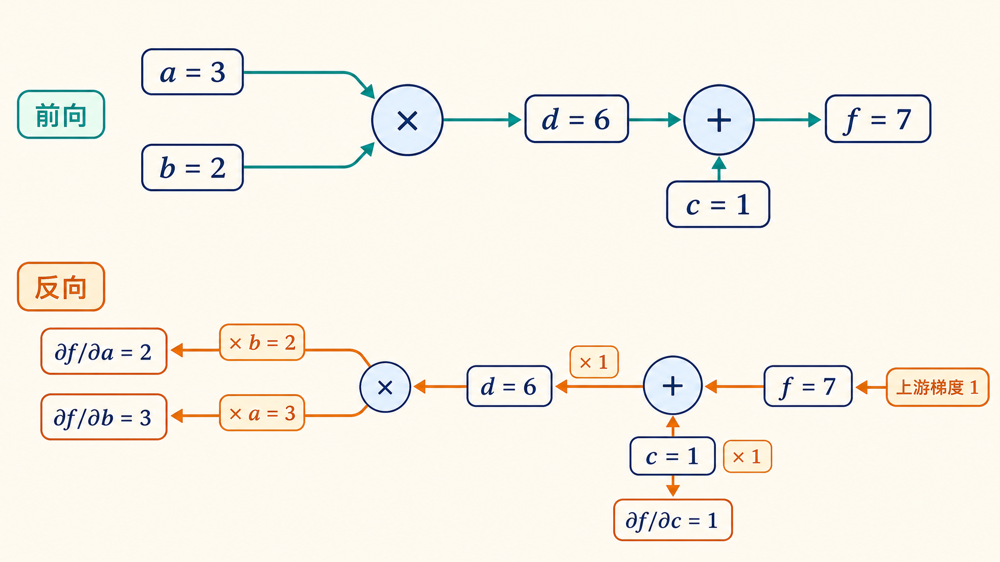
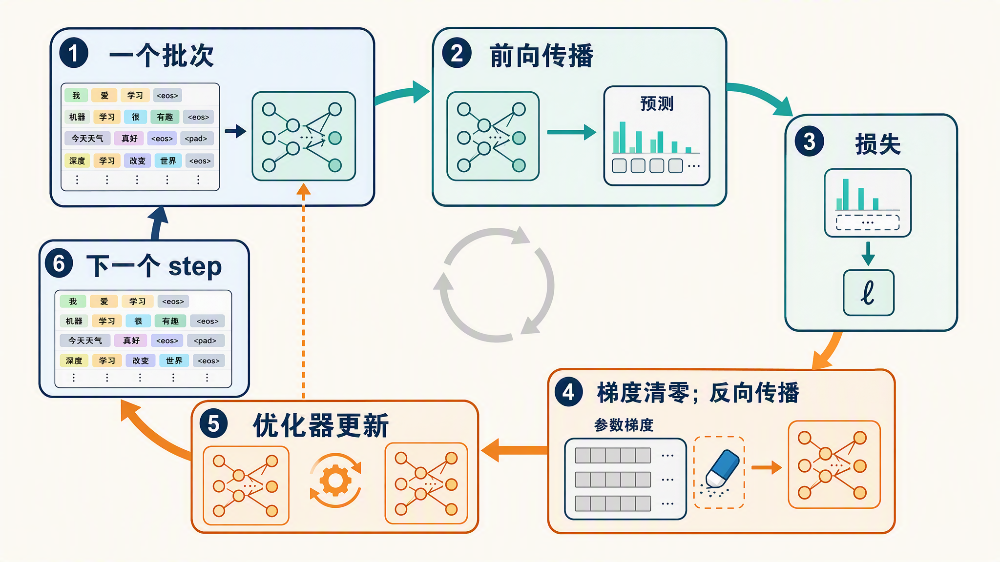
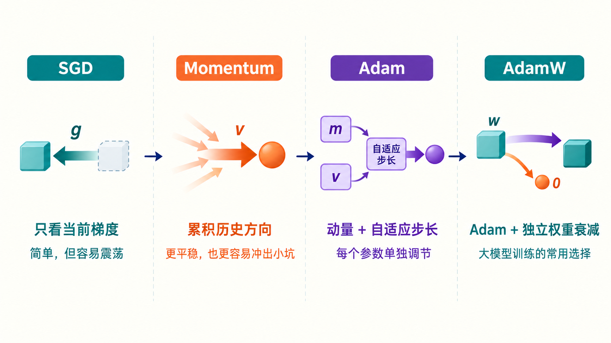
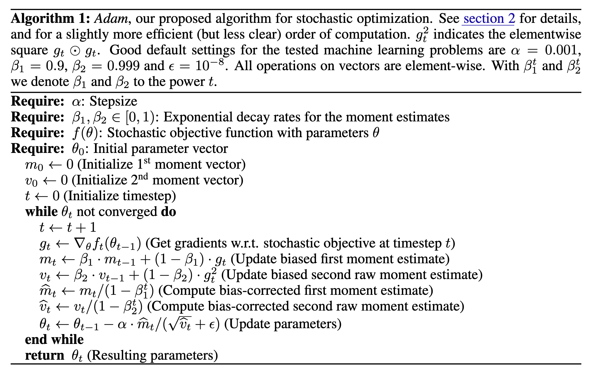
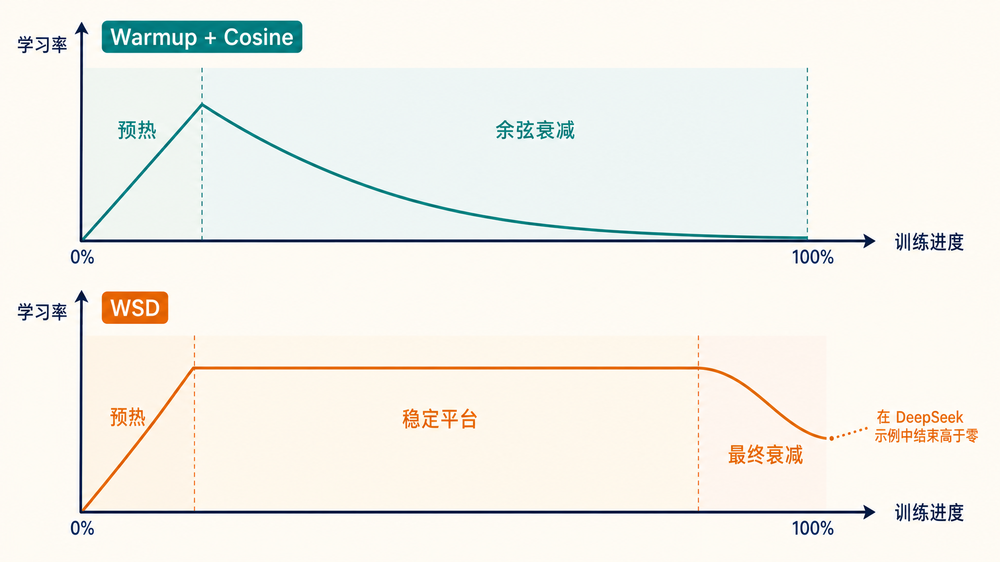
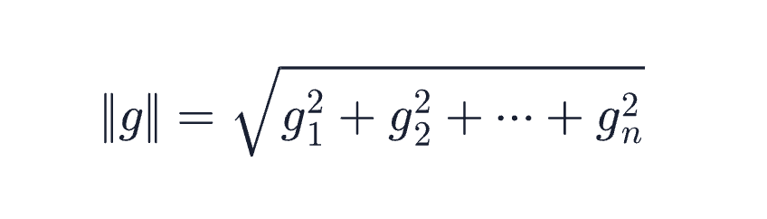
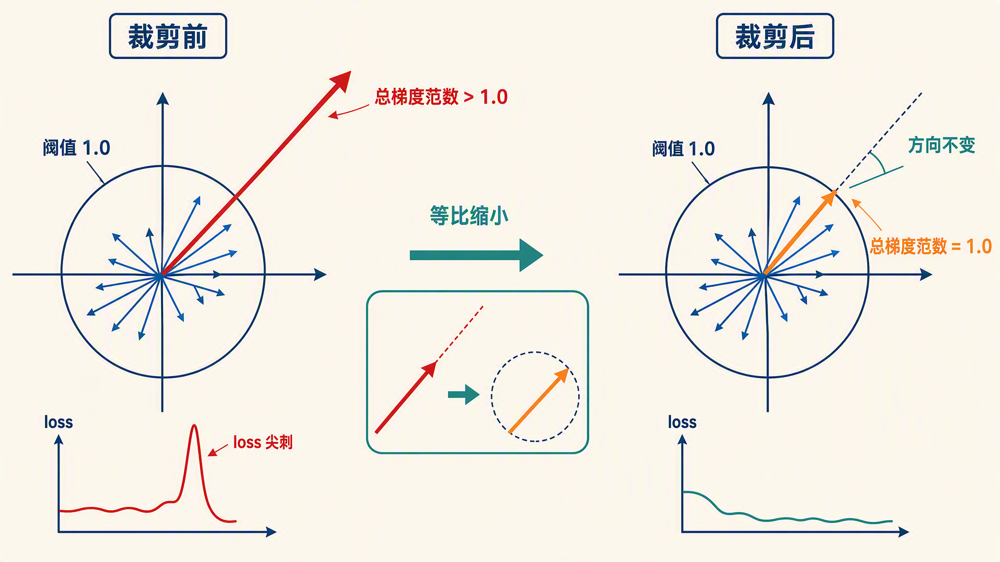

# 学习大模型训练的反向传播与优化器

上一篇我们学习了大模型训练的目标函数：Next Token Prediction，我们解决了训练的第一个问题：怎么定义模型的损失。模型在每个位置预测下一个 token 的概率分布，用**交叉熵损失（Cross-Entropy Loss）**把预测分布和真实 token 对比，再在整个批次上取平均，得到一个标量损失。损失越小，说明模型对这批数据的预测越准。

不过损失只是一个分数，它告诉我们错了多少，却不告诉我们该怎么改。模型里有几十亿个参数，每个参数该往哪个方向调、调多少，靠人拍脑袋显然不行。今天就来解决这个问题，答案分两步：**反向传播（Backpropagation）**负责算出损失对每个参数的梯度，**优化器（Optimizer）**负责根据梯度决定参数这一步怎么走。

## 什么是梯度

**梯度（Gradient）** 是大模型训练的核心概念，它是理解整篇的钥匙，我们从最基础的地方讲起。

先看**导数（Derivative）**。一个函数在某一点的导数，就是函数曲线在那一点的斜率，表示自变量动一小步、函数值会跟着变化多少。拿 f(x) = x² 举例，它在 x = 3 处的导数是 6，意思是 x 在 3 附近每增加一点点，f(x) 大约按 6 倍的速度跟着增加。导数为正，函数在往上走；导数为负，函数在往下走；导数为 0，说明正好在坡顶或谷底，往哪边走函数值都暂时不变。想找到函数的最小值，一个有用的线索就出来了：先沿着导数的反方向走，函数值一定在下降，一直走到导数为 0 的地方，那就是谷底的位置。



模型的情况要复杂一些：损失不是单个变量的函数，而是几十亿个参数的函数。对这样的多变量函数，每次只关心一个参数，把其余参数全部当作固定不变，这时算出来的导数叫**偏导数（Partial Derivative）**。每个参数都有自己的偏导数，把所有参数的偏导数收集起来排成一排，就是梯度。

我们看一个只有两个参数的小例子。假设损失函数是 L(w₁, w₂) = w₁² + 3w₂，它有两个自变量。对 w₁ 求偏导时，把 w₂ 当成一个固定数字，含 w₂ 的项导数为 0，得到 ∂L/∂w₁ = 2w₁；同理对 w₂ 求偏导，把 w₁ 固定，得到 ∂L/∂w₂ = 3。在 w₁ = 1、w₂ = 2 这个点上，两个偏导数分别是 2 和 3，这个点的梯度就写作 (2, 3)：它告诉我们，w₁ 动一小步损失按 2 倍变化，w₂ 动一小步损失按 3 倍变化，想降损失，两个参数都得往小的方向调，而且 w₂ 那边调起来见效更快。



直觉上，梯度就是损失对每个参数的敏感程度：这个参数动一小步，损失会跟着变化多少。梯度绝对值大，说明这个参数对损失影响大；梯度为正，说明参数增大损失会变大，想降损失就得把参数往小调。

训练的目标很朴素：让每个参数都沿着自己梯度的反方向走一小步，损失就会下降。难点在于，模型的损失要经过几十层 Transformer 的层层计算才得到，直接对每个参数求导根本算不过来。高效算出所有梯度的方法，就是反向传播。

## 反向传播与链式法则

**反向传播**的本质是微积分里的**链式法则（Chain Rule）**：复合函数的导数等于各层导数的连乘。假设复合函数 y = f(g(x))，那么它的导数等于：



神经网络就是一个超深的复合函数，损失对某个底层参数的梯度，等于从损失往回一路上所有局部导数的乘积。

为了让这个过程可执行，框架会把计算过程组织成一张**计算图（Computational Graph）**：每个节点是一次基本运算，每条边是一个中间值。在推理系列里我们完整走过一遍前向传播，推理时算完就扔了；训练时的前向会顺带把这张图记下来，反向传播时沿着图从损失往回走，逐节点求局部导数、一路连乘。

### 手算梯度

让我们从最简单的场景开始，用一张最小的计算图把链式法则走一遍。计算分两步：

```text
d = a × b
f = d + c
```

这张图里有两类节点：a、b、c 是输入，叫叶子节点，它们是梯度的终点，相当于真实模型里的参数；乘法和加法是运算节点，一共两个，每个运算节点把输入值算成输出值。

取 a = 3、b = 2、c = 1，前向算一遍：d = 6，f = 7。

现在从 f 开始往回走。对每个运算节点，先算它对自己输入的局部导数，再把路径上的导数连乘：

1. 加法节点：f = d + c，所以 ∂f/∂d = 1，∂f/∂c = 1
2. 乘法节点：d = a × b，所以 ∂d/∂a = b = 2，∂d/∂b = a = 3
3. 连乘：∂f/∂a = ∂f/∂d × ∂d/∂a = 1 × 2 = 2；∂f/∂b = 1 × 3 = 3；∂f/∂c = 1

完整的前向计算和反向梯度流动如下图所示。前向从左往右算出中间值，反向从右往左，把上游梯度乘上每个节点的局部导数，再传给更上游：



可以看到，∂f/∂a = 2 这个结果的直觉解释也成立：a 增加一点点，d 按 2 倍的速度变，f 跟着按 2 倍的速度变，f 对 a 的敏感程度正好是 2。

真实的模型无非是这张图放大几十亿倍。每个节点的运算都是基本操作，加减乘除、指数函数、矩阵乘法，这些运算的导数都有现成公式，反向传播就是机械地把它们按图连乘。一次前向加一次反向，所有参数的梯度就全部到手了。这套机制叫**自动微分（Automatic Differentiation）**，是 PyTorch 里 autograd 模块的名字来源。

## PyTorch autograd 验证

这一节，我们用 PyTorch 把刚才的手算验证一遍：

```python
import torch

a = torch.tensor(3.0, requires_grad=True)
b = torch.tensor(2.0, requires_grad=True)
c = torch.tensor(1.0, requires_grad=True)

d = a * b   # 前向：d = 6
f = d + c   # 前向：f = 7

f.backward()  # 反向传播，梯度写入 .grad

print(a.grad)  # tensor(2.)
print(b.grad)  # tensor(3.)
print(c.grad)  # tensor(1.)
```

代码不长，但里面有三个值得关注的点：

1. **`requires_grad=True`**：创建张量时告诉框架这个张量需要求梯度，只有标了它的张量，反向传播后才有梯度可读
2. **`backward()`**：在标量 f 上调用，触发反向传播，框架沿着记录好的计算图从 f 往回逐节点连乘
3. **`.grad`**：反向传播算完的梯度就存在每个张量的这个属性里，直接读取即可

可以看到，输出和手算结果完全一致：2、3、1。框架内部做的事和我们手算的一样，先记图，再从 f 往回连乘。

需要注意的是：PyTorch 的梯度是**累加**的。连续调两次 `backward()`，梯度会在原来的 `.grad` 上累加而不是覆盖。所以每个训练 step 开头都要先清零。真实训练里一个 step 的标准写法是这三行：

```python
optimizer.zero_grad()  # 清空上一步残留的梯度
loss.backward()        # 反向传播，梯度写入每个参数的 .grad
optimizer.step()       # 优化器读取梯度，更新参数
```

整个训练循环就是这三行的反复执行，如下图所示：



## 优化器的演进

到这里，梯度算出来了，下一步就是优化器根据梯度来更新参数。具体是怎么更新的呢？最直觉的做法是拿梯度乘个系数从参数里减掉，这个想法确实能用，它就是经典的 SGD 算法；但人们很快发现它有不少毛病，于是研究人员提出了一个又一个的改进方案。下面我们就沿着这条路线看看优化器的演进历史。



### SGD：沿负梯度走一步

**随机梯度下降（Stochastic Gradient Descent，简称 SGD）**是最朴素的优化器：参数沿负梯度方向走一步，步长由**学习率（Learning Rate）**控制：

```text
w ← w − η × g
```

其中 w 是参数，g 是梯度，η 是学习率。

先说说名字里的随机二字。理论上最准的做法是把全部训练数据算一遍梯度再更新，这叫全批量梯度下降。但训练语料动辄上万亿 token，全算一遍才动一步，训练根本推不动。所以实际做法是每次随机抽一小批数据（mini-batch）来估计梯度，这就是随机两个字的来历。今天大家说的 SGD，指的其实都是这种小批量版本。小批量估计的梯度不等于真梯度，带着噪声，更新方向会抖动，但这不全是坏事：噪声带来的随机扰动，恰好能帮模型从一些平坦的鞍部（梯度接近零但既不是最高也不是最低的位置）里挣脱出来，全批量的精确梯度反而会在那里停住。

SGD 真正的毛病在另外两处。一是狭长弯曲的谷底：垂直谷底的方向坡度陡，沿着谷底的方向坡度缓，负梯度总是指向最陡的方向，于是更新在谷底两侧来回震荡，前进很慢。二是遇到局部的小坑或平地，梯度一变小，步子就跟着变小，容易卡住不动。

### Momentum：带上惯性

**动量（Momentum）**给更新加上惯性。这个方法最早是 1964 年 Polyak 提出的重球法（Heavy Ball），1986 年由 Rumelhart、Hinton 和 Williams 引入神经网络训练，2013 年 Sutskever 等人的 [ICML 论文](https://proceedings.mlr.press/v28/sutskever13.html)又证明了它在深度学习里不可或缺。它的做法是不再只看当前这一步的梯度，而是维护一个历史梯度的指数加权平均：

```text
v ← β × v + g
w ← w − η × v
```

可以把它想象成一个小球从山坡上滚下来：β 通常取 0.9，相当于保留了之前九成的速度。当前梯度只占一成话语权，所以单个 batch 的噪声不至于让方向剧烈摇摆。β 还决定了记忆的长度：β = 0.9 时，一步之前的梯度影响力大约是当前的九成，两步之前是八成多，影响力每步按 β 衰减，大体上只有最近十来步的梯度还在起作用。

Momentum 恰好对症 SGD 的两个毛病。在狭长谷底里，来回震荡的分量方向相反，平均起来相互抵消；而沿谷底前进的分量方向一致，平均起来越攒越大，小球得以沿着谷底持续加速。在平地和小坑里，历史攒下的速度也不会因为一步梯度变小就立刻消失，小球靠惯性就能冲过去。

### Adam：每个参数自己的学习率

Momentum 解决了震荡和卡住的问题，但还有一个从 SGD 起就存在的问题：所有参数共享同一个学习率。这个假设在真实模型里并不成立。模型里不同参数的梯度大小可以差出几个数量级：有的参数对应的特征在数据里很少出现，梯度稀疏又微弱；有的参数几乎每条数据都在更新它，梯度一贯很大。同一个学习率对前者太小，对后者又可能太大，总有一部分参数学得不好。

**Adam（Adaptive Moment Estimation，自适应矩估计）**由 Kingma 和 Ba 在 2014 年提出，论文是 [arXiv 1412.6980](https://arxiv.org/abs/1412.6980)。它要解决的正是这个问题：让每个参数根据自己的梯度历史自动调节步长。做法是在 Momentum 思路上更进一步，为每个参数单独维护两个统计量：

* **一阶矩估计 m**：梯度的指数加权平均，衰减系数 β₁ 通常取 0.9，作用和动量一样，指明平均方向
* **二阶矩估计 v**：梯度平方的指数加权平均，衰减系数 β₂ 通常取 0.999，衡量这个参数梯度的一贯大小

> **矩（Moment）** 是一个统计学术语，用来概括一批数字的特征。你可以把它想成是描述一组数据或分布形状的尺子。一阶矩，就是咱们常说的平均值（数学期望），它告诉你数据集中在哪里，像是分布的“重心”或“平衡点”。二阶矩，最常用的是方差，它衡量数据围绕重心的“散开程度”。

> **矩（Moment）** 和上一节的 **动量（Momentum）** 在拼写上很相近，其实它们是同源的，都来自拉丁语 momentum（运动、推动力），后来分了两条路：Momentum 留在物理学里，指牛顿力学中运动的量，译作动量；Moment 在物理里指力让物体转动的效应，即力矩的矩，统计学家发现均值、方差的数学结构和力矩一样，都是取值乘距离再求和，就借用了这个名字，中文跟着译作矩。

每一步的更新分三行写：

```text
m ← β₁ × m + (1 − β₁) × g      （更新一阶矩，也就是平均方向）
v ← β₂ × v + (1 − β₂) × g²     （更新二阶矩，也就是梯度的一贯大小）
w ← w − η × m / √v             （用 m 定方向，用 √v 缩放步长）
```

直觉是：一个参数的梯度一贯很大，说明这个方向地形陡峭，v 大就把步长自动调小，防止冲过头；梯度一贯很小或很稀疏的参数，v 小，步长自动放大，不至于学不动。每个参数相当于有了自己的自适应学习率。

可能有读者会问：Momentum 里 w ← w − η × v，v 也是每个参数各自的，步长不也不一样吗？关键在步长随什么变化。Momentum 的步长正比于梯度本身的大小，梯度大的参数步子更大；Adam 除以 √v 之后，分子分母随梯度尺度一起涨，比值把梯度自身的大小消掉。一贯大梯度的参数被压住，稀疏小梯度的参数被抬高，这才是自适应的真正含义。

这个设计让 Adam 对学习率的初始取值不敏感，开箱即用，迅速成了深度学习的默认优化器。

> 细心的读者会发现，这里 m 的更新是 β₁ × m + (1 − β₁) × g，而上面 Momentum 一节写的是 β × v + g，梯度前面没有乘系数。两种写法都是真实存在的惯例：Momentum 里 v 是梯度的加权求和，积累下来比原始梯度大约 1/(1−β) 倍，多出的倍数被吸收进学习率里；Adam 里的 m 是真正的加权平均，系数加起来等于 1，m 始终和梯度保持同一量级。Adam 必须这么做，因为步长是 m / √v 的比值，分子分母在同一尺度上，这个比值才成立。

落到具体的实现上 Adam 还有两个细节。一是 **ε（epsilon）**：分母 √v 会加上一个很小的常数（通常 10⁻⁸），防止 v 接近零时除出一个天文数字。二是**偏差修正（Bias Correction）**：m 和 v 都从零开始累积，训练初期样本太少，估计值会系统性偏小，所以前几步要把它们除以 1−βᵗ 放大回正常水平。这里的 t 是当前的步数：第 1 步时 β₁ᵗ 还是 0.9，修正力度大；第 100 步时 0.9 的一百次方已经约等于零，修正因子就趋近于 1 了，不再起作用。

因此，Adam 完整的更新公式如下：

```text
m ← β₁ × m + (1 − β₁) × g        （一阶矩：平均方向）
v ← β₂ × v + (1 − β₂) × g²       （二阶矩：梯度的一贯大小）
m̂ ← m / (1 − β₁ᵗ)               （偏差修正，t 是当前步数）
v̂ ← v / (1 − β₂ᵗ)               （偏差修正）
w ← w − η × m̂ / (√v̂ + ε)        （更新参数，ε 防除零）
```

这也就是论文里的样子了：



### AdamW：把权重衰减解耦出来

**权重衰减（Weight Decay）**是一种正则手段，让权重在每次更新时额外缩小一点，防止权重无节制增大导致过拟合。这个想法可以追溯到上世纪八十年代，Hinton 等人在神经网络训练里就已经在用了；1992 年 Krogh 和 Hertz 的论文 [A Simple Weight Decay Can Improve Generalization](https://papers.nips.cc/paper/563-a-simple-weight-decay-can-improve-generalization.pdf)给出了理论分析，证明它确实能提升泛化能力，从此成了标准做法。

老做法是通过 L2 正则实现的：在原来的损失后面加一项惩罚，权重越大惩罚越重：

```text
L' = L + (λ / 2) × Σw²
```

新损失 L' 对 w 求导，梯度里就多出一项 λ × w，于是更新式从 w ← w − η × g 变成 w ← w − η × (g + λw)，也就是每步除了按梯度走，还要额外减掉 η × λ × w。这一项和梯度无关、只和 w 自身成正比，效果是每步都把权重往零的方向拉一点，这就是衰减两个字的来历。λ 越大，拉得越狠。

> **L2 正则**是正则化（Regularization）的一种，正则化泛指在训练目标之外额外施加的约束，用来防止模型把训练数据背下来（过拟合）。L2 指的是惩罚项取所有权重的平方和，也就是权重向量的 L2 范数的平方；对应地还有 L1 正则，取的是权重绝对值之和，效果是把不重要的权重直接压成零。两者都来自更古老的统计学：L2 在统计学里叫岭回归（Ridge Regression），数学根源是 Tikhonov 正则化。

这个做法在 SGD 时代没有问题，但在 Adam 里有个毛病：衰减项 λ × w 混进梯度 g 之后，会被当作梯度的一部分去更新二阶矩 v，再被 √v 缩放。梯度一贯大的参数 v 也大，衰减项除下来反而变弱，衰减效果打了折扣，而且不同参数受到的衰减力度变得参差不齐。

Loshchilov 和 Hutter 在 [2017 年的论文](https://arxiv.org/abs/1711.05101)里指出了这个毛病，提出了 **AdamW** 算法：把权重衰减从梯度更新里解耦出来，先按 Adam 正常更新，再单独让权重乘一个略小于 1 的系数：

```text
w ← w − η × m / √v    （Adam 的正常更新）
w ← w − η × λ × w     （独立的权重衰减，λ 是衰减系数）
```

改动很小，效果却稳定得多。一个直观的差别是：L2 老做法下，衰减力度跟着梯度走，每个参数实际受到的衰减参差不齐；AdamW 里所有参数按同一个 λ 均匀收缩，正则强度真正由 λ 说了算，和梯度尺度不再纠缠。

现在 AdamW 是大模型预训练的标配，Llama 系列、Qwen 系列、DeepSeek 系列这些训练细节公开的主流模型用的都是它。以 DeepSeek-V3 为例，它用 AdamW 训练，β₁ 取 0.9、β₂ 取 0.95、权重衰减 λ 取 0.1。这里的 β₂ 比常见的 0.999 小，意味着对梯度大小的记忆更短、反应更快，这也是近些年大模型训练的流行取值。

## 学习率调度

在真正执行训练任务时，学习率还会随着训练的进度而变化，这叫做**学习率调度（Learning Rate Schedule）**。这是因为不同阶段的诉求不一样：训练一开始参数是随机初始化的，大步容易走飞，要先小步热身；进入中段后参数已经落在合理区域，梯度方向可靠，这时要放开步长全力下降，大步才走得快；到了结尾接近收敛，大步会在谷底附近来回跳动，又该收小步安稳落定。

它和上一节介绍的优化器并不冲突。两者作用在不同的轴上：优化器沿着**参数的维度**，决定同一时刻每个参数各走多少，比如 Adam 会给不同参数不同的步长比例；调度沿着**时间的维度**，决定当前这一步所有参数整体迈多大。调度给出当前步的全局系数，乘在优化器算出的更新量上，参数维度的相对差异由优化器管，时间维度的整体缩放由调度管。

最常见的组合是**预热 + 余弦衰减**，分两段：

* **预热（Warmup）**：训练开头让学习率从 0 线性升到峰值，通常持续几千步。刚初始化时参数是随机的，梯度大且方向不稳定，此时用大学习率容易一步把训练打飞。小步热身让参数先进入合理区域，再放开手脚
* **余弦衰减（Cosine Decay）**：一到峰值就立刻按余弦曲线开始下滑，平滑降到接近 0。注意这个组合里峰值只是一个瞬间，没有平台期。训练后期模型已经接近收敛，小步微调可以让它安稳落进一个平坦的低谷。这条曲线由 Loshchilov 和 Hutter 2016 年的 [SGDR 论文](https://arxiv.org/abs/1608.03983)推广开来

DeepSeek-V3 用的是另一种叫 **WSD（Warmup-Stable-Decay，预热-稳定-衰减）** 的调度，它把上面缺的那段平台补上了：前 2000 步线性预热到 2.2×10⁻⁴，然后在长达 10 万亿 token 的训练里保持不变，最后 4.3 万亿 token 再余弦衰减到 2.2×10⁻⁵。长平台期的好处是中途的 checkpoint 都处于同一个学习率状态，随时可以决定加训数据或者进入退火阶段（anneal，指训练末期衰减学习率让模型收敛的阶段），不必一开始就定死总训练量。

两种调度的曲线形状对比如下：

| 阶段 | 预热 + 余弦衰减 | WSD |
| ---- | ---- | ---- |
| 开头 | 线性升到峰值 | 线性升到峰值 |
| 中段 | 立即开始按余弦曲线下滑 | 长时间保持峰值不变 |
| 结尾 | 平滑降到接近 0 | 最后一段快速衰减 |



## 关键超参数盘点

到这里，更新参数的完整链条就讲完了：反向传播算出梯度，优化器把梯度加工成更新量，调度再按训练进度整体缩放。回顾这条链条，有三个超参数反复出现：SGD 里的学习率、AdamW 里的权重衰减，以及一直没展开讲的批大小。它们必须在训练开始前一天就定下来，对结果的影响比模型结构的小修小补大得多，这里集中盘一下：

| 超参数 | 调大 | 调小 |
| ---- | ---- | ---- |
| 学习率 | 收敛快，但过大容易震荡甚至发散 | 稳但慢，可能训练不完或卡在半路的坑里 |
| 批大小 | 梯度估计准、吞吐高，但显存占用大，过大时泛化可能变差 | 梯度噪声大，单步更新便宜，小模型反而常因此受益 |
| 权重衰减 | 正则强，权重保持小，太大则欠拟合 | 正则弱，模型自由度高，太小可能过拟合 |

其中，学习率和权重衰减上面都已经讲过了，这里重点介绍下**批大小（Batch Size）**，它是指每个训练 step 用多少条样本估计梯度，就是 SGD 一节里 mini-batch 的那个批。大模型预训练的批大小普遍很大，DeepSeek-V3 在训练中逐步把批大小加到 15360 条序列，一方面是梯度更稳，另一方面是大批次能喂饱成千上万张 GPU 的并行计算。学习率和批大小通常要配套调，批大了学习率才敢开大。

## 梯度爆炸与梯度裁剪

超参数定完、训练跑起来之后，还有一个常见事故要提防。反向传播是几十层导数的连乘，一旦某些层的导数偏大，乘积会指数级膨胀，这就是**梯度爆炸（Exploding Gradients）**：梯度突然蹿到一个巨大的值，一步更新把参数打飞，loss 曲线上表现为一根尖刺。

对付它的办法是**梯度裁剪（Gradient Clipping）**：更新前先算一遍所有梯度的总范数，超过阈值就整体等比缩小，梯度的方向保持不变，幅度则被压回安全范围，实践中阈值通常取 1.0。

**范数（Norm）**是向量长度的推广说法，最常见的是 L2 范数，就是中学里算向量长度的办法：



每个分量平方、加起来、开根号。这里把所有参数的梯度当成一个超长的向量，算它的 L2 范数，得到全部梯度加在一起的总长度。超过阈值时，所有梯度乘上同一个系数「阈值 / 总范数」。因为乘的是同一个系数，各参数梯度之间的相对比例不变，相当于把梯度向量朝着原点等比压缩。

梯度裁剪在实践中非常重要，大模型训练几乎必开。PyTorch 里有一个专门做这件事的函数 `torch.nn.utils.clip_grad_norm_`，签名如下：

```python
torch.nn.utils.clip_grad_norm_(
    parameters,        # 要裁剪的参数集合，通常传 model.parameters()
    max_norm,          # 总范数阈值，超过就等比缩小
    norm_type=2.0,     # 用哪种范数，默认 L2
    error_if_nonfinite=False,
    foreach=None,
)
```

用法很简单，放进前面见过的训练循环里，位置在 `backward()` 之后、`step()` 之前：

```python
optimizer.zero_grad()
loss.backward()
torch.nn.utils.clip_grad_norm_(model.parameters(), max_norm=1.0)  # 梯度裁剪
optimizer.step()
```

注意时序很重要：梯度是 `backward()` 算出来的，所以要等反向传播完才能裁剪；而 `step()` 读的是 `.grad` 里的值，所以裁剪必须在优化器读取之前完成。这个函数还有两个细节：一是它作用于 `model.parameters()` 的全部梯度，算的正是前面说的总范数；二是它会返回裁剪前的总范数，训练时把这个值打到日志里，是监控梯度健康度的常用手段，如果它频繁撞阈值，说明学习率可能偏大或者数据里有异常样本。

关于 loss 尖刺的成因和更多稳定训练的手段，后面讲到训练稳定性时还会展开。



## 小结

最后总结下今天的内容，我们学习了参数是怎么被一步步更新的：

1. **梯度**：损失对每个参数的敏感程度，训练就是让每个参数沿负梯度方向走
2. **反向传播**：链式法则在计算图上的机械执行，前向记图、反向连乘，一次前向加一次反向拿到所有梯度
3. **优化器演进**：SGD 沿负梯度走一步，Momentum 加惯性冲出小坑，Adam 用一阶和二阶矩给每个参数自适应步长，AdamW 把权重衰减解耦出来，是大模型训练的标配
4. **学习率调度**：开头 warmup 防打飞，后期余弦衰减安稳收敛，DeepSeek 用的 WSD 在中间加了一个长平台期
5. **超参数**：学习率、批大小、权重衰减三者配套调，梯度裁剪是防梯度爆炸的保险丝

不过这里藏着一个我们一直没细看的开销：AdamW 要为每个参数额外保存 m 和 v 两个状态，而且通常是 FP32 精度（32 位浮点数，每个数值占 4 字节）。一个 7B 模型，光优化器状态就是 70 亿 × 2 × 4 字节 = 56 GB，还没算权重、梯度和前向传播的中间激活。显存就那么多，这些东西怎么放得下？混合精度训练又是怎么把占用压下来的？这就是下一篇要解决的问题了。

## 参考

* [Adam 论文：Adam: A Method for Stochastic Optimization](https://arxiv.org/abs/1412.6980)
* [Sutskever 等人的 ICML 2013 论文：On the Importance of Initialization and Momentum in Deep Learning](https://proceedings.mlr.press/v28/sutskever13.html)
* [《动手学深度学习》：Adam](https://d2l.ai/chapter_optimization/adam.html)
* [AdamW 论文：Decoupled Weight Decay Regularization](https://arxiv.org/abs/1711.05101)
* [Krogh & Hertz 1992：A Simple Weight Decay Can Improve Generalization](https://papers.nips.cc/paper/563-a-simple-weight-decay-can-improve-generalization.pdf)
* [SGDR 论文：余弦退火与热重启](https://arxiv.org/abs/1608.03983)
* [DeepSeek-V3 技术报告](https://arxiv.org/abs/2412.19437)
