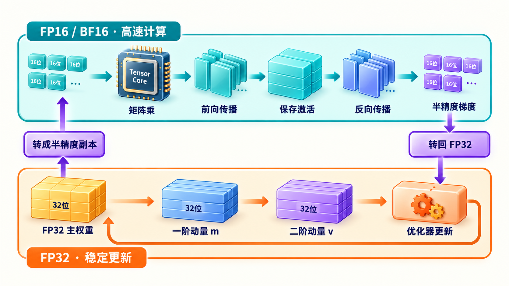
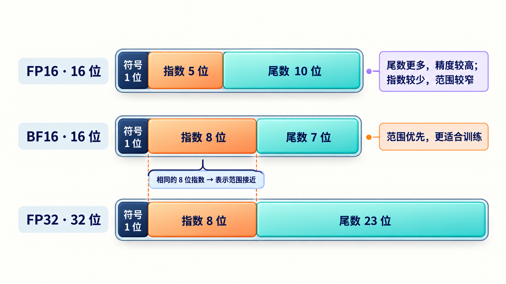
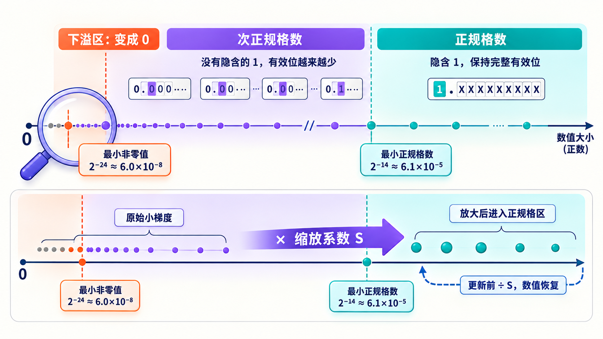
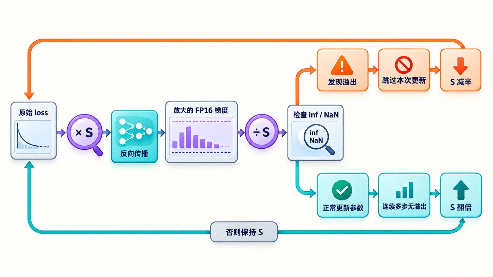
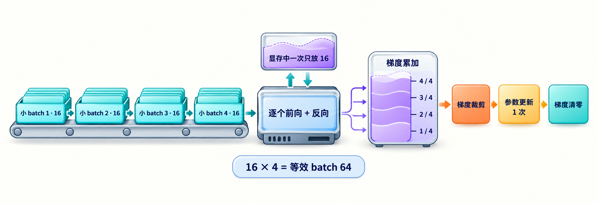
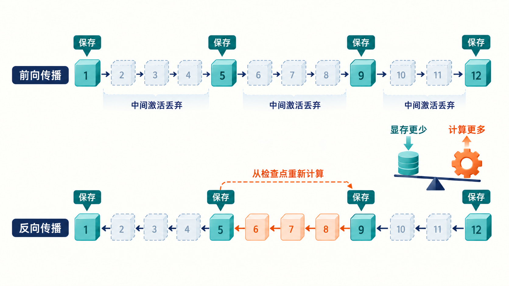
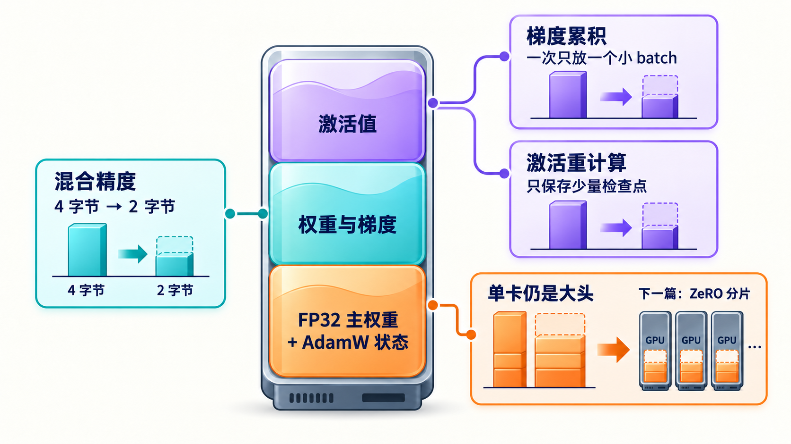

# 学习大模型训练的显存管理与混合精度

在上一篇中，我们学习了参数是怎么被一步步更新的：前向传播算出损失，反向传播沿计算图把梯度传回每个参数，最后 AdamW 用一阶、二阶矩估计对参数做更新。当时我们的注意力都在计算过程上，有一个问题被有意略过了：这些东西全都得放进显卡的显存里。

上一篇其实已经埋了伏笔。AdamW 要为每个参数额外维护两个和权重一样大的状态，再加上梯度本身，训练时要存的远不止模型权重。很多人第一次跑全参数训练时都会撞上 OOM（Out of Memory，显存溢出），然后才发现推理能放得下的卡，训练根本不够用。今天我们就来算算训练到底要占多少显存，并学习配套的解决手段：混合精度训练，以及两个省显存的经典技巧。

## 显存五件套

推理的时候，显存里主要是模型权重和 KV Cache，这部分我们在《大模型推理》系列的 KV Cache 一篇里算过。到了训练，要存的东西一下子多了起来。以全精度的 FP32（32 位浮点数，每个数值占 4 字节）训练为基准，每个参数背后跟着四份数据：

| 组成 | 每个参数占用 | 说明 |
| ---- | ---- | ---- |
| 权重 | 4 字节 | 模型本身，推理时也有 |
| 梯度 | 4 字节 | 反向传播的产物，和权重一一对应 |
| 一阶矩估计 | 4 字节 | AdamW 维护的梯度指数滑动平均 |
| 二阶矩估计 | 4 字节 | AdamW 维护的梯度平方的指数滑动平均 |

加起来是每个参数 16 字节。一个 7B 模型，不算别的，光这四样就是：

```text
70 亿 × 16 字节 = 112 GB
```

112 GB 是什么概念？目前主流的数据中心显卡 H100 单卡是 80 GB 显存，也就是说连模型的这些静态状态都装不下，训练根本无从谈起。


这还没完，还有第五块：**激活值（Activations）**，也就是前向传播过程中每一层算出的中间结果。我们在推理系列第四篇《学习大模型推理的前向传播：Transformer 与注意力机制》曾学习过，比如 RMSNorm 的输出、注意力的 Q/K/V 和注意力分数、残差相加得到的中间向量、前馈网络升维后的结果，这些都是。推理时一层算完中间值就扔了，只留最后的输出；训练不行，反向传播算梯度时要用到这些中间值，所以前向时必须把它们全部留在显存里。

那么这些激活值加起来一共有多大呢？NVIDIA 在 MLSys 2023 的论文 [Reducing Activation Recomputation in Large Transformer Models](https://arxiv.org/abs/2205.05198)里逐层拆解过 Transformer 要存的全部中间值，给出了每层激活显存的精确公式：

```text
每层激活显存 = s × b × h × (34 + 5 × a × s / h) 字节
```

其中 s 是序列长，b 是 batch，h 是隐层维度，a 是注意力头数。括号里的 34 对应和序列长线性相关的中间值，是论文逐项点算出来的：注意力部分占 11，MLP 部分占 19，两处 LayerNorm 占 4，加起来正好 34。5·a·s/h 项来自注意力分数矩阵，随序列长平方增长，序列越长，注意力这块的占比越大，这也是长文本训练的显存格外紧张的原因。

拿 7B 模型代入算一遍：32 层、隐层维度 4096、32 个注意力头。假设 batch 8、序列长 4096。先看线性项，s × b × h = 4096 × 8 × 4096 ≈ 1.3 亿，乘上 34 字节，每层约 4.6 GB，32 层就是约 147 GB，已经比模型状态那 112 GB 还要大，这还没算随序列长平方增长的注意力项呢。

小结一下训练和推理的显存差别：推理时显存的大头是权重加 KV Cache；训练时则是权重、梯度、两份优化器状态、激活值这五样，其中前四样每个参数 16 字节雷打不动，第五样随 batch 和序列长度增长，往往比前四样加起来还大。这就是为什么同一台机器，推理 7B 模型绰绰有余，训练却连门槛都摸不到。

> 微软 DeepSpeed 团队在 [ZeRO 论文（arXiv 1910.02054）](https://arxiv.org/abs/1910.02054) 里把前四样统称为模型状态（Model States），把激活值等称为残余状态（Residual States）。

## 混合精度训练

既然显存放不下，就得想办法把占用压下来。最容易想到的办法是：显存里存的都是 FP32 的数值，每个数值占 4 字节，如果换成只占 2 字节的 16 位浮点数，也就是经常说的**半精度浮点数（Half Precision）**，显存不就直接省一半了吗。

这个思路其实并不新鲜。推理系列讲推理加速时学过的量化，做的就是同一件事：把 FP32 的数值压成 INT8 甚至 INT4 来省显存。不同的是，推理只算前向，压成整数也能凑合；训练还要反向传播和参数更新，对精度敏感得多，整数不够用，折中就是 16 位浮点。

但即便是 16 位浮点，也不是把所有数值都换掉，而是只能换一部分，一般的做法是：前向和反向计算中用到的权重副本、梯度、激活值改用 FP16 或 BF16 这样的 16 位格式；权重本身和优化器状态保留 FP32，保证更新的精度。正因为换一部分、留一部分，这个做法被称为**混合精度训练（Mixed Precision Training）**。

> 保留的这份 FP32 权重叫**主权重（Master Weights）**，它是权重的权威版本，优化器每次更新都作用在它上面，更新完再转一份 16 位的副本供计算使用。也就是说权重存了两份：主权重负责精确记值，副本负责快速计算。

为什么不把所有的数值全部改成半精度存储呢？两个原因。一是精度：半精度尾数位少，两个相差很小的数可能被舍入成同一个数。权重更新本质上是旧值加一个很小的增量，增量很容易被直接舍掉，模型就学不动了。二是范围：FP16 能表示的最大值只有 65504，梯度一大就溢出成无穷大。所以稳妥的做法是，关键的累加和更新留在 FP32，矩阵乘这类吞吐大头放到半精度。



这套方案最早由 NVIDIA 和百度在 2017 年的 [Mixed Precision Training 论文](https://arxiv.org/abs/1710.03740)里系统提出，如今已是所有大模型训练的标配。

> 半精度计算除了省显存还更快。NVIDIA 显卡从 Volta 架构开始内置 Tensor Core（张量核心，专门加速矩阵乘的硬件单元），跑半精度矩阵乘的吞吐是 FP32 的好几倍。

### FP16 和 BF16 的区别

半精度有两个主流格式：FP16 和 **BF16（Brain Floating Point 16，脑浮点格式）**。FP16 是 IEEE 754 浮点标准里的老牌格式，BF16 则是 Google 为 TPU 提出的新设计。两者都是 16 位，但位分配不同：

| 对比项 | FP16 | BF16 | FP32（参照） |
| ---- | ---- | ---- | ---- |
| 符号位 | 1 | 1 | 1 |
| 指数位 | 5 | 8 | 8 |
| 尾数位 | 10 | 7 | 23 |
| 表示范围 | 最大约 65504 | 与 FP32 相同量级，约 3.4e38 | 约 3.4e38 |
| 有效精度 | 较高 | 较低 | 最高 |
| 通常需要损失缩放 | 是 | 否 | 否 |



FP16 把更多位留给尾数，所以 16 位格式里精度更高，但指数只有 5 位；BF16 直接保留 FP32 的 8 位指数，只压缩尾数，因此表示范围几乎不变。

可以看出：FP16 把位花在精度上，范围窄；BF16 把位花在范围上，精度低。训练时梯度和损失的动态范围往往很大，FP16 动不动就溢出，需要额外的机制来兜底；BF16 的范围和 FP32 一致，基本不用担心溢出，代价是尾数只有 7 位。大模型训练的实践表明，范围比精度更要紧，所以 Llama、Qwen、DeepSeek 等主流模型的预训练清一色用 BF16。

> BF16 的系统性验证来自 Intel Labs 和 Facebook 2019 年的论文 [A Study of BFLOAT16 for Deep Learning](https://arxiv.org/abs/1905.12322)。他们在图像、语音、语言建模、推荐系统等多个领域做了实验，发现 BF16 训练不需要调任何超参、同样的迭代步数就能达到和 FP32 一致的精度，原因是它的指数位和 FP32 相同，动态范围一致，反向传播的误差梯度不会被截断，也就不需要损失缩放。这篇论文后来成了各家硬件支持 BF16 的理论依据。

### FP16 的损失缩放

虽然 BF16 已成主流，FP16 的**损失缩放（Loss Scaling）**仍然值得学习一下，它能帮我们看清半精度训练的数值问题到底出在哪。

要理解这个问题，先得花一点篇幅讲讲浮点数是怎么回事。浮点数本质上是二进制版的科学记数法。十进制的科学记数法把一个数写成 1.23 × 10⁻¹⁴，其中 1.23 是有效数字，−14 是数量级。浮点数完全是一样的结构，只是把每一部分都换算成二进制位来存：**符号位**存正负，**尾数位**存有效数字，**指数位**存数量级。尾数位的多少决定精度，就像 1.23 只有三位有效数字，写不出 1.2345678；指数位的多少决定范围，指数最小到 −14，比 10⁻¹⁴ 还小的数就没法正常表示了。

这里还有一个问题要解决，二进制位只能存非负整数，负指数怎么存呢？标准的做法是约定一个**偏置（bias）**：把存进去的值统一减去偏置，得到的才是真实指数。FP16 的指数位是 5 位、偏置是 15，字段里存 1 就表示 2⁻¹⁴，存 15 就表示 2⁰。

指数字段两端的值还被挪作他用：全 1 留给无穷大和 NaN，全 0 留给 0 和一类特殊的数。这里要分清两个概念。指数字段不为 0 时，尾数前面默认隐含一个 1，就像科学记数法里小数点前必须是 1 到 9，每个数的有效数字都是满的，这叫**正规格数**；当数值小到指数字段触底为 0，隐含的 1 就没有了，相当于科学记数法破例写成 0.01 × 10⁻¹⁴，前面的位被 0 占掉，有效数字变少，精度开始打折，这叫**次正规格数**。所以 FP16 能满精度表示的最小值是 2⁻¹⁴ ≈ 6.1e-5。比它小的数进入次正规格区间：指数已经触底，只能固定在 2⁻¹⁴，剩下的分辨率全靠尾数撑，每小一步有效数字少一位，精度一路下降；由于尾数一共 10 位，直到最后一位到 2⁻²⁴ ≈ 6e-8 就彻底变成 0 了。



有了这些基础，FP16 的问题就好理解了。反向传播得到的梯度大量分布在 6e-5 以下，转成 FP16 后精度丢失甚至直接归零，这部分参数就再也收不到有效的梯度信号了。对照着看，BF16 的指数位是 8 位、偏置 127，和 FP32 一模一样，最小值能到 2⁻¹²⁶，梯度再小也装得下，这就是前文说 BF16 不怕下溢的原因。

损失缩放的思路很巧妙：既然梯度太小，那就别动梯度，而是改动损失。反向传播开始前，先把损失乘上一个缩放系数 S，根据链式法则，算出来的所有梯度也会被放大 S 倍，小梯度就被抬进了 FP16 能表示的区间。等梯度算完、更新之前，再统一除以 S 缩回来，对参数更新本身没有影响。

工程上更进一步的是动态损失缩放：缩放系数不是固定的，训练过程中自动调整。一旦检测到梯度出现 inf 或 NaN（说明放过头溢出了），就跳过这次更新、把 S 减半；如果连续若干步没有溢出，就把 S 翻倍，尽量用大系数对抗下溢。



## 两个省显存的经典技巧

混合精度解决的是每个数值占几字节的问题，接下来两个技巧从另一个方向入手：让同一时刻要存的东西变少。

### 梯度累积

**梯度累积（Gradient Accumulation）**解决的是小显存模拟大 batch 的问题。上一篇我们说过 batch 大一点训练更稳，但激活值随 batch 线性增长，显存装不下大 batch 怎么办？答案是分批喂：把一个 64 的大 batch 拆成 4 个 16 的小 batch，每个小 batch 单独前向反向，梯度先攒着不更新，攒满 4 次再统一做一次参数更新。这里的 64 和 16 指的是一批里的样本条数，一条样本就是一条序列（比如一段 4096 个 token 的文本）：



对应的训练循环大致如下：

```python
accum_steps = 4  # 累积 4 个小 batch 才更新一次参数

optimizer.zero_grad()
for i, (inputs, labels) in enumerate(dataloader):
    # autocast：自动混合精度的上下文，里面的矩阵乘等算子自动用 BF16 计算
    with torch.amp.autocast("cuda", dtype=torch.bfloat16):
        # criterion 是损失函数，比较模型输出和真实标签，算出损失
        loss = criterion(model(inputs), labels)
        loss = loss / accum_steps  # 损失先除以累积步数

    loss.backward()  # 梯度累加到 .grad 上，中途不清零

    # i 从 0 开始数，i+1 能被 4 整除说明攒满了 4 个小 batch，该更新了
    if (i + 1) % accum_steps == 0:
        # 梯度裁剪，上一篇讲过，保证训练稳定
        torch.nn.utils.clip_grad_norm_(model.parameters(), 1.0)
        optimizer.step()
        optimizer.zero_grad()
```

有两个细节值得注意。一是 `loss / accum_steps`：损失一般是 batch 内取平均的，4 个小 batch 的梯度直接相加，相当于把大 batch 的梯度放大了 4 倍，所以要么损失先除 4，要么梯度最后除 4。二是 `zero_grad` 的时机挪到了更新之后，中间的反向就是靠不清零来实现梯度累加的。

这样一来，显存里同时只有一个小 batch 的激活值，但优化器看到的更新效果和 64 的大 batch 基本一致：梯度在 `backward` 时是直接累加的，4 个小 batch 的梯度加起来再平均，和一次性用 64 条算梯度在数学上是同一回事。所以梯度累积的等效 batch 就是**单卡小 batch × 累积步数**，如果还要再往上加，就只能靠多卡了，我们暂时按下不表，留到下一篇讲分布式时再展开。

### 激活重计算

**激活重计算（Activation Checkpointing，也叫梯度检查点 Gradient Checkpointing）**的思路是拿时间换空间，也是这几个技巧里省显存最多的。前面说过，激活值要从前向一直存到反向，这是几十 GB 的大头。但反过来想，反向时需要某个中间激活，其实可以用存下来的层输入当场重算一遍前向得到。既然能重算，前向时就不必全存了。

可以把它理解成我们打游戏时的存档：不用每走一步都存档（把每一步激活都存下来），只在关卡门口存档就行（保存少数几个位置的激活），死了就从最近的存档点重打这一段（反向时重算这段前向）。省的是存档占的空间，花的是重打的时间，这就是拿时间换空间。

具体做法是每隔若干层设一个检查点，只保存检查点处的激活，检查点之间的中间激活全部丢弃。反向传播到某一段时，先从最近的检查点出发重新跑一遍这段前向，把中间激活补回来，再算梯度。显存从存全部 L 层降到只存几个检查点加当前一段，激活这块能压缩好几倍；代价是反向时多跑了大约一遍前向，训练整体会慢上三成左右。这项技术最早来自 2016 年陈天奇等人的论文 [Training Deep Nets with Sublinear Memory Cost](https://arxiv.org/abs/1604.06174)。



PyTorch 里用 `torch.utils.checkpoint` 就能给任意一段前向套上重计算：

```python
from torch.utils.checkpoint import checkpoint

class TransformerBlock(nn.Module):
    def forward(self, x):
        # 训练时对整层做激活重计算，推理时正常前向
        if self.training and self.use_checkpoint:
            return checkpoint(self._forward_impl, x, use_reentrant=False)
        return self._forward_impl(x)
```

这段代码的核心是 `checkpoint` 这个函数，它包住了整层的前向计算 `_forward_impl`。被包住的前向跑的时候不记录任何中间激活，只把输入 x 存下来，x 就是这一层的存档点；反向传播到这一层时，`checkpoint` 会拿 x 重新跑一遍 `_forward_impl`，把中间激活补回来再算梯度。`use_reentrant=False` 是官方推荐的用法，新的实现更稳定，能正确处理嵌套和断开梯度等场景。外面的 `self.training` 判断也值得注意：重计算只在训练时有意义，推理时不需要反向传播，直接正常前向即可。

## 训练显存汇总

最后我们来做一个汇总，看看 7B 全参数训练要多少显存，用混合精度重新算一遍。7B 模型，权重和梯度用 BF16（各 2 字节），主权重和 AdamW 状态保留 FP32（4 + 8 字节）：

| 组成 | 精度 | 每个参数占用 | 7B 模型合计 |
| ---- | ---- | ---- | ---- |
| 权重 | BF16 | 2 字节 | 14 GB |
| 梯度 | BF16 | 2 字节 | 14 GB |
| 主权重 | FP32 | 4 字节 | 28 GB |
| AdamW 矩估计状态 | FP32 | 8 字节 | 56 GB |
| 模型状态小计 | | 16 字节 | 112 GB |
| 激活值 | BF16 | 随 batch、序列长变化 | 数十 GB（可开重计算压缩） |

把这张表加起来会发现，混合精度之后模型状态还是每参数 16 字节，仍然是 112 GB 没少：虽然权重和梯度各减半，省出 4 字节，但又多存了一份 FP32 主权重，正好抵消，而 AdamW 的两个矩估计状态必须留在 FP32，一分没动。所以混合精度在显存上的真正收益不在模型状态，而在激活值：激活从 FP32 减半到 BF16，再叠上梯度累积和激活重计算，这块才能真正压下来。另外矩阵乘走半精度后计算速度大幅提升，这是速度上的收益。

几种技术省下的并不是同一块显存，可以把它们放在一起看：



## 小结

今天我们学习了训练显存的构成，以及几种显存优化的方法，总结如下：

1. **显存五件套**：权重、梯度、AdamW 两份矩估计状态，FP32 基准下每参数 16 字节，7B 模型就是 112 GB；再加上随 batch 和序列长增长的激活值，往往比前四样加起来还大
2. **混合精度训练**：前向反向用 FP16 或 BF16，主权重和优化器状态保留 FP32；BF16 的指数位和 FP32 相同、不怕溢出，是大模型训练的主流选择
3. **损失缩放**：FP16 下小梯度会下溢成 0，先把损失放大、梯度算完再缩回来解决；BF16 基本不需要
4. **两个经典技巧**：梯度累积把大 batch 拆成多个小 batch 分批喂，显存里始终只有一个小 batch 的激活值；激活重计算只保存少数检查点、反向时重算中间激活，拿时间换空间

即便如此，112 GB 的模型状态加上几十 GB 激活，单张 80 GB 的卡无论如何也装不下：7B 这样看起来不算太大的模型，全参数训练都塞不进一张卡，几百 B 的模型更是想都不用想。好在已经有不少现成的解决方案：数据并行、张量并行、流水并行、ZeRO 等，思路都是把模型状态、激活值和数据切开，分摊到几十上百张卡上，这就是分布式训练，我们下一篇逐个来看。

## 参考

* [Mixed Precision Training 论文（NVIDIA，2017）](https://arxiv.org/abs/1710.03740)
* [BFLOAT16 深度学习训练研究（Intel，2019）](https://arxiv.org/abs/1905.12322)
* [ZeRO 论文（微软 DeepSpeed，2020）](https://arxiv.org/abs/1910.02054)
* [激活显存拆解论文：Reducing Activation Recomputation in Large Transformer Models（NVIDIA，MLSys 2023）](https://arxiv.org/abs/2205.05198)
* [激活重计算论文：Training Deep Nets with Sublinear Memory Cost](https://arxiv.org/abs/1604.06174)
* [PyTorch 自动混合精度官方文档](https://pytorch.org/docs/stable/amp.html)
* [PyTorch 激活重计算官方文档](https://pytorch.org/docs/stable/checkpoint.html)
* [Hugging Face Trainer 官方文档](https://huggingface.co/docs/transformers/main_classes/trainer)
