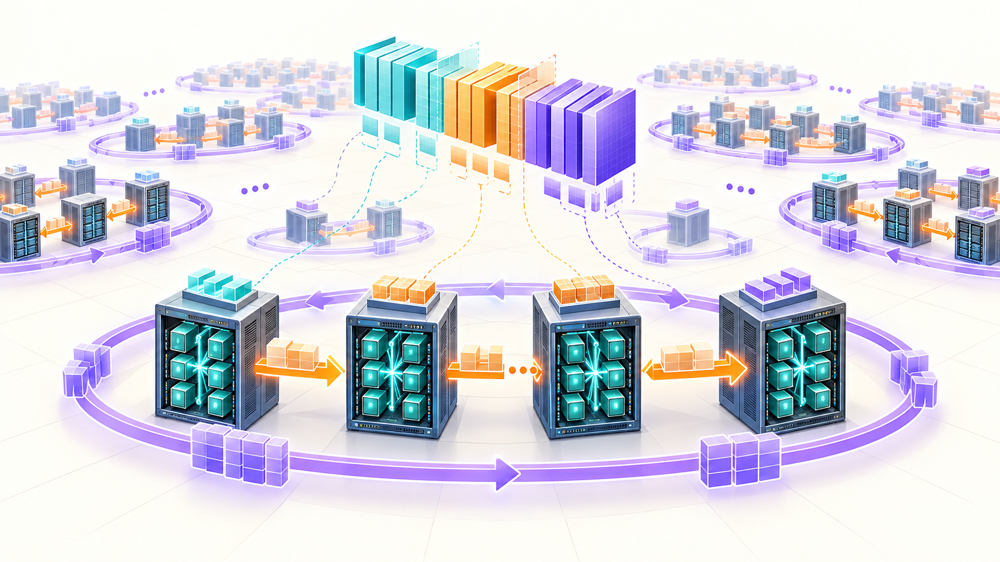
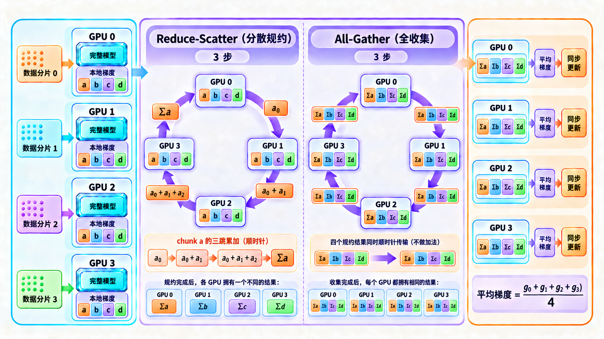
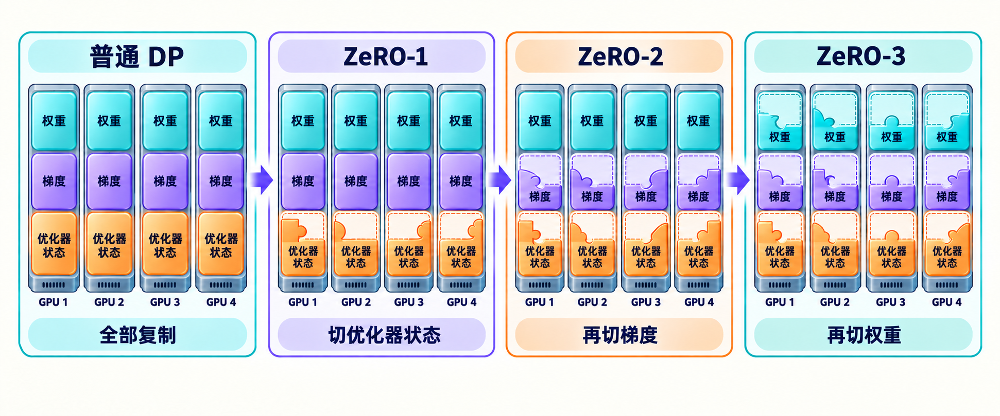
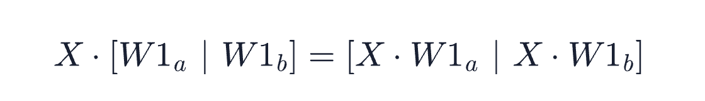
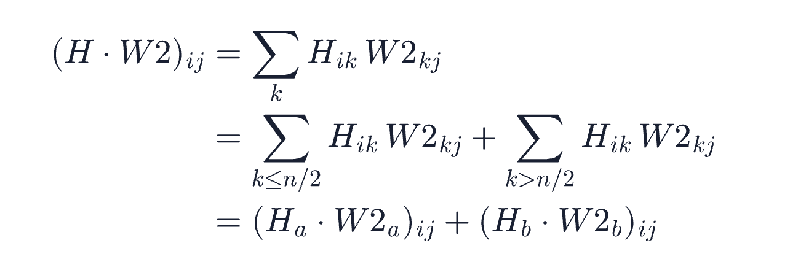
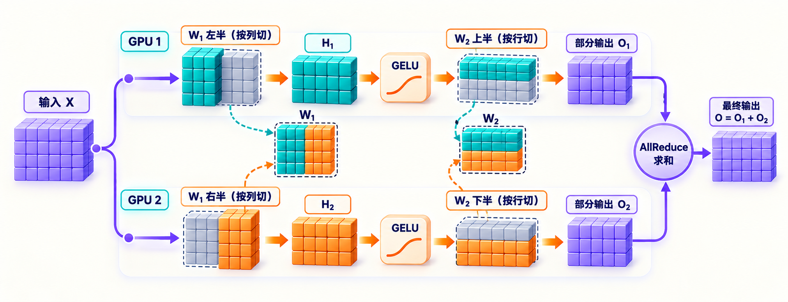
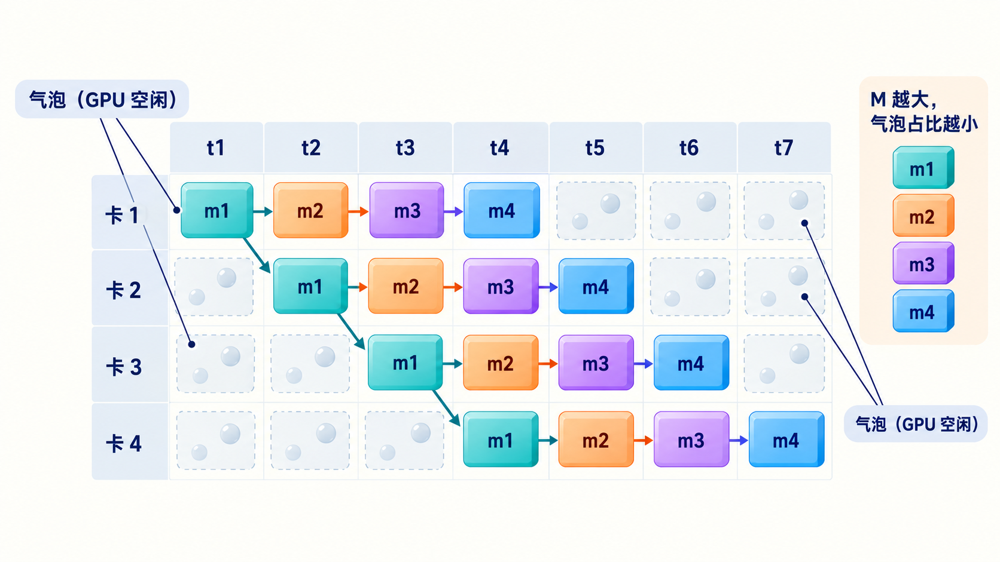
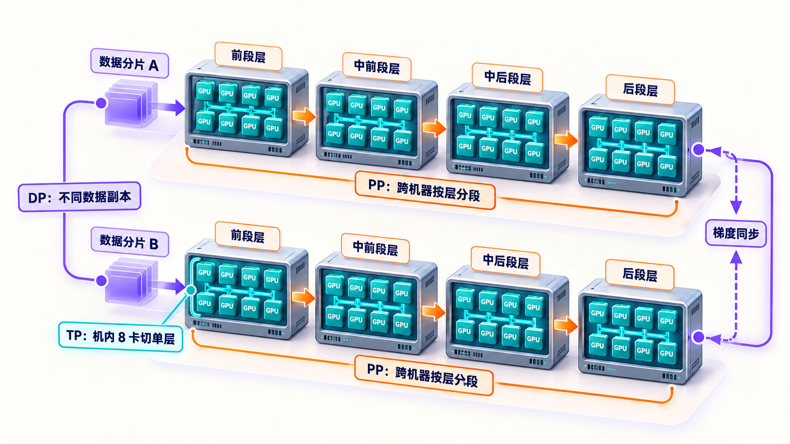
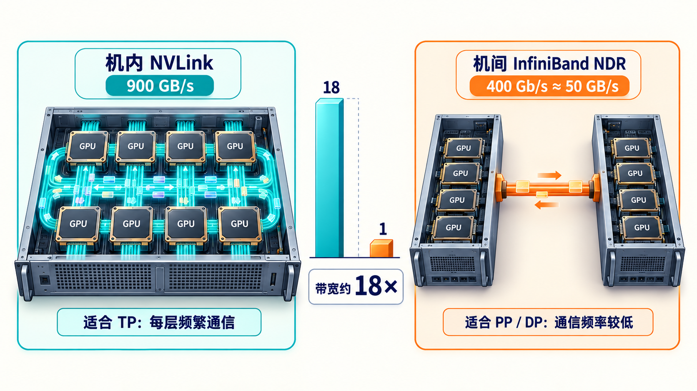

# 学习大模型训练的分布式并行策略

在上一篇《学习大模型训练的显存管理》中，我们算过训练的显存占用：一个 7B 模型用 AdamW 全参数训练，FP32 主权重、Adam 的 m 和 v 两个状态、FP16 权重和梯度加起来大约 112 GB。我们也学了混合精度、激活重算、梯度累积这些省显存的手段，但结论很清楚：这些手段能压的主要是激活值，模型状态那 112 GB 一分没少，单张 80 GB 的卡还是装不下。

显存放不下之外，时间上也绕不过去。训练的总计算量有一个经验估算式：**6 × 参数量 × token 数**，出自 OpenAI 的 [Scaling Laws 论文](https://arxiv.org/abs/2001.08361)。这个 6 是这么来的：前向传播时，每个 token 经过模型，每个参数大约参与一次乘加运算，一次乘加按 2 次浮点运算（FLOPs）计；反向传播要同时算对输入的梯度和对参数的梯度，计算量约为前向的 2 倍。前向 2、反向 4，合起来每个 token 每个参数就是 6 次浮点运算。

我们以 DeepSeek-V3 为例，它的预训练用了 14.8 万亿个 token，总参数 671B，但它是 MoE（Mixture of Experts，混合专家）模型，每个 token 只激活其中 37B 参与计算，按激活参数算，总计算量约 6 × 370 亿 × 14.8 万亿 ≈ 3 × 10²⁴ FLOPs。H100 的半精度理论峰值大约每秒 10¹⁵ 次浮点运算，即便让一张卡全程满负荷不停机，也要算上百年。

因此想要训练一个像样的大模型，靠一张卡既放不下也算不完，出路只有一条：把训练切到成百上千张 GPU 上。今天我们就来学习怎么切，主角是四种并行策略：数据并行、张量并行、流水并行，以及数据并行的升级版 ZeRO。



## 单卡的两个瓶颈

综上所述，训练一个模型，每张参与计算的 GPU 需要承担两类负担：

* **状态负担**：模型权重、梯度、优化器状态，这些必须在显存里放得下
* **计算负担**：每个 step 的前向和反向传播，这些必须在可接受的时间内算完

上一篇解决的是状态负担在单卡上的压缩。但模型再大一点，比如 70B，光 FP16 权重就要 140 GB，怎么压都塞不进一张卡。而计算负担更直接，14.8 万亿 token 的总计算量是天文数字，唯一的办法是让多张卡同时算。

所以分布式训练要解决两件事：**模型放不下就分开放，数据算不完就并行算**。下面四种并行策略，分别从不同维度回答这两个问题。

## 数据并行

最直觉的想法是**数据并行（Data Parallel，简称 DP）**：每张卡都放一份完整的模型，把训练数据切成 N 份，每张卡算自己那份数据的前向和反向，得到各自的梯度。然后把所有卡的梯度做一次 **AllReduce（全规约）**，也就是跨卡求和取平均，每张卡拿到相同的平均梯度后各自更新权重。

这个做法在深度学习里的系统化始于 Google 2012 年的 [DistBelief 论文](https://papers.nips.cc/paper_files/paper/2012/file/6aca97005c68f1206823815f66102863-Paper.pdf)，论文让多个模型副本各训一份数据。值得一提的是，DistBelief 当年用的是异步更新：各副本算完梯度就直接推给参数服务器，不互相等待。今天主流变成了同步版本，也就是上面说的梯度 AllReduce，所有副本对齐后再一起更新。

> 规约（Reduction）是并行计算里的基本操作：把分散在多处的多个值按某种运算合并成一个值，比如求和、求平均。Reduce 是合并完交给一张卡；AllReduce 则是合并完之后，每张卡都拿到这个结果。

AllReduce 的主流实现是**环形（Ring）规约**：N 张卡首尾相连成一个环，每张卡只和左右两个邻居通信。以 4 张卡为例，先把每张卡要同步的数据切成 4 块，记作 a、b、c、d，然后沿环传两圈。

第一圈叫 **Reduce-Scatter（分散规约）**，目标是让每块的求和结果分别落到一张卡上。每一步，每张卡把手里的一块发给右边邻居，同时接收左边邻居发来的一块，加到自己对应的那块上。盯着 a 块看它的旅程：卡 0 把自己的 a 发给卡 1，卡 1 加上自己的 a 再发给卡 2，卡 2 如法炮制发给卡 3，三步之后卡 3 手里的 a 就是四张卡的总和。四块数据不是排队传的，而是错开位置同时在环上流动：a 从卡 0 出发时，b 从卡 1 出发，c 从卡 2 出发，d 从卡 3 出发。三步走完，每张卡恰好拿到其中一块的完整求和。

第二圈叫 **All-Gather（全收集）**，目标是把每块的最终结果分发给所有卡。走法和第一圈一模一样，区别只有一点：收到块之后不再相加，直接收下并原样转发给下一家。再走三步，每张卡就收齐了全部四块的最终结果。

对这个过程感兴趣的同学可以阅读 [Andrew Gibiansky 讲 Baidu AllReduce 的文章](https://andrew.gibiansky.com/blog/machine-learning/baidu-allreduce/)，里面有带图的分步演示，讲得非常清楚。

这个算法的好处从走法里就能看出来：两圈各走 N−1 步，每步每张卡只传数据量的 1/N，加起来每张卡的通信量约为数据量的 2 倍，和卡数 N 无关。卡越多，每步传的块越小，总量不涨。

一个 step 的流程如下图所示：



因为每张卡算的是同一个模型的不同数据、用的是同步后的同一份梯度，所以数学上等价于单卡用一个更大的 batch 训练。N 张卡就把一个 step 的时间缩短到接近 1/N。

PyTorch 把这套逻辑封装成了 `DistributedDataParallel`（简称 DDP），用法如下：

```python
import os
import torch
import torch.distributed as dist
from torch.nn.parallel import DistributedDataParallel as DDP

# 初始化进程组，让本进程加入一个通信组
dist.init_process_group(backend="nccl")  # nccl 是 NVIDIA 的 GPU 集合通信库
# 给每个进程分配一个编号
local_rank = int(os.environ["LOCAL_RANK"])
torch.cuda.set_device(local_rank)
# 把模型搬上本进程绑定的卡
model = MyModel().to(local_rank)
# DDP 包装，别的都不变
model = DDP(model, device_ids=[local_rank])

for batch in train_loader:      # 每个进程通过 sampler 只拿到数据的一个分片
    loss = model(batch)
    loss.backward()             # 反向传播时自动对梯度做 AllReduce
    optimizer.step()
    optimizer.zero_grad()
```

逐块解释一下这段代码：

1. **初始化进程组**：`dist.init_process_group(backend="nccl")` 让本进程加入一个通信组，同组的进程之间才能收发数据。backend 是底层通信库，GPU 训练一律用 NCCL（NVIDIA 的 GPU 集合通信库），AllReduce 这类操作最终都是它执行的
2. **LOCAL_RANK**：DDP 的用法是一张卡一个进程，启动时 PyTorch 的启动器会给每个进程分配一个编号，通过环境变量传进来，就是 LOCAL_RANK。进程拿到自己的编号后，用 `torch.cuda.set_device` 绑定到对应的那张卡
3. **MyModel**：占位符，代表你自己的模型类，换成实际的网络定义即可。先 `.to(local_rank)` 把模型搬上本进程绑定的卡
4. **包一层 DDP**：`DDP(model, device_ids=[local_rank])` 是关键的一步。包完之后，前向照常调用，反向时 DDP 会自动对梯度做 AllReduce，不需要自己写通信代码
5. **数据分片**：`train_loader` 要配合 DDP 提供的 `DistributedSampler` 使用，它保证每张卡拿到的是数据的不同分片，这里为简洁省略了

可以看到业务代码几乎没动，`loss.backward()` 内部会自动发起梯度的 AllReduce，DDP 还会把通信和反向计算重叠起来，不等梯度全部算完就先开始传已经算好的部分。具体用法可以参考 [PyTorch 官方的 DDP 教程](https://docs.pytorch.org/tutorials/intermediate/ddp_tutorial.html)。

数据并行有个明显的前提：每张卡得装得下完整的模型状态。但前面算过，7B 配 AdamW 就要 112 GB，已经超过了单卡 80 GB，这个前提在 7B 上就已经不成立了，必须得想其他的办法。

## ZeRO

回头看数据并行，每卡一份完整模型其实是一种浪费：8 张卡，优化器状态就存了 8 份一模一样的。**ZeRO（Zero Redundancy Optimizer，零冗余优化器）** 要解决的就是这个冗余，它来自微软 2019 年的论文 [ZeRO: Memory Optimizations Toward Training Trillion Parameter Models](https://arxiv.org/abs/1910.02054)，随 DeepSpeed 框架落地。思路是把模型状态切成 N 份，每张卡只存 1/N，用的时候再通过通信临时补齐，用通信换显存。

ZeRO 分三个阶段，切的东西逐级增加：

| 阶段 | 切分的内容 | 每卡保存（相对 DP） | 代价 |
| ---- | ---- | ---- | ---- |
| ZeRO-1 | 优化器状态 | 完整的权重和梯度，优化器状态 1/N | 更新时多一次通信 |
| ZeRO-2 | 再加梯度 | 完整的权重，梯度和优化器状态各 1/N | 反向时梯度边算边规约 |
| ZeRO-3 | 再加权重 | 所有状态都只存 1/N | 前向反向都要临时聚合权重 |

以 8 卡训练 7B 模型为例，ZeRO 论文把 FP32 主权重和 m、v 两个状态一起算作优化器状态，合计 84 GB，ZeRO-1 把它切成每卡约 10 GB，每卡总占用从 112 GB 降到 40 GB 以内；ZeRO-3 则把权重也切开，每卡只留十几 GB。三个阶段的变化如下图所示：



> PyTorch 原生也有一个对应物叫 **FSDP（Fully Sharded Data Parallel，全分片数据并行）**，思想和 ZeRO-3 一致：参数分片存放，计算前临时聚合，算完就扔。Meta 训练 Llama 系列用的就是 FSDP，它的设计经验写在论文 [PyTorch FSDP: Experiences on Scaling Fully Sharded Data Parallel](https://arxiv.org/abs/2304.11277) 里。

要注意的是，ZeRO 和 FSDP 本质上还是数据并行。可能有读者会问，既然连梯度和权重都切开了，为什么还算数据并行呢？这里关键在于看计算是怎么组织的，而不是看状态是怎么存储的。ZeRO 切开的是存储，权重分片放着，每张卡算到某一层时，先把这层的完整权重临时聚合过来，算的是完整的矩阵乘法，算完就扔。每张卡跑的仍然是完整的模型前向和反向，只是各吃各的数据分片，这正是数据并行的计算模式。

从表格里能看出 ZeRO 的取舍：状态被切成 N 份，参与切分的卡越多，每卡要存的那份就越薄，但省显存的代价是通信，切得越细，临时聚合和规约的次数就越多。通信的代价到底有多大，我们放到最后一节细说。

## 张量并行

数据并行家族有一个共同的极限：单层的权重矩阵必须完整地参与一次矩阵乘法，一张卡连一层都放不下时，数据并行怎么切都没用。**张量并行（Tensor Parallel，简称 TP）** 换了一个维度：不切块数据，而是把一层的权重矩阵横着或竖着切开，分到多张卡上，每张卡算矩阵的一部分，单层的一次矩阵乘法由多张卡合力完成。

这里可以和 ZeRO 对照着看：ZeRO 切的是存储，算到某一层时会把完整权重临时聚合过来，算的是完整的矩阵乘法；TP 切的是计算本身。一句话区分：**ZeRO 是存的时候切、算的时候合，张量并行是算的时候也在切**。

这套切法最经典的实现来自 NVIDIA 的 [Megatron-LM](https://arxiv.org/abs/1909.08053)。以 Transformer 里的 FFN（前馈网络）为例，它是两个矩阵乘法中间夹一个激活函数：`GELU(X · W1) · W2`。Megatron 的切法是：

1. **第一个矩阵按列切**：W1 切成左右两半，两张卡各拿一半，各自和完整的输入 X 相乘再过 GELU，得到两份部分结果
2. **第二个矩阵按行切**：W2 切成上下两半，每张卡的部分结果正好喂给对应那一半 W2，乘完后两张卡的输出做一次 AllReduce 求和，就得到和单卡完整计算一模一样的结果

为什么矩阵可以这样拆呢？这里要回忆一下大学线性代数里的分块矩阵乘法：矩阵乘法沿内维度可以分块，分块算完再组合，结果和整体算完全一样。不过这两步还有点区别。第一步按列切，依据是结果的每一列只依赖 W1 的对应列，两块互不干扰：



所以两张卡各算一半，拼起来就是完整结果。GELU 是逐元素函数，先切开再激活和先激活再切开完全一样，不受影响。第二步按行切，依据是矩阵乘法本质是沿内维度的求和，而求和可以分段。设上一步的输出 H = [H_a | H_b]，W2 按行切成上下两半 [W2_a; W2_b]，切口和 H 的列对齐，那么：



也就是 H·W2 = H_a·W2_a + H_b·W2_b：每张卡用自己的一半 H 和一半 W2 算出一个部分和，两个部分和逐元素相加才是完整结果，也就是第二步最后的那次 AllReduce 求和。

切分过程如下图所示：



注意力层同理：多头注意力天然就是多个独立的头，把 Q、K、V 的投影矩阵按头切开，每张卡负责一部分头，各自独立算注意力，不用通信；最后所有头的输出拼接起来过输出投影矩阵 W_O，W_O 按行切，结尾配一次 AllReduce，和上面 FFN 第二步的求和分段相同。

把一个完整层的前向从头到尾数一遍，每个子层都是先列切、后行切配成一对：列切的半边把计算铺开，各卡独立完成；行切的半边把求和分段，收尾时通信一次。注意力收尾一次、FFN 收尾一次，每层前向正好两次 AllReduce；反向传播经过同样的两处，还要再同步两次梯度，前向反向加起来每层四次，数学上和单卡完全等价。

不过这个等价也是有代价的：TP 的通信发生在每一层的前向和反向里，通信频率远高于数据并行（后者一个 step 才通信一次）。所以 TP 的通信必须走机内的高速互联，一般只在一台机器的 8 张卡内部使用，跨机器就吃不消了。

## 流水并行

除了数据和张量，还有一种切法更省事：**流水并行（Pipeline Parallel，简称 PP）**，按层切。模型有 80 层，4 张卡，那就第 1 到 20 层放卡 1，21 到 40 层放卡 2，依此类推。数据像流水一样，卡 1 算完把中间结果传给卡 2，卡 2 传给卡 3，一张卡只需要和上下游通信，通信量比 TP 小得多。

但朴素的按层切有个致命问题：任何时刻只有一张卡在干活，其余卡都在等上一段的输出，设备利用率是 1/N。这段空闲时间大家俗称**气泡（Bubble）**。

Google 在 [GPipe 论文](https://arxiv.org/abs/1811.06965)里提出了一种思路，专门解决这个问题：把一个 batch 再切成 M 个 **micro-batch**，像工厂流水线一样依次喂进去。卡 1 算完第 1 个 micro-batch 传给卡 2，自己马上开始算第 2 个。用 4 卡、4 个 micro-batch 排一下时间表：

| 时刻 | 卡 1 | 卡 2 | 卡 3 | 卡 4 |
| ---- | ---- | ---- | ---- | ---- |
| t1 | m1 | 空闲 | 空闲 | 空闲 |
| t2 | m2 | m1 | 空闲 | 空闲 |
| t3 | m3 | m2 | m1 | 空闲 |
| t4 | m4 | m3 | m2 | m1 |
| t5 | 空闲 | m4 | m3 | m2 |
| t6 | 空闲 | 空闲 | m4 | m3 |
| t7 | 空闲 | 空闲 | 空闲 | m4 |

示意图如下：



可以看到开头和结尾各有一段所有卡轮流空闲的时间，这就是气泡。从上表能数出来：每张卡干活 4 拍、空等 3 拍，空闲和干活的时间比是 3/4。一般化的结论是，p 段流水线、m 个 micro-batch 时，这个比值是 (p−1)/m，所以 micro-batch 数越大，气泡占比越小，流水线越接近满载。实际训练里还有更精细的调度方式，比如 [PipeDream 论文](https://arxiv.org/abs/1806.03377)提出的 1F1B 和 Megatron-LM 提出的 interleaved 调度，都能进一步压气泡。这些属于工程优化，细节我们这里就不展开了，1F1B 和 interleaved 的完整调度图和气泡分析都在 [Megatron-LM 的 3D 并行论文](https://arxiv.org/abs/2104.04473)里，感兴趣的同学可以翻一翻。

## 3D 并行

真实的大模型训练不会只用一种并行，而是按通信特性把几种并行组合起来，这就是常说的 **3D 并行**：**TP 在最内层，PP 在中层，DP 在最外层**。

组合的逻辑完全由带宽决定。TP 每层都要通信，放在机内 NVLink 里；PP 只在段的边界传一次中间激活，通信量小，可以跨机器；DP 一个 step 只在梯度同步时通信一次，放在最外层跨最多的机器。假设一个 4096 卡的集群（512 台 8 卡机器），典型的组织方式是：机内 8 卡做 TP；每 16 台机器做 PP 串起全部层，组成一条流水线，也就是一个完整模型副本；512 台机器一共分成 32 条流水线，构成 32 个数据并行组，各算各的数据分片。



Megatron-LM 团队在 [2021 年的论文](https://arxiv.org/abs/2104.04473)里系统验证了这种组合（论文里叫 PTD-P，即 Pipeline、Tensor、Data 三种 Parallelism 的首字母缩写）：在 3072 张 A100 上训练 1 万亿参数的模型，总算力跑到 502 petaFLOP/s，每张卡达到理论峰值的 52%；在 175B 和 530B 规模上，还比只用 ZeRO-3 的方案快了 70%。这个数字侧面说明，万亿级模型光靠切存储是不够的，得三种并行一起上。

除了 TP、PP、DP 这三个常用的并行策略，如果模型是 DeepSeek-V3 这样的 MoE 架构，还会再加一维**专家并行（Expert Parallelism，简称 EP）**。MoE 模型的 FFN 不是一份而是几十上百份，每份叫一个专家，每个 token 经过路由器挑选少数几个专家来算。EP 的做法是把不同的专家分到不同的卡上，每个 token 按路由结果发给对应专家所在的卡，算完再发回来。注意这里通信的模式变了：前面三种并行用的是 AllReduce 或点对点，EP 用的是 **All-to-All**，每张卡都要和多张其他卡交换 token，负载不均匀时还会出现有的卡排长队、有的卡闲着的情况。为了压住 All-to-All 的开销，DeepSeek-V3 在 [技术报告](https://arxiv.org/abs/2412.19437)里提到两个手段：限制每个 token 最多路由到 4 台机器，以及专门设计的 DualPipe 调度把通信和计算重叠起来。专家并行的更多工程细节，感兴趣的同学可以直接看这篇报告。

## 通信是隐藏的敌人

前面几节里，通信这个词反复出现：数据并行每个 step 结尾的梯度 AllReduce，ZeRO 算到某一层时的临时聚合，张量并行每层的两次同步，流水并行段与段之间传递的中间激活。这个通信的代价到底有多大，我们这一节就来算一算。

先看**数据并行**。每个 step 结尾要对全部梯度做一次 AllReduce，前面讲过环形规约每张卡的通信量约为数据量的 2 倍。7B 模型的 BF16 梯度是 14 GB，也就是说每个 step 每张卡要收发约 28 GB。一个 step 的计算量大约是 6 × 70 亿 × 几万 token，折合单卡要数秒钟，28 GB 在机间网络上传输不到一秒，还能和反向传播重叠起来，压力不大。

再看**张量并行**，情况完全不同。TP 的通信对象是中间激活，每层前向两次 AllReduce、反向再来两次。一个 micro-batch 的激活有多大呢？假设它只有 1 条序列、序列长 4096、隐层维度 4096，混合精度下每个元素 2 字节，就是 1 × 4096 × 4096 × 2 字节 ≈ 32 MB。前面讲过环形规约每张卡的通信量约为数据量的 2 倍，所以一次 AllReduce 每张卡收发约 64 MB，一层四次就是 256 MB，32 层一个 micro-batch 就是约 8 GB。关键不在总量而在频率：这些通信插在每一层的计算之间，一层算完马上就要等通信。一层在 8 张卡上的计算只有几毫秒，通信也必须压在毫秒级，否则流水线全程在等网络。

**流水并行**最轻松：只在段的边界把中间激活传给下一张卡，一个 micro-batch 一次前向传 32 MB，加上反向 64 MB。频率是每个 micro-batch 一次，量也小，三种策略里对网络要求最低。

把三个策略的通信量放在一起：

| 策略 | 通信对象 | 频率 | 单卡单次通信量 |
| ---- | ---- | ---- | ---- |
| DP | 全部梯度 | 每个 step 一次 | 约 28 GB |
| TP | 中间激活 | 每层四次 | 每层约 256 MB |
| PP | 段间激活 | 每个 micro-batch 一次 | 约 64 MB |

带宽的现状决定了各种并行该放在哪里。机内的 **NVLink** 是 NVIDIA 的 GPU 直连互联技术，H100 上第 4 代的带宽是 900 GB/s。机器之间的互联主流是 **InfiniBand**，NDR 规格每端口 400 Gb/s，换算过来约 50 GB/s。两者差了将近 18 倍。对着上表看结论就自然出来了：TP 的通信插在每层计算的缝隙里，延迟敏感，只有 NVLink 扛得住，所以它被严格限制在机内；DP 和 PP 的通信是整块的、可以预见的，能和计算重叠，放到慢得多的机间网络上也没问题。



实际系统里还会用通信计算重叠、梯度分桶、拓扑感知调度等手法把通信藏起来，让 GPU 在等数据的时候继续算别的。这些工程细节是训练框架的核心竞争力，我们下一篇会看到。

## 小结

今天我们学习了把训练切到成百上千张 GPU 上的四种并行策略：

1. **数据并行（DP）**：最直觉的切法，每张卡放一份完整模型，各算各的数据分片，梯度通过 AllReduce 求平均后同步更新。PyTorch 把它封装成 DDP，模型包一层就能用
2. **ZeRO**：数据并行中每张卡存一份完整状态太浪费，ZeRO 把优化器状态、梯度、权重逐级切开，每张卡只存一份切片，用通信换显存。PyTorch 原生的 FSDP 是同一思想
3. **张量并行（TP）**：一张卡连一层都放不下时，就得把单层的大矩阵也切开。按列切、按行切分到多卡，每张卡算矩阵的一部分，每层两次 AllReduce 拼出结果。通信太频繁，只适合机内 NVLink
4. **流水并行（PP）**：按层把模型切成几段，数据像流水线一样流过各段。朴素切法大部分卡都在空等，靠 micro-batch 把流水线填满
5. **3D 并行**：真实训练是组合使用，通信频率决定怎么组合，TP 放机内，PP 跨机器，DP 在最外层。MoE 模型还要再加一维专家并行

讲了这么多的并行策略，其实只回答了怎么切的问题，如果真要组织一次预训练，还需要一套把这些策略落地、管几千张卡的训练框架，以及一个决定模型多大、数据多少、算力怎么分配才划算的经验法则。这两件事，我们下一篇接着聊。

## 参考

* [DeepSeek-V3 技术报告](https://arxiv.org/abs/2412.19437)
* [DistBelief 论文：Large Scale Distributed Deep Networks（NIPS 2012）](https://papers.nips.cc/paper_files/paper/2012/file/6aca97005c68f1206823815f66102863-Paper.pdf)
* [Scaling Laws 论文：Scaling Laws for Neural Language Models](https://arxiv.org/abs/2001.08361)
* [PyTorch DDP 官方教程](https://pytorch.org/tutorials/intermediate/ddp_tutorial.html)
* [Andrew Gibiansky：Bringing HPC Techniques to Deep Learning（环形 AllReduce 图解）](https://andrew.gibiansky.com/blog/machine-learning/baidu-allreduce/)
* [ZeRO 论文：Memory Optimizations Toward Training Trillion Parameter Models](https://arxiv.org/abs/1910.02054)
* [DeepSpeed ZeRO 官方教程](https://www.deepspeed.ai/tutorials/zero/)
* [PyTorch FSDP 论文：Experiences on Scaling Fully Sharded Data Parallel](https://arxiv.org/abs/2304.11277)
* [Megatron-LM 论文：Training Multi-Billion Parameter Language Models Using Model Parallelism](https://arxiv.org/abs/1909.08053)
* [Megatron-LM GitHub 仓库](https://github.com/NVIDIA/Megatron-LM)
* [GPipe 论文：Easy Scaling with Micro-Batch Pipeline Parallelism](https://arxiv.org/abs/1811.06965)
* [PipeDream 论文：Generalized Pipeline Parallelism for DNN Training](https://arxiv.org/abs/1806.03377)
* [Megatron-LM 3D 并行论文：Efficient Large-Scale Language Model Training on GPU Clusters](https://arxiv.org/abs/2104.04473)
* [NVIDIA H100 官方页面](https://www.nvidia.com/en-us/data-center/h100/)
