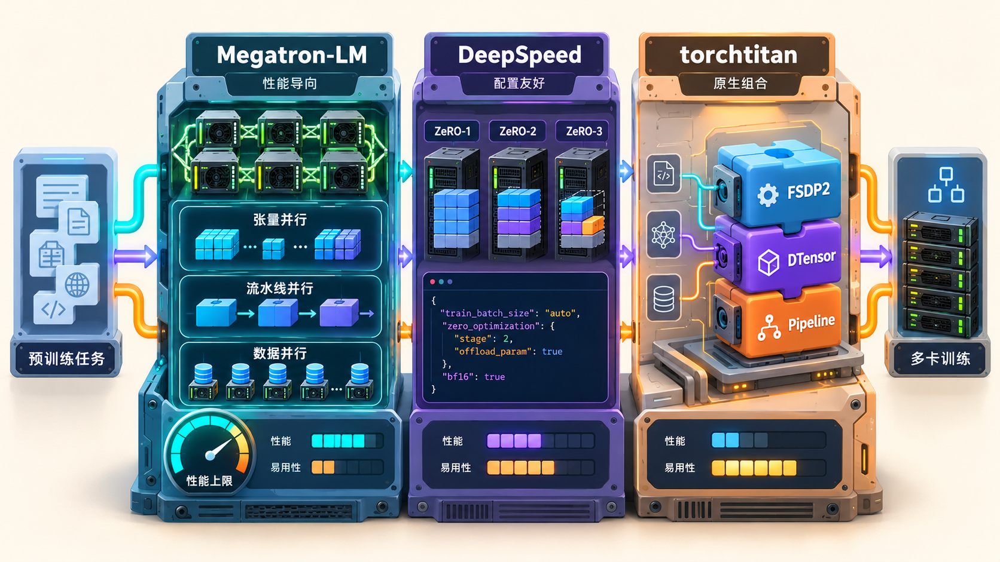
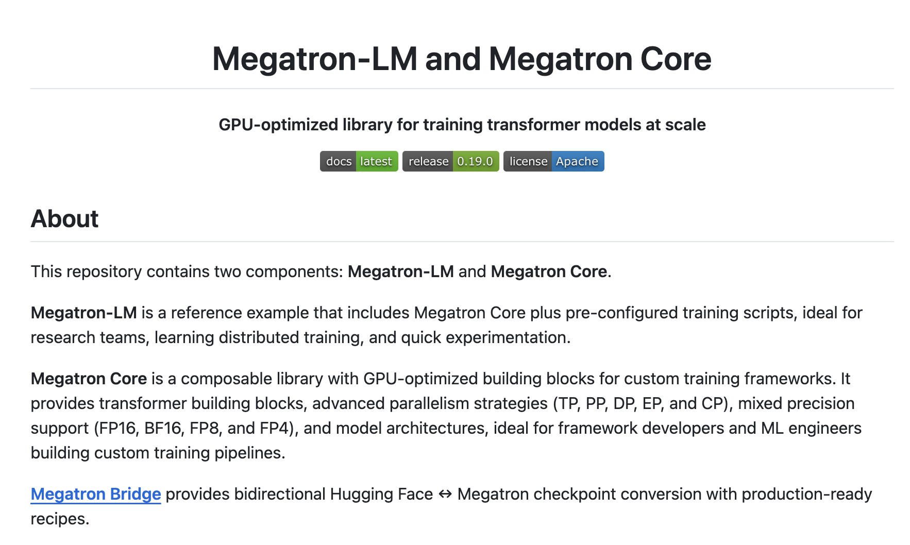
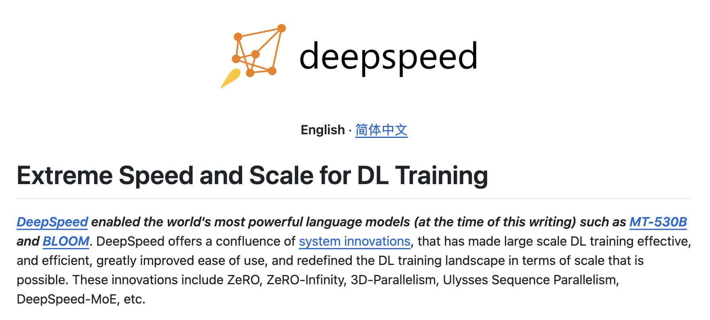
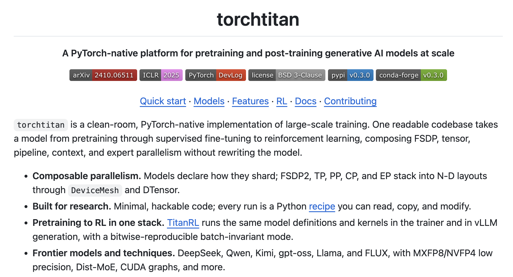
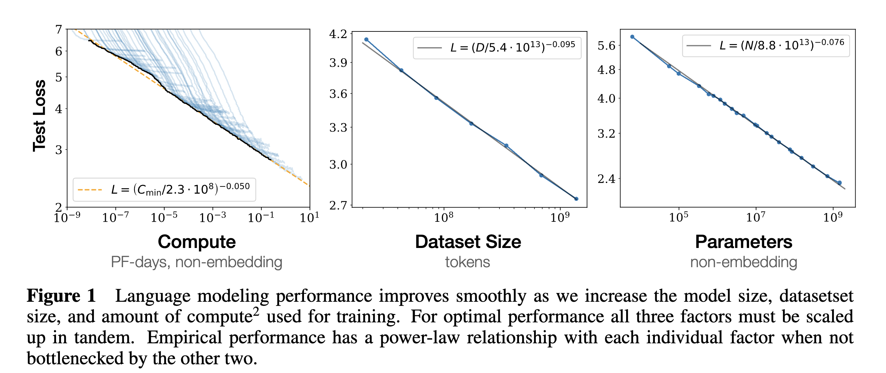
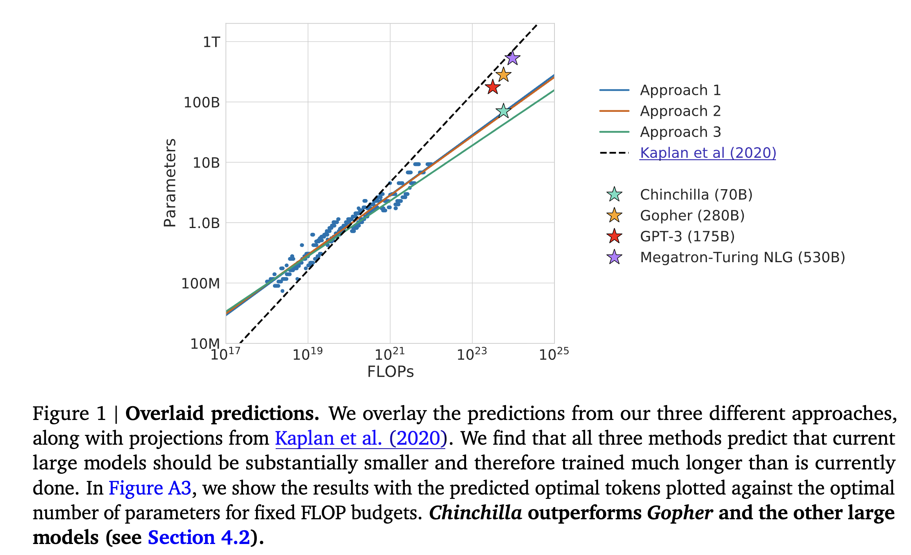
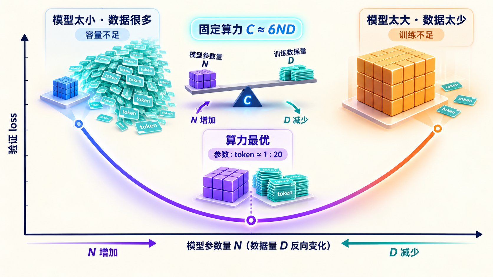
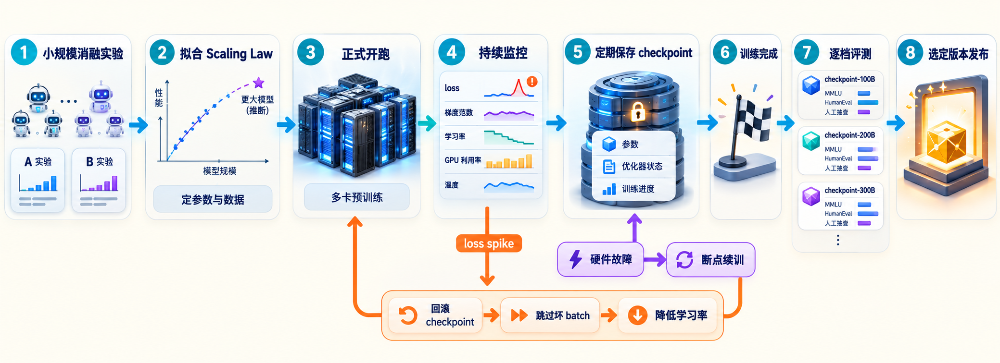
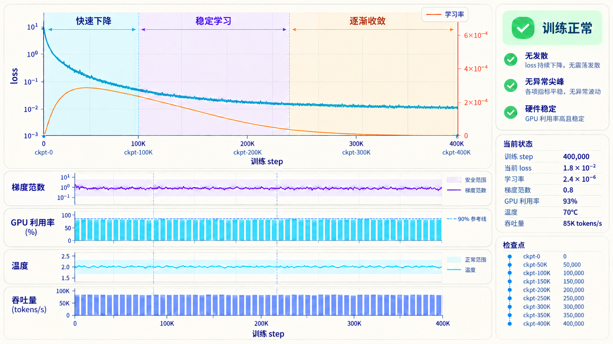
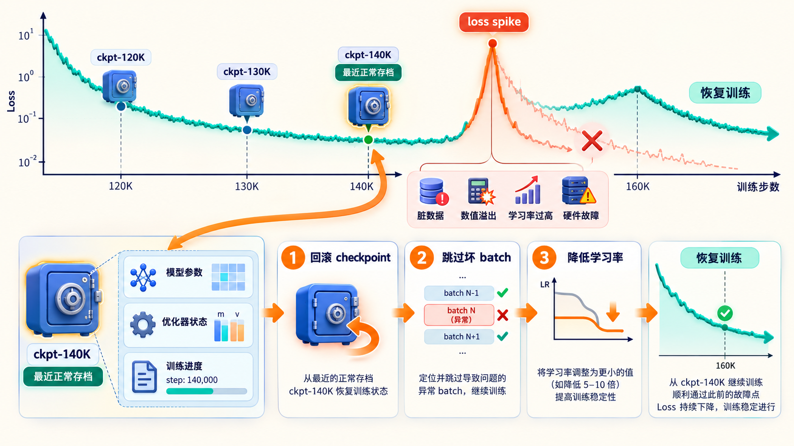

# 学习大模型训练的预训练工程：框架与 Scaling Law

在上一篇《学习大模型训练的分布式并行策略》中，我们学习了把一个超大模型拆到成百上千张 GPU 上的几种手段：数据并行、张量并行、流水线并行。这些策略组合起来，就是常说的 3D 并行，是预训练能在万卡集群上跑起来的基础。

上一篇我们是从原理层面逐个拆开讲的，真到动手训练时，没有人会照着论文从零手写这些并行逻辑。业界已经有几个久经考验的开源框架，把并行策略、显存优化、通信调度都实现好了。今天我们就来看看预训练的工程全景，主流框架怎么选、模型规模怎么定、一次真实的预训练从实验到发布要经历哪些环节。

## 训练框架概述

预训练框架要解决的问题，就是把上一篇讲的那些并行策略变成配置项，同时把通信和显存压榨到位。目前主流的选择有三个：

| 框架 | 出品方 | 核心特点 | 代表技术 |
| ---- | ---- | ---- | ---- |
| Megatron-LM | NVIDIA | 3D 并行的鼻祖，性能调优极致 | 张量并行、流水线并行 |
| DeepSpeed | 微软 | ZeRO 的出处，生态和文档完整 | ZeRO 三个阶段的显存切分 |
| torchtitan | PyTorch 官方 | 纯原生 API 实现，代码简洁 | FSDP2、DTensor 组合式并行 |

> 这三个框架是**预训练**的主力。到了**微调**阶段，模型规模通常小一些，工程诉求也变了，主流工具就变成了 transformers 的 `Trainer` 和 Hugging Face 的 [TRL](https://github.com/huggingface/trl) 库，这个我们到后面讲微调的篇目再展开。



### Megatron-LM

[Megatron-LM](https://github.com/NVIDIA/Megatron-LM) 是 NVIDIA 在 2019 年开源的训练框架，它的第一篇论文 [Megatron-LM: Training Multi-Billion Parameter Language Models Using Model Parallelism](https://arxiv.org/abs/1909.08053) 第一次把 Transformer 层内的张量并行讲清楚，2021 年的后续论文 [Efficient Large-Scale Language Model Training on GPU Clusters Using Megatron-LM](https://arxiv.org/abs/2104.04473) 又补齐了流水线并行和数据并行的组合。三种并行合起来用，就是大家常说的 3D 并行（论文里叫 PTD-P）。GPT-3 时代的许多大模型训练，用的都是 Megatron 或它的变体。

Megatron 的特点是性能导向。它对 GPU 内核、通信重叠、显存复用做了大量手写优化，在 NVIDIA 硬件上的吞吐基本是所有框架的上限。代价是代码复杂度也高，配置项多，想改模型结构需要对它切分权重的方式有比较深的理解。



翻翻这个仓库的代码，有两点值得注意。

一是它实际包含两部分：**Megatron Core** 是可组合的底层库，打包了各种 GPU 优化的构件；**Megatron-LM** 是基于 Core 的参考训练脚本，`pretrain_gpt.py` 这样的入口文件就在仓库根目录。想给自己的框架做底座的人用 Core，想直接跑训练的人用参考脚本，这是它的两层用法。

二是再往下一层进到 `megatron/core`，这个目录里装的基本上都是我们之前学过的内容：

```text
megatron/core/
├── tensor_parallel/      # 张量并行
├── pipeline_parallel/    # 流水线并行
├── context_parallel/     # 上下文并行
├── distributed/          # 数据并行
├── transformer/moe/      # 专家并行
├── optimizer/            # 分布式优化器
├── fp8_utils.py          # FP8 混合精度
└── ...
```

上一篇讲的并行策略在这里各占一个目录，之外还有长序列用的**上下文并行（Context Parallelism，简称 CP）**，把长序列切开分到多卡上算注意力，以及 MoE 用的专家并行，混合精度也一路支持到 FP8、FP4。

仓库自带一个用模拟数据的最小训练循环，不用准备数据，主要用来验证安装和分布式环境是否正常：

```bash
$ torchrun --nproc_per_node=2 examples/run_simple_mcore_train_loop.py
```

参数里的 2 是卡数，没有两张卡也没关系，改成 1 也能跑通流程，只是体现不出分布式的部分。

真正训练时的入口是 `pretrain_gpt.py`，配置方式是一张长长的参数清单，并行度、模型结构、学习率调度、checkpoint 路径全是命令行参数：

```bash
$ torchrun --nproc_per_node=8 pretrain_gpt.py \
    --tensor-model-parallel-size 2 \
    --pipeline-model-parallel-size 4 \
    --num-layers 32 --hidden-size 4096 \
    --seq-length 2048 --micro-batch-size 4 \
    --lr 3.0e-4 --lr-decay-style cosine \
    --bf16 \
    --data-path /path/to/data --save /path/to/checkpoints
```

这里的命令做了精简，真实场景通常有几十上百个参数。可以看到上一篇的概念在这里直接变成了参数名：`--tensor-model-parallel-size` 是张量并行度，`--pipeline-model-parallel-size` 是流水线段数，`--bf16` 是混合精度。

### DeepSpeed

[DeepSpeed](https://github.com/deepspeedai/DeepSpeed) 是微软在 2020 年开源的框架（仓库现在维护在 deepspeedai 组织下），上一篇讲过的 **ZeRO（Zero Redundancy Optimizer，零冗余优化器）** 就出自它的[论文](https://arxiv.org/abs/1910.02054)。ZeRO 把优化器状态、梯度、参数分三个阶段逐步切到多张卡上，让单卡放不下的模型也能训练。

DeepSpeed 的特点是上手相对友好，一份 JSON 配置就能打开 ZeRO、混合精度、梯度累积这些功能，和 Hugging Face transformers 的集成也很成熟。除了训练，它后来还扩展出了推理、压缩等模块，生态铺得比较开。



看下它的仓库结构，训练内外的环节都有对应的模块：

```text
deepspeed/
├── runtime/                 # 训练运行时
│   ├── zero/                # ZeRO 三个阶段
│   ├── tensor_parallel/     # 张量并行
│   ├── pipe/                # 流水线并行
│   └── activation_checkpointing/  # 激活重计算
├── sequence/                # Ulysses 长序列并行
├── moe/                     # 专家并行
├── nvme/                    # NVMe 硬盘卸载
├── inference/               # 推理
├── compression/             # 模型压缩
└── ...
```

可以看到张量并行、流水线并行 DeepSpeed 自己也有实现，ZeRO 只是它最出名的一块。ZeRO 家族在论文之外也还有续作：**ZeRO-Infinity** 更进一步，把切开的状态继续卸载到 CPU 内存甚至 NVMe 硬盘，拿主存和磁盘换显存。当年微软 530B 的 Megatron-Turing NLG 和开源的 BLOOM-176B，都是 DeepSpeed 和 Megatron 搭配着训练出来的。

一份典型的 ZeRO Stage 2 配置长这样：

```json
{
  "train_batch_size": 1024,
  "gradient_accumulation_steps": 8,
  "bf16": { "enabled": true },
  "zero_optimization": {
    "stage": 2,                    // 切分梯度 + 优化器状态
    "overlap_comm": true           // 通信和计算重叠
  }
}
```

可以看到，之前学的概念在这里全都变成了配置项：混合精度是 `bf16`，梯度累积是 `gradient_accumulation_steps`，ZeRO 切到第几阶段是 `stage`。框架把这些封装好之后，工程上的主要工作变成了调配置而不是写并行代码。

有了配置，启动用 DeepSpeed 自带的启动器，一行命令拉起多卡：

```bash
$ deepspeed --num_gpus 8 train.py --deepspeed_config ds_config.json
```

`deepspeed` 命令相当于在 torchrun 之上又包了一层，按卡数自动起进程、读 JSON 配置初始化 ZeRO 和混合精度。注意这里的 `train.py` 是你自己的训练脚本：DeepSpeed 和 Megatron 不一样，它本身是个库，不带完整的训练入口，要接进你已有的脚本里。不想从零写的话，官方在 [DeepSpeedExamples](https://github.com/deepspeedai/DeepSpeedExamples) 仓库里放了完整的训练示例可以当起点。

### torchtitan

[torchtitan](https://github.com/pytorch/torchtitan) 是 PyTorch 官方团队推出的新一代预训练框架，[论文](https://arxiv.org/abs/2410.06511)发表在 ICLR 2025。它的思路和前两家不太一样：Megatron 和 DeepSpeed 诞生得早，当时 PyTorch 官方的分布式 API 还不成熟，两家都自研了一整套并行基础设施；而 torchtitan 完全站在官方原语上，直接用 PyTorch 原生的 FSDP2、DTensor、Pipeline 等 API 做组合，证明只靠官方原语就能搭出生产级的训练系统。



torchtitan 的代码量小、结构清楚，Llama 风格的模型从单卡到多卡的配置都是现成的。想了解现代 PyTorch 分布式训练长什么样，读它的代码比读 Megatron 要轻松得多，它也常被当作新框架的参考实现。

它的代码有多简洁呢？看它的目录结构就知道了：

```text
torchtitan/
├── models/llama3/              # 一个模型只有三个核心文件
│   ├── model.py                # 模型定义
│   ├── flavors.py              # 8B、70B 等尺寸变体
│   └── state_dict_adapter.py   # 和 Hugging Face 权重互转
├── distributed/                # 并行逻辑集中在这一处
│   ├── fsdp.py                 # FSDP2 数据并行
│   ├── pipeline_parallel.py    # 流水线并行
│   ├── context_parallel.py     # 上下文并行
│   └── ...
└── ...
```

可以看到，每个模型目录下就几个核心文件，看上去非常清爽。模型代码里完全不写通信逻辑，只需要声明自己怎么切；怎么把权重切开铺到各张卡上、什么时候通信，都由 `distributed` 下的通用代码按声明去执行。

仓库收录的模型也跟上了前沿，流行的开源模型基本都有现成实现：

```text
torchtitan/models/
├── llama3/        # Llama 3
├── qwen3/         # Qwen3，另有 qwen3_5、qwen3_6、qwen3_8
├── deepseek_v3/   # DeepSeek-V3，另有 deepseek_v4
├── kimi_k2_7/     # Kimi K2.7，另有 kimi_k3
├── gpt_oss/       # OpenAI 开源的 gpt-oss
├── flux/          # FLUX 图像生成模型
└── ...
```

看完代码结构，再看看怎么把训练跑起来。它启动一个 8B 模型的训练只需要一行命令：

```bash
$ MODULE=torchtitan_recipes.models.llama3 CONFIG=llama3_8b ./run_train.sh
```

`run_train.sh` 内部调的同样是 PyTorch 的多进程启动器 `torchrun`，MODULE 和 CONFIG 指定用哪个 recipe。torchtitan 里一个 **recipe** 就是一个返回完整配置的 Python 函数，比如 `llama3_8b` 定义了 8B 模型的全部训练参数。想改配置不用记参数名，基于现成 recipe 写个函数改一行就行：

```python
# my_recipes.py：基于现成的 8B recipe 改出自定义配置
from torchtitan_recipes.models.llama3 import llama3_8b

def llama3_8b_tp2():
    config = llama3_8b()
    config.parallelism.tensor_parallel_degree = 2  # 打开 2 路张量并行
    return config
```

改完用 `MODULE=my_recipes CONFIG=llama3_8b_tp2 ./run_train.sh` 启动即可。配置即代码，这是它和 DeepSpeed 的 JSON 风格最不一样的地方。

## Scaling Law

框架选好之后，接下来是一个更根本的问题：这次训练，模型参数定多少，训练数据备多少？拍脑袋定是要烧掉几百万美元学费的，好在有一个经验规律可以依靠，就是 **Scaling Law（缩放定律）**。

### Kaplan 的发现

2020 年，OpenAI 的 Kaplan 等人发表了论文 [Scaling Laws for Neural Language Models](https://arxiv.org/abs/2001.08361)，系统性地扫了一批不同规模的训练实验，发现一个非常干净的规律：模型的验证集 loss 随**计算量**、**参数量**、**数据量**三个因素分别呈幂律下降。画在双对数坐标上，loss 和这三个量近似是一条直线。



这个发现的意义在于可预测。小规模实验上拟合出幂律的参数，就能外推更大规模下 loss 会降到哪里，不用真把钱烧进去才知道结果。Kaplan 论文还给出了一个配置建议：算力增加时，应该优先把模型做大，数据量的增长可以慢一些。GPT-3 的 1750 亿参数、3000 亿 token 就是在这个思路下定的，数据对参数的比例还不到 2 比 1。

### Chinchilla 的修正

2022 年，DeepMind 的 Hoffmann 等人用超过 400 组训练实验重新审视了这个问题，[论文](https://arxiv.org/abs/2203.15556)给出了不同的结论：Kaplan 的实验里学习率调度没有随训练长度调好，导致数据量大的配置被低估了。修正之后，最优策略变成了**参数量和训练 token 数同比扩张**，换算下来大约是**每个参数配 20 个 token**。

他们用这个比例训练了 **Chinchilla**：700 亿参数、1.4 万亿 token。对比同门的 Gopher（2800 亿参数、3000 亿 token），Chinchilla 参数只有四分之一，训练算力相当，效果却全面更好。这说明 Gopher 这类大模型其实被喂得太少了，大量参数在训练数据不足的情况下没有学到位。



论文的图 1 对这个结论做了总结：作者用三种相互独立的方法分别估计最优配置（固定模型大小扫数据量、固定算力扫模型大小、拟合显式的 loss 函数求最优解），三条预测线几乎重合；再把当时的主流大模型（GPT-3、Gopher 等）按实际算力和参数量标上去，全都落在预测线的外侧，也就是同样算力下参数偏多、数据偏少的那一侧。

这篇论文扭转了整个行业的方向。之前大家比谁的参数多，之后大家比谁喂的数据足：Llama、Qwen 这些后来的开源模型，参数量收敛到百亿上下的量级，训练 token 数却一路涨到十几万亿。20 token/参数这条经验值也因此成了预训练配置时的默认起点。

两篇论文的核心差异可以这样对照：

| 对比项 | Kaplan 2020 | Chinchilla 2022 |
| ---- | ---- | ---- |
| 机构 | OpenAI | DeepMind |
| 算力增加时的建议 | 优先把模型做大 | 参数和数据同比扩张 |
| 数据对参数的比例 | 不到 2 token/参数 | 约 20 token/参数 |
| 代表性实践 | GPT-3（175B，3000 亿 token） | Chinchilla（70B，1.4 万亿 token） |
| 对行业的导向 | 堆参数 | 堆数据 |

可以看到，同一个问题，两批严谨的实验得出了几乎相反的配置建议。但两篇论文其实并不矛盾：loss 按幂律下降这个规律本身始终成立，没有人推翻；被修正的只是由它推出的配置建议，也就是固定算力下参数和数据的最优配比。Kaplan 把它定在了模型偏大的一侧，Chinchilla 重新量了一遍，把它移到了「参数和数据同比扩张」的位置。

> 要注意 20 token/参数是**训练算力最优**的比例，追求的是同样的算力换来最低的 loss。如果考虑推理成本，模型越小服务越便宜，实际生产中往往会把模型做得更小、数据喂得更多，也就是所谓过度训练。比如 Llama 3 的 8B 模型喂了 15 万亿 token，就是这个思路。

### 一个思想实验

把 Scaling Law 落到决策上，就是这样一个思想实验。假设你的预算固定，能买的总算力 C 是确定的。那么：

* **模型做大、数据喂少**：单步计算贵，能跑的步数少，数据没学够，参数冗余
* **模型做小、数据喂多**：单步便宜，能喂很多数据，但模型容量不够，学不动更复杂的模式
* **最优解在中间**：loss 随两者的配置是一条 U 形曲线，谷底就是算力最优配置

Scaling Law 论文做的事，就是用大量小规模实验把这条 U 形曲线的谷底位置量出来。Chinchilla 的结论是这个谷底大致在「参数:token = 1:20」附近。真到一个新项目时，团队通常会在自己的小模型上重新拟合一遍幂律系数，因为具体比例会随数据质量、模型结构、tokenizer 而变化，20 只是经验中位数。



## 训练成本估算

Scaling Law 解决的是比例问题：参数和数据按什么配比最划算。接下来算绝对成本，一个规模确定的训练任务，到底要消耗多少算力、跑多长时间、花多少钱。训练所需 **FLOPs（Floating-Point Operations，浮点运算次数）有一个经典的估算公式：

```text
训练所需 FLOPs ≈ 6 × 参数量 N × 训练 token 数 D
```

这个公式上一篇已经介绍过，我们还用它算过 DeepSeek-V3 的总计算量约为：

```text
6 × 37B × 14.8T ≈ 3.3 × 10^24 FLOPs
```

当时的结论是单张卡要算上百年。这次接着往下换算，看看一个集群要跑多久、花多少钱。

先看硬件侧。DeepSeek-V3 训练用的 H800 和上一篇说的 H100 算力相同，BF16 稠密峰值约 989 TFLOPS，差别只在机间互联带宽。但实际训练不可能跑满峰值：通信要等、流水线有气泡、激活要重算，有效算力总要打个折扣。业界用 **MFU（Model FLOPs Utilization，模型算力利用率）** 衡量实际跑出的算力占峰值的比例，大规模训练一般在 30%~45% 之间。取 40% 估算，单卡有效算力约 4 × 10^14 FLOP/s，可以推算出总计训练卡时：

```text
(3.3 × 10^24) ÷ (4 × 10^14) ≈ 8.3 × 10^9 秒 ≈ 230 万卡时
```

卡时就是一张卡跑一小时。有了总卡时，集群要跑多久就好算了：假设我们有 1000 张卡，230 万 ÷ 1000 ≈ 2300 小时，差不多要跑三个多月。

[DeepSeek-V3 技术报告](https://arxiv.org/abs/2412.19437)里的实际数字是：预训练 266.4 万 H800 卡时，加上上下文扩展和后训练，总计 **278.8 万 H800 卡时**，可以看到我们的估算值和真实值在同一量级，差的那部分正是上面说的各种折扣。他们使用的集群是 2048 张卡，266.4 万 ÷ 2048 ≈ 1300 小时，约 54 天，因此预训练不到两个月就完成了。另外，如果我们反过来拿满峰值所需的卡时（3.3 × 10^24 ÷ 9.89 × 10^14 ≈ 93 万）除以实际的 266.4 万，还能推出 DeepSeek-V3 的有效利用率大约是 35%，落在 30%~45% 的常规区间内。

成本上，报告按每卡时 2 美元的租用价折算，总成本约 **557.6 万美元**。这个口径有两点要留意：一是它只算了正式训练这一次的开销，前期无数次小规模实验和消融的成本不在里面；二是 2 美元/卡时是假设的租用价，自建集群的真实成本结构完全不同。所以这个数适合用来感受量级，不适合当作练一个同级别模型的预算。


这组数字也回应了系列开篇谈到的一个现象：能自己训练头部模型的机构屈指可数。即便把工程做到 DeepSeek 这个水准，一次正式训练也是数百万美元、两千张卡跑将近两个月的投入。

## 一次训练的真实生命周期

成本估完，框架选好，配置定好，接下来是真金白银地开跑。一次预训练从启动到发布，大致经历下面这些环节：



### 小规模实验先行

正式训练之前，团队会先在几亿到几十亿参数的小模型上做大量实验，这叫**消融实验（Ablation Study）**，指的是每次只改一个变量、观察它对结果的影响，用来定位哪个设计真正有效。数据配比、学习率、模型结构的每个改动，都要先在小规模上验证有效，再通过 Scaling Law 外推到大模型上的表现。前面说的 557.6 万美元不含这部分成本，但实际上这一阶段的开销常常不亚于正式训练本身。

### 监控 loss 曲线

训练启动后，日常的核心工作是盯着 loss 曲线。一条健康的预训练曲线大体是平滑下降的，早期降得快，后面逐渐放缓。除了 loss，还要盯梯度范数、学习率、每张卡的利用率和温度。工程师每天看曲线的状态，和运维盯线上服务监控没有太大区别。



### loss spike 问题

大模型训练里几乎都会遇到 **loss spike（损失尖峰）**，指的是 loss 毫无征兆地突然向上跳一个台阶，有时跳完自己能回来，有时就此发散再也救不回来。成因通常是某批脏数据、数值溢出、学习率过高或硬件故障，超大模型在 bf16 的低精度下对这类扰动尤其敏感。2023 年还有一篇论文 [Spike No More](https://arxiv.org/abs/2312.16903) 专门研究这个问题。

遇到 spike 之后的抢救动作比较固定，一般是这么三步：

1. **回滚 checkpoint**：回到尖峰发生前最近的正常存档，从那里重新来
2. **跳过坏 batch**：如果定位到是某批数据引起的，重跑时把这段数据跳过去
3. **降低学习率**：恢复后用一个更低的学习率过渡一段，让训练重新稳住



### checkpoint 与断点续训

上面这三步都建立在一个前提上：手头得有最近的正常存档可以回。**checkpoint（检查点）** 就是训练状态的完整快照，包括模型参数、优化器状态和训练进度。几百 GB 的模型加上优化器状态，一次存档动辄上 TB，所以保存频率是个权衡：存太勤，磁盘和 I/O 吃不消，训练还要停下来等；存太稀疏，出一次故障就要白白重跑好几天的算力。常见做法是按固定步数存常规档，再额外保留少量里程碑档。

checkpoint 的另一个作用是**断点续训**：万卡集群跑几个月，硬件故障是日常而不是意外，挂一批机器、换一批机器、从最近的存档接着跑，是整个周期的常态。上一篇提到的并行策略在这里还有个麻烦：存档和恢复都要按并行的切分方式来做，换卡数时还要能做重新切分。

### 选 checkpoint 发布

loss 降到底，训练跑完了，但发哪一个 checkpoint 不是自动决定的。训练后期的多个存档会在一批下游评测集上逐一打分，看 MMLU（多任务知识问答）、HumanEval（代码生成）这类基准测试的表现，再结合人工抽查，挑综合表现最好的那个发布。有时最后一步的 checkpoint 反而不是分数最高的，中途某个点的泛化更好。

## 小结

最后，我们把今天学习的预训练工程总结一下：

1. **训练框架**：Megatron-LM 是 3D 并行的鼻祖、性能极致；DeepSpeed 是 ZeRO 的出处、生态完整；torchtitan 用 PyTorch 原生 API 做组合式并行，是新一代的简洁代表
2. **Scaling Law**：Kaplan 2020 年发现 loss 随算力、参数、数据幂律下降；Chinchilla 2022 年修正了配置结论，参数和数据要同比扩张，经验值是每个参数约 20 个 token，行业由此从堆参数转向堆数据
3. **成本估算**：训练算力约等于 6 × 参数量 × token 数。拿 DeepSeek-V3 验算了一遍，估算结果和官方 278.8 万 H800 卡时在同一量级，官方口径成本约 557.6 万美元，且不含前期实验
4. **训练生命周期**：小规模消融先行，正式开跑后盯 loss 曲线，遇到 loss spike 靠回滚 checkpoint、跳过坏 batch、降学习率抢救，checkpoint 同时支撑断点续训，训练完还要逐档评测再选版本发布

到这里，预训练的各个环节我们就完整学了一遍：数据、分词、目标函数、优化器、显存、并行、工程，全部就位。但跑完预训练拿到的基座模型，其实只会一件事，就是续写文本。你问它一个问题，它可能接着你的问题再编三个问题，而不是回答。从会续写到会对话，中间还差关键的一步，接下来就轮到后训练登场了：先学监督微调让模型听懂指令，再学 LoRA 这类参数高效微调方法，让普通显卡也能做微调。说实话，真正从头训练一个模型的人少之又少，所以预训练这几篇我们只能走马观花看一遍原理和工程，后训练就不一样了，从下一篇开始就不只是看，而是真的动手跑起来。

## 参考

* [Megatron-LM GitHub 仓库](https://github.com/NVIDIA/Megatron-LM)
* [Megatron-LM 论文：Training Multi-Billion Parameter Language Models](https://arxiv.org/abs/1909.08053)
* [Megatron-LM 3D 并行论文](https://arxiv.org/abs/2104.04473)
* [DeepSpeed GitHub 仓库](https://github.com/deepspeedai/DeepSpeed)
* [DeepSpeedExamples 官方示例仓库](https://github.com/deepspeedai/DeepSpeedExamples)
* [ZeRO 论文：Memory Optimizations Toward Training Trillion Parameter Models](https://arxiv.org/abs/1910.02054)
* [torchtitan GitHub 仓库](https://github.com/pytorch/torchtitan)
* [torchtitan 论文：One-Stop PyTorch Native Solution for Production Ready LLM Pretraining](https://arxiv.org/abs/2410.06511)
* [Hugging Face Smol Training Playbook（含主流训练框架对比）](https://huggingface.co/spaces/HuggingFaceTB/smol-training-playbook)
* [TRL GitHub 仓库](https://github.com/huggingface/trl)
* [Kaplan 缩放定律论文：Scaling Laws for Neural Language Models](https://arxiv.org/abs/2001.08361)
* [Chinchilla 论文：Training Compute-Optimal Large Language Models](https://arxiv.org/abs/2203.15556)
* [DeepSeek-V3 技术报告](https://arxiv.org/abs/2412.19437)
* [Spike No More 论文：Stabilizing the Pre-training of Large Language Models](https://arxiv.org/abs/2312.16903)
