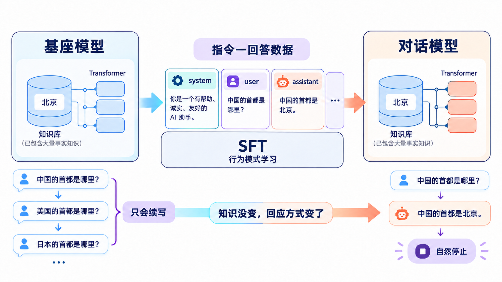
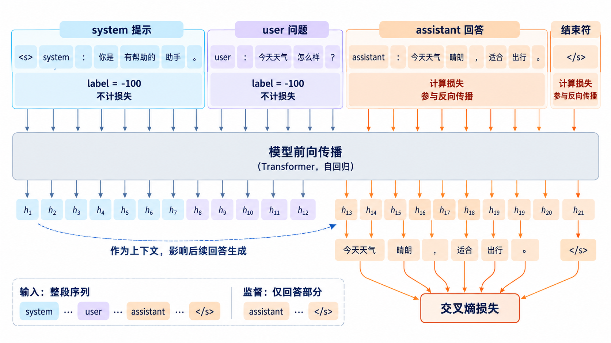
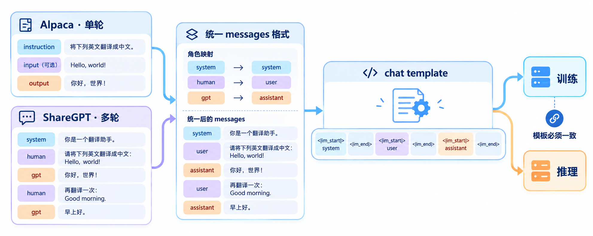
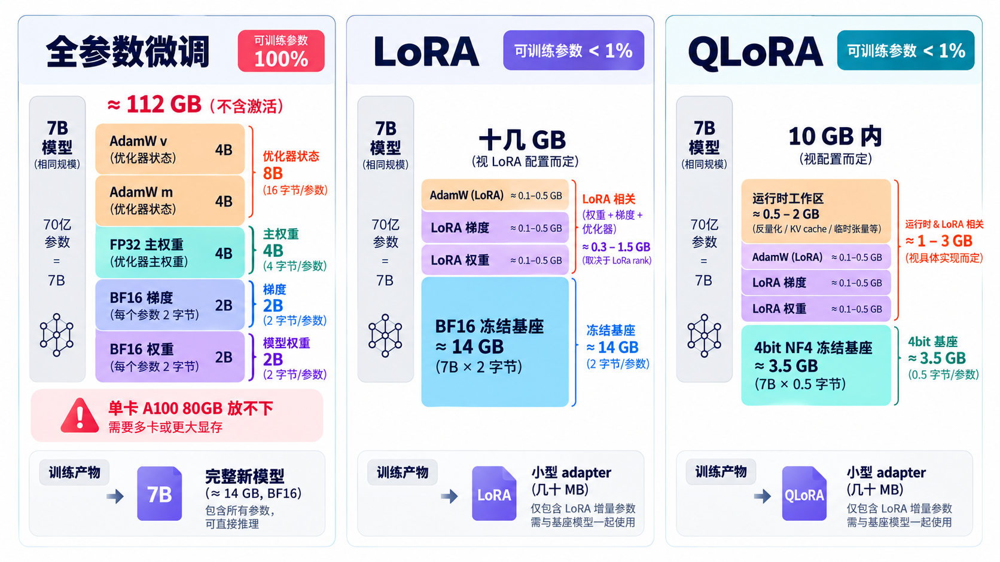
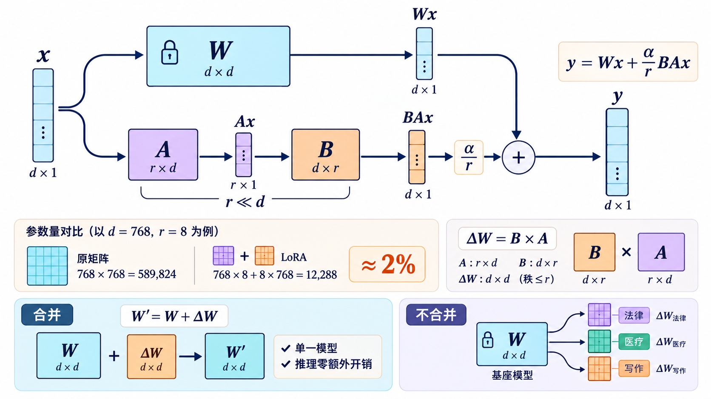
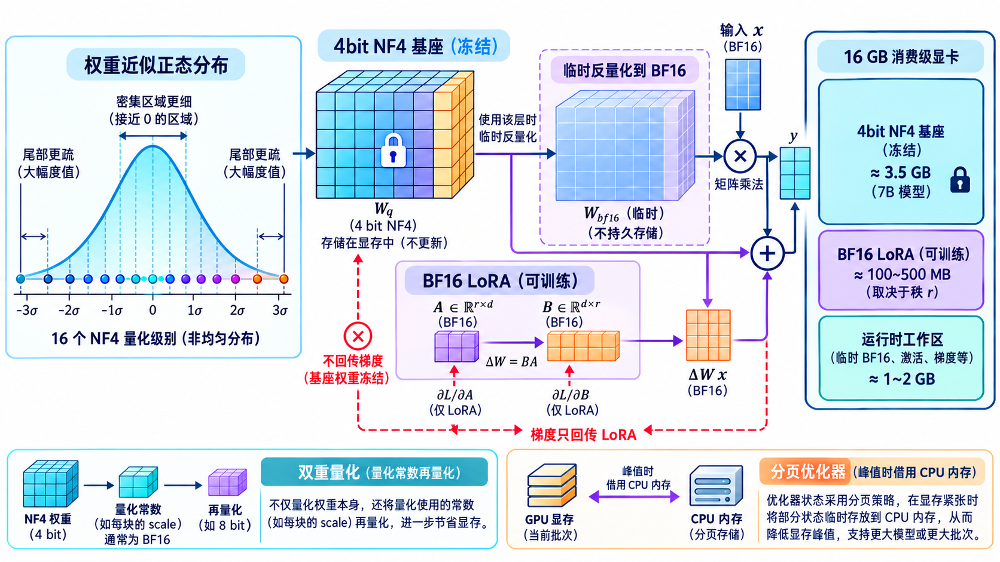
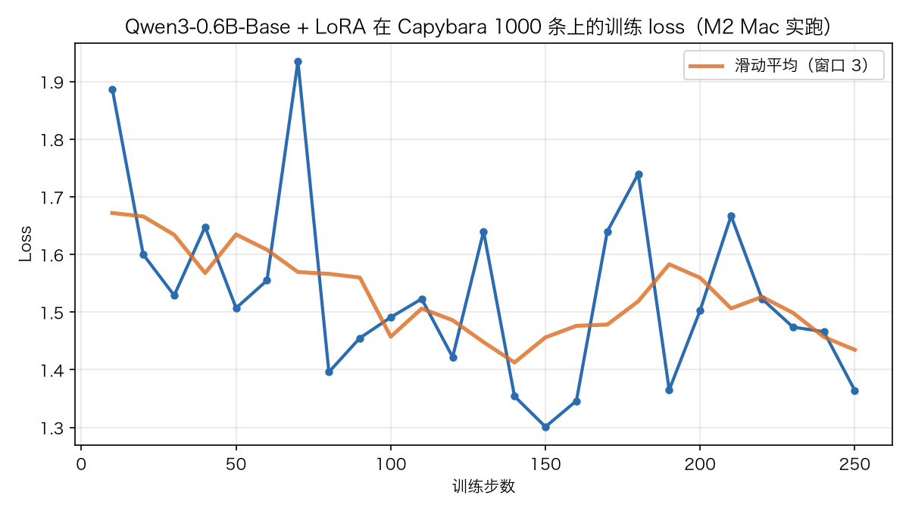

# 学习大模型训练的监督微调：SFT 与 LoRA

在上一篇中，我们把预训练的工程面完整过了一遍：Megatron-LM 和 DeepSpeed 这类框架如何用张量并行、流水线并行把几千亿参数的训练摊到成百上千张卡上，以及 Scaling Law 如何指导我们在算力预算内分配模型大小和数据量。到此为止，预训练这条线就收尾了，它的产出物是一个**基座模型（base model）**。

基座模型有一个鲜明的特征：它只会续写，不会对话。你问它一个问题，它不一定回答，可能顺着你的问题继续往下编，因为在预训练语料里，一个问题后面跟着的往往还是问题。我们在《大模型推理》系列里用的 Qwen3-0.6B 这种开箱即聊的模型，其实都经过了后训练（Post-Training）的加工。今天我们就来学后训练的第一站：**监督微调（Supervised Fine-Tuning，简称 SFT）**，以及和它形影不离的**低秩适配（Low-Rank Adaptation，简称 LoRA）**。

## 从基座模型说起

先用一个具体的例子感受一下基座模型和对话模型的差别。同样输入一句话：

```text
输入：中国的首都是哪里？

基座模型的输出可能是：
中国的首都是哪里？美国的首都是哪里？日本的首都是哪里？
（它把输入当成了某篇文章的片段，继续往下续写）

对话模型的输出：
中国的首都是北京。
```

> 上面的基座模型输出是示意。用 Qwen3-0.6B-Base 实测，它其实已经能给出正确答案，但答完不收尾：要么把车轱辘话一遍遍重复，要么自问自答继续往下编。所以更准确的差别是，基座模型答完停不下来，对话模型答完就干净地停下。

整个过程可以画成这样：



两者的差异不在知识量。基座模型在预训练时早就见过海量关于北京的知识，它缺的不是知识本身，而是对什么时候该给出回答的把握。预训练的目标只有一个，就是我们之前学习过的目标函数 Next Token Prediction，模型学到的是文本的统计规律，而不是问答的交互格式。

把基座模型变成对话模型的过程，叫做**指令微调（Instruction Tuning）**，它是监督微调在对话场景下的具体形态。模型是从数据里学规律的，所以指令微调就是给它看大量的指令-回答配对数据，让它学会看到问题就给出回答这个模式。

## 监督微调

和预训练相比，SFT 的**训练目标完全一样**，还是 Next Token Prediction，还是交叉熵损失。变的是两样东西。

第一样是数据。预训练用的是海量无标注文本，SFT 用的是人工或机器构造的指令-回答配对数据，量级从万亿 token 缩到几千到几百万条样本。

第二样是损失的计算范围。一条 SFT 样本由两部分拼成：提示部分（system、user 的问题）和回答部分（assistant 的回复）。训练时整段序列都会输入模型，但**只对回答部分的 token 计算损失**，提示部分的损失会被屏蔽掉。这个技巧叫**损失掩码（loss mask）**。



为什么要掩掉提示部分呢？这是因为我们关心的是模型生成回答的能力。提示部分在每个样本里各不相同，对它算损失既浪费，又会让模型去拟合用户提问的分布，那不是我们要的行为。掩码的实现很简单：把提示部分 token 的标签设为 -100，PyTorch 的交叉熵损失默认会忽略这个值。

> 也有研究专门探讨过提示部分要不要算损失。Huerta-Enochian 和 Ko 的论文 [Instruction Fine-Tuning: Does Prompt Loss Matter?](https://arxiv.org/abs/2401.13586) 系统扫了提示损失的权重，发现短回答任务上给提示部分保留一个很小的损失权重反而效果更好，但主流做法仍是只算回答部分。

## 两种常见的数据格式

SFT 数据集在实际使用中沉淀出了两种主流格式。

### Alpaca 格式：单轮指令

斯坦福的 [Alpaca](https://github.com/tatsu-lab/stanford_alpaca) 项目用的格式非常简单，每条样本三个字段：

```json
{
  "instruction": "把这句话翻译成英文",
  "input": "学习永无止境",
  "output": "Learning never ends."
}
```

`instruction` 描述要做什么，`input` 是可选的输入内容（不需要输入的任务就留空），`output` 是期望的回答。这种格式覆盖的是单轮问答场景，一条样本就是一次完整的交互。

### ShareGPT 格式：多轮对话

ShareGPT 格式来自同名的 ShareGPT 网站（已关停），那是个让用户公开分享 ChatGPT 对话的站点。2023 年 [Vicuna 项目](https://lmsys.org/blog/2023-03-30-vicuna/)用从上面收集的约 7 万条真实对话微调出模型，这个数据格式就随之流行开来。它用消息列表表示多轮对话：

```json
{
  "conversations": [
    {"from": "system", "value": "你是一个乐于助人的助手。"},
    {"from": "human", "value": "帮我写一句关于秋天的诗"},
    {"from": "gpt", "value": "秋风起，叶落知多少。"},
    {"from": "human", "value": "再写得伤感一点"},
    {"from": "gpt", "value": "满目秋声里，故人独不归。"}
  ]
}
```

`from` 标记说话角色，`value` 是该角色说的内容。现在主流训练框架（TRL、LLaMA-Factory、Axolotl）都同时支持这两种格式，而且通常会先统一转成 OpenAI 风格的 `messages` 列表，再套用模型自带的**聊天模板（chat template）**渲染成最终文本。聊天模板在推理系列的《学习大模型推理的分词：从文本到 Token》一篇里专门学过：用户消息进模型前会被包成带角色标记的对话格式，比如 Qwen 系列用 `<|im_start|>` 和 `<|im_end|>` 包裹每轮发言。当时我们关心的是推理时怎么包，今天反过来了，训练时用的模板必须和推理时一致，否则模型会不认识自己见过的格式。



## 指令数据从哪来

数据是 SFT 的核心，来源大致有三条路。

* **人工标注**：找标注员写问题、写回答，质量最高，成本也最高，一条几块钱很正常，百万级数据量就是几百万的预算
* **Self-Instruct**：2022 年华盛顿大学提出的方法（[Self-Instruct 论文](https://arxiv.org/abs/2212.10560)），先准备一小批人工写的种子任务，让强模型照着样子自动生成新任务和新回答，再用规则过滤掉低质量结果。Alpaca 的 5.2 万条数据就是这么来的，生成成本只有几百美元的 API 费
* **蒸馏强模型**：直接拿 GPT 或 OPUS 这类顶级模型的回答当训练目标，让小模型去模仿。ShareGPT 数据本质上也是蒸馏的产物。代价是回答里会带上强模型的口癖和错误，而且有服务条款上的合规风险

数据量方面，一个流传很广的误区是越多越好。Meta 的 **LIMA** 论文 [Less Is More for Alignment](https://arxiv.org/abs/2305.11206) 给出了反例：只用 1000 条精挑细选的样本微调 65B 的 LLaMA，在人评里就能和用 5.2 万条数据的 Alpaca-65B 打得有来有回，甚至在相当一部分对比中不输给 GPT-4。作者据此提出了 **表层对齐假说（Superficial Alignment Hypothesis）**：模型的知识和能力几乎全在预训练阶段学到，对齐阶段教给它的主要是用什么格式、调用哪部分知识来回应，所以少量高质量、多样化的数据就够了。

> 这个假说对实践的指导很直接：与其堆几十万条良莠不齐的蒸馏数据，不如花心思挑几千条覆盖广、风格一致的精选数据。


## 全参微调的显存开销

数据准备好了，还得有显卡把训练跑起来。如果沿用预训练的方式做**全参数微调（Full Fine-Tuning）**，显存开销和《学习大模型训练的显存管理与混合精度》一篇算过的一模一样：以混合精度训练为例，每个参数背后跟着 BF16 权重、BF16 梯度、FP32 主权重、AdamW 的两个动量状态，合计约 16 字节。一个 7B 模型就是：

```text
7 × 10^9 参数 × 16 字节 ≈ 112 GB
```

这还没算激活值，这也意味着消费级显卡完全没戏，连单张 A100（80 GB）都放不下。全参微调基本上是预训练级别的硬件门槛，这正是参数高效微调方法兴起的背景。



## LoRA：只学一个低秩的增量

**LoRA（Low-Rank Adaptation，低秩适配）** 是微软在 2021 年提出的方法，这篇 [LoRA 论文](https://arxiv.org/abs/2106.09685) 观察到，微调时权重的变化量虽然维度很大，但本质上信息量不高，可以用一个低秩矩阵来近似。

要理解 LoRA，得先知道矩阵的**秩（rank）**是什么。可以把矩阵的每一行看成一条信息，秩就是这些行里真正独立的条数。举个例子：

```text
M = [1 2]
    [2 4]
```

这个矩阵有 2 行，但第二行只是第一行的 2 倍，没有带来任何新信息，真正独立的只有 1 条，所以它的秩是 1。矩阵可以很大，但如果里面的行互相抄来抄去、全是重复信息，秩照样很小。

秩之所以重要，是因为线性代数里有个定理：秩为 r 的矩阵，一定可以拆成两个小矩阵的乘积，一个 d × r 的矩阵乘一个 r × d 的矩阵。比如上面这个秩 1 的矩阵就能拆成：

```text
[1 2]   [1]
[2 4] = [2] × [1 2]
```

左边 2 × 1 的矩阵乘右边 1 × 2 的矩阵，拼回来正好是原矩阵。这就是 LoRA 的全部数学基础：如果 ΔW 的秩真的是 r，把它拆成两个小矩阵不是近似，而是严格的相等。参数量为什么能省也一目了然：原矩阵有 d × d 个数，两个小矩阵加起来只有 2 × d × r 个，r 越小省得越多。

具体做法是把原来的权重矩阵 W 完全冻结，在它旁边并联一个增量 ΔW，并把 ΔW 分解成两个小矩阵的乘积：ΔW = B × A。A 的形状是 r × d，B 的形状是 d × r，其中 r 是秩，远小于 d。前向时输入 x 同时走两路，输出相加：



这里的 A 一般用随机高斯初始化，B 直接置零，所以 ΔW 一开始就是 0，训练的起点恰好是基座模型本身。

来算一下参数量。假设原矩阵是 768 × 768，取 r = 8：

```text
全量更新：768 × 768 = 589,824 个参数
LoRA 增量：768 × 8 + 8 × 768 = 12,288 个参数
```

可训练参数量只有原来的 2% 左右。实际使用时，LoRA 通常只加在注意力层的 Q、K、V、O 四个投影矩阵上，一个 7B 模型的 LoRA 可训练参数一般只有几千万，占总参数量的 1% 以下。优化器状态和梯度只针对这些小矩阵，显存开销从上百 GB 降到十几 GB 的级别。论文里有一个 GPT-3 175B 用 LoRA 微调的例子，可训练参数最少只有 470 万，checkpoint 从 350 GB 缩到 35 MB，显存从 1.2 TB 降到 350 GB，训练还快了 25%。

LoRA 还有两个超参数要调：

* **r（秩）**：增量的表达能力上限。论文试了 1 到 64 几个档位，发现同时调 Q 和 V 时 r=1 就够用，开到 64 也没有额外收益，作者因此判断更新矩阵的内在秩可以非常小。实践中 8 到 64 是常见起点，任务和预训练分布差得特别远时才需要开大
* **alpha（缩放系数）**：实际生效的增量会乘上 alpha / r 的系数。alpha 取 16、r 取 8，增量就放大 2 倍，相当于一个独立于 r 的学习率调节旋钮

由于 W 自始至终不动，训练完的 LoRA 权重可以选择**合并（merge）**回原权重得到一个新模型，推理时零额外开销；也可以不合并，把一份几 MB 的适配器文件挂在基座上按需加载，一个基座模型配多个适配器做多任务。

## QLoRA：再把基座压到 4bit

LoRA 解决了优化器状态的开销，但冻结的基座权重本身还得全精度加载，7B 的 BF16 权重就要 14 GB。**QLoRA** [论文](https://arxiv.org/abs/2305.14314)在 LoRA 的基础上又进一步：把基座权重量化到 4bit 存储，训练时只在用到的时候临时反量化回 BF16 参与计算，梯度只回传到 LoRA 的小矩阵上。

QLoRA 用的是一种叫 **NF4（4-bit NormalFloat，4 位正态浮点）** 的数据类型。它的出发点是预训练权重近似服从零均值的正态分布，所以把 16 个量化档位按标准正态分布的分位点摆放，在权重密集的地方分得更细，论文证明了它是这类数据上信息论意义最优的 4bit 类型。再配上**双重量化**（对量化常数本身再量化一次）和**分页优化器**（显存不够用时，把优化器状态自动挪到内存里顶着），显存门槛大幅下降：33B 模型可以在 24 GB 的消费级显卡上 12 小时内微调完，65B 模型也从超过 780 GB 压到了单张 48 GB 显卡能装下的程度。



那么量化训练的效果会不会打折呢？论文用 Guanaco 系列回答了这个问题：在 Open Assistant 的 9,209 条精选数据上 QLoRA 微调出的 Guanaco-65B，在 Vicuna 评测上达到了 ChatGPT 的 99.3%，说明 4bit 基座加 LoRA 的组合并不输全精度微调。

## 动手实战：用 TRL 微调基座模型

概念讲完，我们动手微调一个真实模型。工具链用 Hugging Face 的 [TRL](https://github.com/huggingface/trl)，它提供的 `SFTTrainer` 把数据格式化、loss mask、聊天模板这些琐事都封装好了；LoRA 部分用同门的 [PEFT](https://github.com/huggingface/peft) 库（Parameter-Efficient Fine-Tuning，参数高效微调工具的集合）。

基座模型选 [Qwen/Qwen3-0.6B-Base](https://huggingface.co/Qwen/Qwen3-0.6B-Base)，注意不是 Qwen3-0.6B，后者是已经后训练过的对话模型，拿它做演示就看不到微调前后的差别了。数据集用 TRL 官方的 `trl-lib/Capybara`，它是 ShareGPT 风格的多轮对话数据，直接就是 `messages` 列表格式。

> 阅读 [Qwen3 的技术报告](https://arxiv.org/abs/2505.09388) 时发现一个有趣的点，Qwen3-0.6B 其实并不是从 Qwen3-0.6B-Base 微调来的。只有 235B、32B 这些旗舰模型使用了四阶段后训练流水线（冷启动 SFT → 推理 RL → 思维模式融合 → 通用 RL）；像 0.6B 这样的小模型走的是蒸馏：先学大模型的输出（off-policy），再让自己生成回答、对齐和老师的输出分布（on-policy），算力只有完整流程的十分之一，效果反而更好。

先说下硬件要求，这个例子的门槛很低：LoRA 微调 0.6B 模型，权重加梯度和优化器状态不到 2 GB，加上激活值，8 GB 显存的显卡就能跑；没有显卡的话，Google Colab 免费版送的 T4（16 GB）也绰绰有余，甚至 Apple Silicon 的 Mac 用 MPS 后端也能跑通。不过**跑通**和**跑完**是两回事：Capybara 全量 15,806 条，按我们实测的速度推算，M2 上跑完一个 epoch 要十几个小时，Colab 的 T4 估计 2~3 小时，4090 级别的显卡 1 小时以内。所以演示时可以不喂全量数据，取几百条的子集就能看到 loss 往下走。下面的代码就是在我的这台 16 GB 内存的 MacBook M2 上跑的：

```python
import torch
from datasets import load_dataset
from peft import LoraConfig
from transformers import AutoModelForCausalLM
from trl import SFTConfig, SFTTrainer

model_id = "Qwen/Qwen3-0.6B-Base"

# 1. 加载数据集，每条样本是 messages 列表，取前 1000 条做演示
dataset = load_dataset("trl-lib/Capybara", split="train").select(range(1000))

# 2. 显式加载模型，再传给 SFTTrainer
model = AutoModelForCausalLM.from_pretrained(model_id, dtype="bfloat16")

# 3. LoRA 配置：秩、缩放系数、作用模块
peft_config = LoraConfig(
    r=16,
    lora_alpha=32,
    lora_dropout=0.05,
    target_modules=["q_proj", "k_proj", "v_proj", "o_proj"],
    task_type="CAUSAL_LM",
)

# 4. 训练配置
training_args = SFTConfig(
    output_dir="./qwen3-0.6b-base-sft",
    per_device_train_batch_size=1,   # 显存宽裕时可以调大
    gradient_accumulation_steps=4,   # 累积 4 步再更新一次，等效批量 4
    learning_rate=2e-4,
    num_train_epochs=1,              # 1000 条 ÷ 等效批量 4 = 250 步
    logging_steps=10,
    max_length=512,                  # 截断超长样本，省显存省时间
    report_to="none",
)

# 5. 组装并启动训练
trainer = SFTTrainer(
    model=model,
    args=training_args,
    train_dataset=dataset,
    peft_config=peft_config,
)
trainer.train()
trainer.save_model("./qwen3-0.6b-base-sft/final")
```

> 版本提示：上面的代码是基于 TRL 0.x 实测的。最新的 TRL 1.x 在损失计算上改用了融合算子，底层依赖 triton 这个内核库，而 triton 目前没有 macOS 版本，Mac 用户安装时记得指定 `trl<1`。

我们来细看下这段代码，一共分为五步：

1. **加载数据集**：`load_dataset` 取了 Capybara 的前 1000 条做演示。数据不用手动格式化，`SFTTrainer` 检测到 `messages` 字段后会自动套用模型的聊天模板，把多轮对话渲染成带 `<|im_start|>` 标记的文本
2. **显式加载模型**：模型先用 `from_pretrained` 加载成对象，再传给 `SFTTrainer`。`SFTTrainer` 也支持直接传模型名，但是我在 Mac 上实测时发现加载权重时会崩溃，因此改成了显式加载（后来才发现是 transformers 的[已知 BUG](https://github.com/huggingface/transformers/issues/48029)，设 `HF_DEACTIVATE_ASYNC_LOAD=1` 关掉异步加载也能绕开）。dtype 用 `bfloat16` 是因为 Qwen3 的 checkpoint 本来就是 BF16 存的，按原精度加载最自然，还能省一半内存
3. **LoRA 配置**：`r=16` 是秩，`lora_alpha=32` 是缩放系数，`target_modules` 指定 LoRA 加在哪些模块上，这里加在注意力的四个投影上。想省事也可以填 `all-linear`，给所有线性层都挂上，QLoRA 论文就发现所有线性层都挂上才能追平全量微调的效果
4. **训练配置**：`gradient_accumulation_steps` 是我们之前学过的梯度累积，显存放不下大批量时，把小批量的梯度累积若干步再做一次参数更新，数学上等效于大批量训练。学习率 2e-4 比预训练常用的值大得多，因为可训练参数是全新初始化的小矩阵，需要更大的步长。另外有一点要注意的是，TRL 默认是对整条序列计算损失的，这和前面说的主流做法正好相反，LLaMA-Factory、Axolotl 这些框架默认都会掩掉提示部分，如果想在 TRL 里想只对 assistant 部分算，可以在 `SFTConfig` 里加一个 `assistant_only_loss=True` 参数，这里我们这个演示没有开，整条序列一起算效果也还好
5. **组装并启动训练**：`SFTTrainer` 把模型、训练配置、数据集、LoRA 配置组装到一起，再通过 `trainer.train()` 启动，训练完保存适配器

如果显存还是紧张，可以把模型加载换成 4bit 量化，上面这套代码就变成了 QLoRA，其余部分完全一样：

```python
from transformers import BitsAndBytesConfig

bnb_config = BitsAndBytesConfig(
    load_in_4bit=True,                        # 基座权重按 4bit 存储
    bnb_4bit_quant_type="nf4",                # 量化类型用 NF4
    bnb_4bit_compute_dtype=torch.bfloat16,    # 计算时临时反量化回 BF16
    bnb_4bit_use_double_quant=True,           # 双重量化，再省一点
)

model = AutoModelForCausalLM.from_pretrained(model_id, quantization_config=bnb_config)
```

> 量化依赖 [bitsandbytes](https://github.com/TimDettmers/bitsandbytes) 这个库实现，它从 0.50 版本起也支持了 Apple Silicon（MPS），所以 Mac 上同样能跑，只是比 CUDA 慢不少。

训练跑起来后，终端里会持续打印 loss 日志，下面是我们实跑的输出（中间做了省略）：

```text
{'loss': '1.887', 'grad_norm': '0.7632', 'learning_rate': '0.0001928', 'epoch': '0.04'}
{'loss': '1.529', 'grad_norm': '0.8053', 'learning_rate': '0.0001768', 'epoch': '0.12'}
{'loss': '1.507', 'grad_norm': '0.6977', 'learning_rate': '0.0001608', 'epoch': '0.2'}
{'loss': '1.396', 'grad_norm': '0.5859', 'learning_rate': '0.0001368', 'epoch': '0.32'}
...
{'loss': '1.301', 'grad_norm': '0.6196', 'learning_rate': '8.08e-05', 'epoch': '0.6'}
{'loss': '1.503', 'grad_norm': '0.9382', 'learning_rate': '4.08e-05', 'epoch': '0.8'}
{'loss': '1.474', 'grad_norm': '0.7348', 'learning_rate': '1.68e-05', 'epoch': '0.92'}
{'loss': '1.364', 'grad_norm': '0.6577', 'learning_rate': '8e-07', 'epoch': '1'}
```

把这 25 个记录点画成曲线更直观，橙色是滑动平均的趋势线：



这是我在 Mac 上实跑的记录：1000 条数据跑满一个 epoch 共 250 步，约 48 分钟，loss 从 1.89 降到 1.36。原始曲线（蓝色）抖动得厉害，但趋势线（橙色）基本一路向下，小批量训练下这种波动很正常。

训练完成后保存下来的不是完整模型，而是一个 `adapter_model.safetensors` 加几个配置文件，我们训出来的这个只有 18 MB。用 PEFT 把它挂回基座，就能对比微调前后的差别：

```python
import torch
from transformers import AutoModelForCausalLM, AutoTokenizer
from peft import PeftModel

model_id = "Qwen/Qwen3-0.6B-Base"

# 基座模型 + LoRA 适配器
base = AutoModelForCausalLM.from_pretrained(model_id, dtype="auto")
model = PeftModel.from_pretrained(base, "./qwen3-0.6b-base-sft/final")
tokenizer = AutoTokenizer.from_pretrained(model_id)

# 按 Qwen 的聊天模板手工拼提示词
prompt = "<|im_start|>user\n请用一句话解释什么是机器学习<|im_end|>\n<|im_start|>assistant\n"
inputs = tokenizer(prompt, return_tensors="pt")

def gen(m):
    with torch.no_grad():
        out = m.generate(**inputs, max_new_tokens=80,
                         do_sample=True, temperature=0.7, top_p=0.8, top_k=20)
    # 只解码新生成的部分
    return tokenizer.decode(out[0][inputs["input_ids"].shape[1]:], skip_special_tokens=False)

print("=== 微调前 ===")
print(gen(base))

print("=== 微调后 ===")
print(gen(model))
```

用同一个问题问微调前后的两个模型，下面是我们实跑出来的真实输出：

```text
问题：请用一句话解释什么是机器学习

微调前（基座模型）：
请用一句话解释什么是机器学习insic
请用一句话解释什么是机器学习insic
……（反复复述问题本身，还夹带乱码，根本没有要回答的意思）

微调后（SFT + LoRA）：
机器学习是一种人工智能技术，它使计算机能够从数据中学习并改进其性能，
而无需明确编程。
```

对比非常直观，变化不在知识，0.6B 的小模型本来就知道机器学习是什么；变化在行为模式，它学会了听到问题就给出回答。不过也有一说一，微调后的模型给出回答之后，继续生成又开始编造新一轮对话、夹带乱码，没有学会在结束符处干净地停下。1000 条数据的量毕竟还是太小，数据量和步数给足了才能学会收放自如。

## 第二个实战：给对话模型换风格

上面的实战教基座模型学会对话，是从零到一。其实社区里更常见的玩法是**继续微调一个已经会聊天的模型**。Qwen3-0.6B 这样的对话模型完全可以继续 SFT，典型的场景有这么几类：

* **风格迁移**：把回复改成特定人设或口癖，比如萝莉风、猫娘风、严谨的法律文书风。教的不是新知识，而是一种说话方式，正好印证 LIMA 的表层对齐假说
* **领域适配**：医疗、法律、客服这些垂直场景，教的是领域的表达习惯和业务知识
* **输出格式定制**：强制 JSON 输出、固定模板回答，工程集成里很常见

继续微调对话模型有三个注意点：

1. **聊天模板必须和它训练时用的完全一致**，因为它就是在 `<|im_start|>` 这套格式上训出来的，换了格式等于自废武功
2. **学习率和步数要克制**，它已经有对话能力了，步子太大会把通用能力训丢（这叫灾难性遗忘），风格类微调一个 epoch 通常就够
3. **数据风格要统一**，几百条精选比几千条混杂的效果好，混进风格不一致的样本，模型学出来就是四不像

我们拿风格迁移练个手，把 Qwen3-0.6B 的回复改成萝莉风。先准备风格数据，每条还是 `messages` 列表，assistant 的回答统一用目标风格手写：

```json
{"messages": [{"role": "user", "content": "今天天气怎么样？"}, {"role": "assistant", "content": "唔……让人家看看窗外哦～今天太阳公公好精神呀，最适合出去玩啦！"}]}
{"messages": [{"role": "user", "content": "我考试没考好"}, {"role": "assistant", "content": "欸？没、没关系的啦！下次再努力就好了嘛～人家给你加油哦！"}]}
{"messages": [{"role": "user", "content": "帮我讲个笑话吧"}, {"role": "assistant", "content": "好呀好呀～有一天小虾米问妈妈：妈妈妈妈，我为什么这么弯呀？妈妈说：因为你在笑呀！嘻嘻，好不好笑？"}]}
```

准备几十到几百条这样的样本，存成 `loli_style.jsonl`（每行一条 JSON），然后把上面的训练代码改三处就能跑：

```python
# 改动 1：模型换成对话模型 Qwen3-0.6B
model = AutoModelForCausalLM.from_pretrained("Qwen/Qwen3-0.6B", dtype="auto")

# 改动 2：数据集换成本地的风格数据
dataset = load_dataset("json", data_files="loli_style.jsonl", split="train")

# 改动 3：学习率调小，对话模型已经有底子，步子收一点
training_args = SFTConfig(
    output_dir="./qwen3-0.6b-loli-sft",
    per_device_train_batch_size=1,
    gradient_accumulation_steps=4,
    learning_rate=1e-4,              # 比微调基座时小
    num_train_epochs=1,
    logging_steps=10,
    max_length=512,
    report_to="none",
)
```

LoRA 配置和训练流程跟上一个实战完全一样，不用动。这里能看出来 LoRA 的一个妙处：同一个基座，想换什么风格就单独训一个小适配器，改人设不用动原模型，不满意把适配器一卸就恢复原样。

> 风格数据的条数不用多，手写几十条风格统一的样本就能感觉到变化。如果训完发现通用问答能力明显下降，就是学过头了，把学习率减半、步数减少再试。

## 全参微调 vs LoRA

最后把两条路线放在一起对比：

| 对比项 | 全参数微调 | LoRA / QLoRA |
| ---- | ---- | ---- |
| 效果上限 | 最高，适合领域深度适配 | 略低，大多数场景足够 |
| 显存（7B 模型） | 约 112 GB 起 | LoRA 十几 GB，QLoRA 可到 10 GB 内 |
| 可训练参数占比 | 100% | 通常 1% 以下 |
| 训练产物 | 完整新模型，部署直接用 | 小适配器文件，可合并也可热插拔 |
| 多任务场景 | 每个任务一份完整权重 | 一个基座挂多个适配器 |
| 适用场景 | 有算力、追求极致效果 | 个人实验、快速迭代、资源受限 |

简单的经验是：验证想法、做领域适配、个人实验，LoRA 和 QLoRA 是默认选项；只有在大规模数据上做深度领域改造、且卡够多时，才轮到全参微调。

## 小结

今天我们从基座模型的局限出发，把后训练的第一站走完了：

1. **SFT 要解决的问题**：基座模型只会续写不会对话，用指令-回答配对数据继续训练，训练目标仍是 Next Token Prediction，但通过 loss mask 只对回答部分算损失
2. **数据格式与来源**：Alpaca 的单轮三字段、ShareGPT 的多轮对话列表；来源有人工标注、Self-Instruct、蒸馏强模型三条路；LIMA 的实验说明几千条精选数据往往就够
3. **LoRA 的思想**：冻结原权重，给权重矩阵学一个低秩增量 ΔW = B × A，可训练参数降到 1% 以下，显存开销大幅下降，产物可以合并回原模型
4. **QLoRA**：再把基座权重量化到 NF4，单张消费级显卡也能微调 7B
5. **动手实战**：TRL 的 `SFTTrainer` 加 PEFT 的 `LoraConfig`，几十行代码微调 Qwen3-0.6B-Base，在 Mac（M2、16 GB）上实测 1000 条数据跑一个 epoch 约 44 分钟，微调后模型从重复问题变成完整回答问题
6. **继续微调对话模型**：Qwen3-0.6B 这类对话模型可以继续 SFT 做风格迁移、领域适配、格式定制；注意聊天模板必须一致、学习率和步数要克制防止灾难性遗忘、数据风格要统一

SFT 让模型学会了回答，但回答得好不好、安不安全，光看指令数据是管不住的。同一个问题往往有多个都说得通的回答，哪个更讨喜、哪个该拒答，需要引入人类的偏好信号。下一篇我们就来学习 **RLHF：从人类偏好到奖励模型**，看人类反馈是如何通过强化学习塑造模型行为的。

## 参考

* [TRL GitHub 仓库](https://github.com/huggingface/trl)
* [transformers issue #48029：macOS MPS 加载权重的段错误](https://github.com/huggingface/transformers/issues/48029)
* [Qwen3 技术报告](https://arxiv.org/abs/2505.09388)
* [TRL 官方文档：SFT Trainer](https://huggingface.co/docs/trl/sft_trainer)
* [PEFT GitHub 仓库](https://github.com/huggingface/peft)
* [Qwen3-0.6B-Base 模型页面](https://huggingface.co/Qwen/Qwen3-0.6B-Base)
* [斯坦福 Alpaca 项目仓库](https://github.com/tatsu-lab/stanford_alpaca)
* [Vicuna 官方博客：Vicuna: An Open-Source Chatbot Impressing GPT-4](https://lmsys.org/blog/2023-03-30-vicuna/)
* [bitsandbytes 量化库](https://github.com/TimDettmers/bitsandbytes)
* [LoRA 论文：Low-Rank Adaptation of Large Language Models](https://arxiv.org/abs/2106.09685)
* [QLoRA 论文：Efficient Finetuning of Quantized LLMs](https://arxiv.org/abs/2305.14314)
* [LIMA 论文：Less Is More for Alignment](https://arxiv.org/abs/2305.11206)
* [Self-Instruct 论文](https://arxiv.org/abs/2212.10560)
* [Instruction Fine-Tuning: Does Prompt Loss Matter?](https://arxiv.org/abs/2401.13586)
* [ShareGPT 格式说明](https://www.ertas.ai/formats/sharegpt-format)
