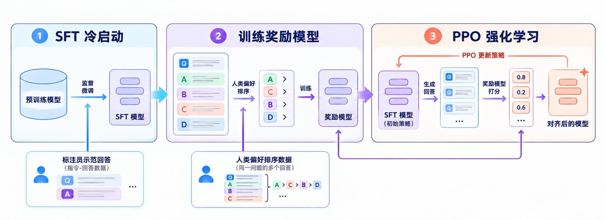
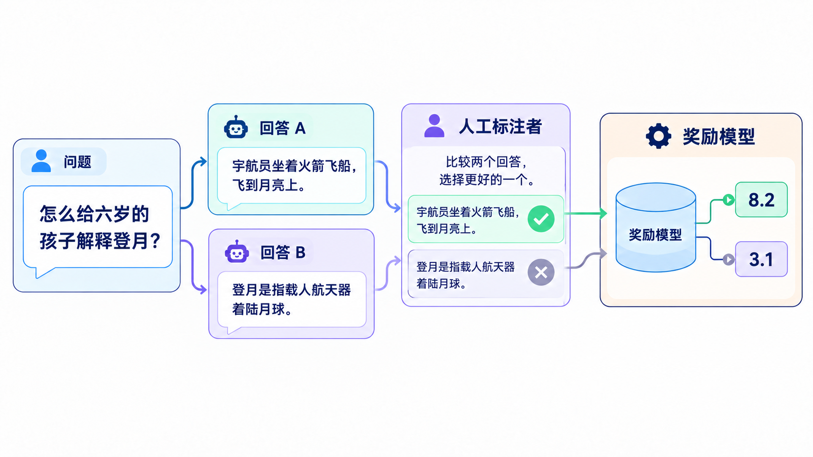
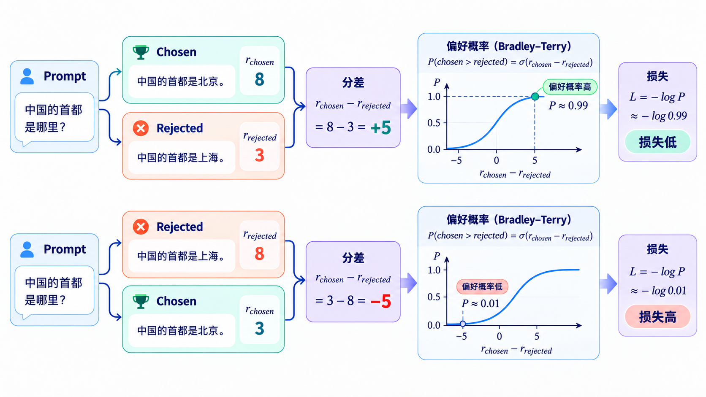
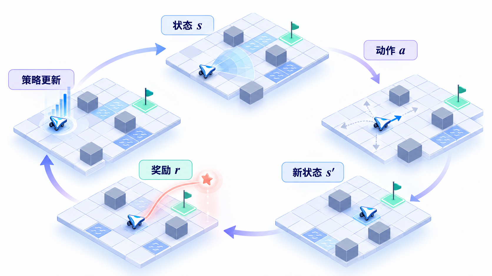
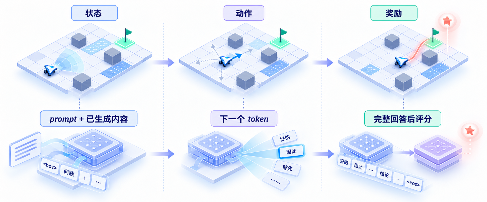
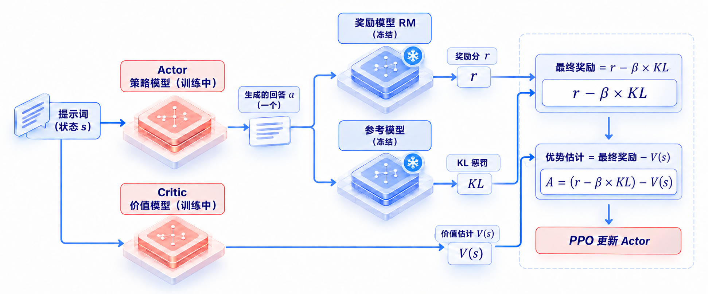
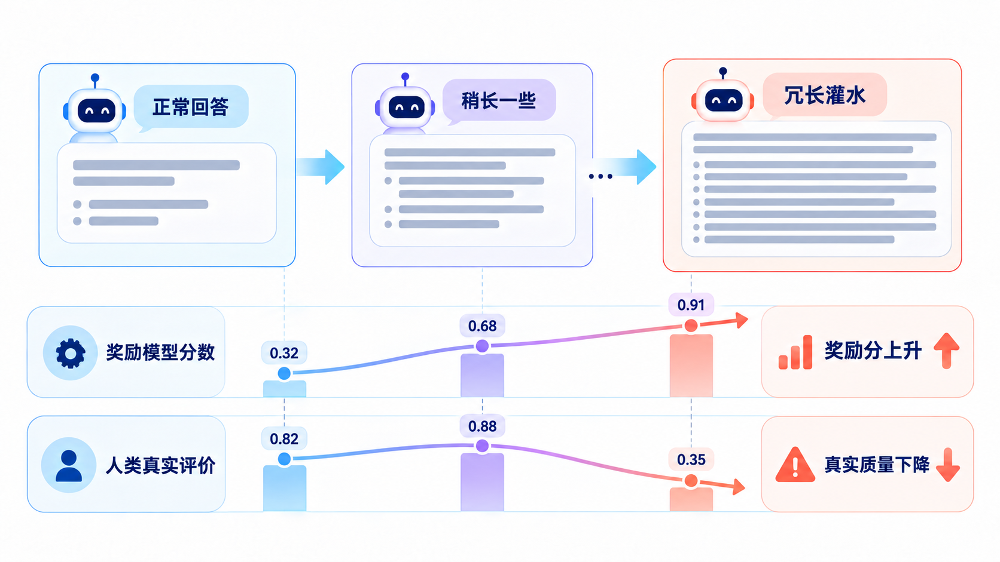
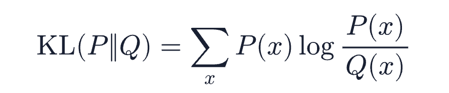
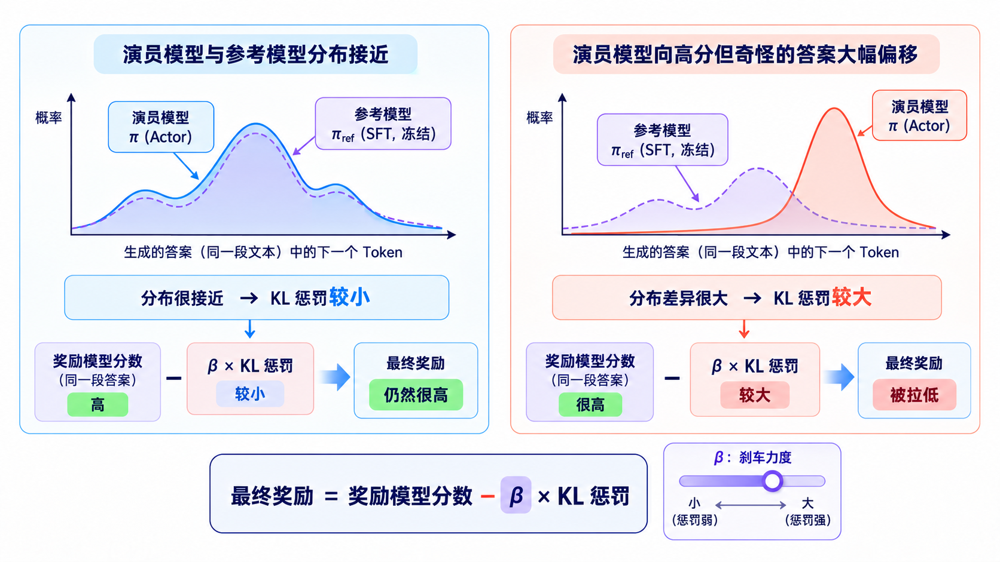
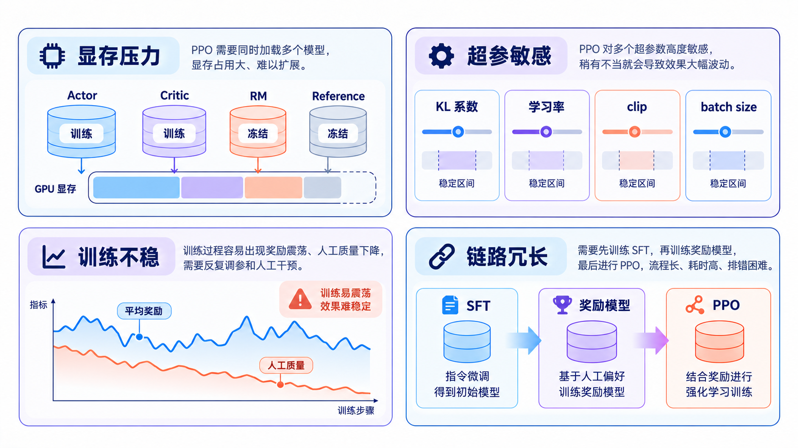

# 学习大模型训练的 RLHF：从人类偏好到奖励模型

在上一篇文章中，我们学习了如何用标注好的问答数据对预训练模型做监督微调，还学习了 LoRA 这种只训练一小部分参数的高效微调方式。经过 SFT，模型学会了模仿标准答案的格式和口吻，从一个只会续写文本的底座模型，变成了一个能按指令回答问题的助手。

不过 SFT 有一个绕不开的局限：它教模型模仿的标准答案只有一个。但同一个问题往往有很多种回答方式，有的准确有的含糊，有的有用有的无聊，甚至有的在胡说八道。好坏之间的差别很微妙，很难写成一条条标准答案让模型去背。还有一点更棘手：对于那些不该回答的有害请求，SFT 最多靠几条例拒样本让模型学着拒绝，模型并不知道拒绝的边界在哪里。对于这些问题，2022 年 OpenAI 发表的 InstructGPT 论文给出了一条新路：不再让模型模仿标准答案，而是让人类告诉模型哪个回答更好，用这个偏好信号来训练模型。这就是 **RLHF（Reinforcement Learning from Human Feedback，基于人类反馈的强化学习）**，也就是用人类偏好作为奖励信号、再用强化学习去优化模型的方法。ChatGPT 之所以在 2022 年底一鸣惊人，背后的关键一步正是它。今天我们就把 RLHF 的完整流程讲清楚。

## SFT 的天花板

我们上一篇讲过，SFT 的训练目标是逐 token 模仿标注员写好的答案，模型学到的是标注员会怎么写。这里面有三个问题：

* **好的标准太多样**：一个开放问题可以有十几种都合格的回答，标注员只能写其中一种，模型模仿这一种，其他的好答案反而被压制了
* **比较比创作容易**：让人写出一个完美答案很难，但让他在两个答案里挑一个更好的很容易。SFT 只利用了前者，把更容易收集的比较信号浪费掉了
* **负样本难覆盖**：有害回答、跑题回答、一本正经胡说八道的回答，形态千变万化，靠人工写例拒样本根本覆盖不过来

可以看到，问题的核心在于：我们其实不缺判断好坏的能力，缺的是把这个判断传递给模型的通道。RLHF 就是搭起这条通道的一套流程。

## RLHF 的三步流程

RLHF 的经典流程来自 OpenAI 2022 年 3 月发表的 [InstructGPT 论文](https://arxiv.org/abs/2203.02155)（Ouyang 等人，NeurIPS 2022）。这篇论文在 GPT-3 的基础上，用人类偏好数据分三步训练出 InstructGPT。最终 1.3B 参数的 InstructGPT 在人类偏好评测里超过了 175B 的原始 GPT-3，参数量差了 100 多倍。

三步流程的整体结构如下图所示：



我们分别看下每一步做什么：

1. **第一步，SFT 冷启动**：就是我们上一篇学过的监督微调。标注员针对一批 prompt 亲手写出理想的回答，用这些数据微调预训练模型，得到一个会按指令行事的 SFT 模型。InstructGPT 这一步用了约 1.3 万个 prompt
2. **第二步，训练奖励模型**：用 SFT 模型对同一批 prompt 各生成多个回答，标注员不写答案，只给这些回答排序，哪个好哪个差。用这些偏好数据训练一个**奖励模型（Reward Model，简称 RM）**，它看一眼回答就能打出一个分数，代替人类做评判。InstructGPT 这一步用了约 3.3 万个 prompt，每个 prompt 配 4 到 9 个模型回答让标注员排序
3. **第三步，PPO 强化学习**：把 SFT 模型当作强化学习里的策略，让它不断生成回答，奖励模型负责打分，用 **PPO（Proximal Policy Optimization，近端策略优化）** 算法更新模型参数，让模型生成的回答拿到的奖励分越来越高

这里第二步和第三步是 RLHF 相对 SFT 真正新增的东西，也是今天的主角。

## 偏好数据与奖励模型

先看第二步，训练奖励模型。这一步又可以拆成三个问题：训练用的偏好数据长什么样，怎么把人类的偏好变成一个可优化的分数，奖励模型本身的结构又怎么搭。我们挨个看。

### 偏好数据长什么样

奖励模型的训练数据是一条条成对的比较。同一个 prompt，模型生成两个回答 A 和 B，标注员选一个更好的。落到数据里就是一条三元组：

```text
{
  "prompt":   "怎么给六岁的孩子解释登月？",
  "chosen":   "宇航员坐着一种叫火箭的飞船……",   # 标注员选中的好回答
  "rejected": "登月是指载人航天器着陆月球……"     # 被比下去的回答
}
```

实际标注时通常不是两两比较，而是一次给 4 到 9 个回答排一个完整的名次，再拆成两两对。InstructGPT 雇了约 40 名标注员来做这件事。这种只需要比较、不需要创作的数据，标注效率高得多，质量也更稳定，毕竟两个人对哪个更好容易达成一致，对标准答案该怎么写则各有各的想法。



### Bradley-Terry 偏好模型

有了成对的数据，奖励模型怎么训练呢？答案是一个 1952 年就有的统计模型，**Bradley-Terry 模型**。它原本是分析象棋选手对战数据的，核心思想是：每个选手有一个实力分，A 赢 B 的概率由两人的分差决定。搬到这里，选手就是回答，实力分就是奖励模型打的分。

具体来说，奖励模型给好回答打分 `r_chosen`，给差回答打分 `r_rejected`，Bradley-Terry 模型认为好回答胜过差回答的概率由分差决定，再过一个 sigmoid 函数（把任意实数压到 0 到 1 之间）变成概率：

```text
P(chosen 优于 rejected) = sigmoid(r_chosen - r_rejected)
```

训练目标就是让标注员选中的那一对概率尽量大，换成损失函数就是：

```text
loss = -log sigmoid(r_chosen - r_rejected)
```

直观理解是，好回答的分必须比差回答高，分差拉得越开，loss 越小。如果模型把好坏打反了，分差为负，loss 就会很大。



如果用 PyTorch 把 loss 写出来，核心代码只有一行：

```python
import torch.nn.functional as F

# r_chosen / r_rejected 是奖励模型对同一 prompt 两个回答的打分，形状都是 [batch]
loss = -F.logsigmoid(r_chosen - r_rejected).mean()
```

### 奖励模型的结构

奖励模型不需要从零训练。标准做法是在 SFT 模型的基础上改造：Transformer 主体整个保留，只换掉最后一层。

回忆一下推理系列《学习大模型推理的前向传播》讲过的内容：模型跑完所有 Transformer 层之后，每个位置会得到一个隐状态向量，维度是 hidden_size；最后还有一个**词表投影头**，把隐状态投影成 vocab_size 维的 logits（词表里每个词的原始打分），再过 softmax 得到下一个 token 的概率分布。这个词表投影头是一个 hidden_size × vocab_size 的大矩阵，以 hidden_size 4096、词表 15 万计算，它一个就有 6 亿多参数。

奖励模型的改造，就是把这个大矩阵整个丢掉，换成一个 hidden_size × 1 的小线性层，一般叫**打分头（score head）**。它只有几千个参数，随机初始化从零学起；Transformer 主体则继承 SFT 模型的权重，自带预训练和 SFT 阶段学到的语言能力，只需要再学下如何把好恶映射成一个分数即可。注意继承权重只是给了主体一个好的起点，不是把它冻结住，训练时梯度会流过整个模型，主体的参数一样会更新，奖励模型的训练是一次完整的全量训练。

打分过程用伪代码表示如下：

```python
hidden = backbone(input_ids).last_hidden_state  # [batch, seq_len, hidden_size]，Transformer 主体的输出
scores = score_head(hidden)                     # [batch, seq_len, 1]，每个位置都被打上一个分数
reward = scores[:, -1]                          # 取最后一个位置的标量，作为整条回答的奖励分
```

注意最后一行：序列里每个位置都会被打一个分，但只取最后一个 token 位置的分数作为奖励。因为 decoder 模型的注意力是单向的，每个位置只能看到自己和左边的内容，只有最后一个位置读完了完整的 prompt 和回答，它的隐状态才能代表整条回答的质量。这个位置通常就是 EOS token 所在的地方。

这个改造在代码层面有现成的实现。用 Hugging Face 的 [TRL](https://github.com/huggingface/trl) 库训练奖励模型时，`AutoModelForSequenceClassification` 配上 `num_labels=1` 就会自动完成加载 SFT 权重、丢掉词表投影头、挂上打分头这三件事。完整的训练代码如下：

```python
from transformers import AutoModelForSequenceClassification, AutoTokenizer
from trl import RewardConfig, RewardTrainer

# 从 SFT 模型初始化，num_labels=1 表示输出一个标量分数
model = AutoModelForSequenceClassification.from_pretrained("your-sft-model", num_labels=1)
tokenizer = AutoTokenizer.from_pretrained("your-sft-model")

# 数据集里每条样本包含 chosen 和 rejected 两段对话
trainer = RewardTrainer(
    model=model,
    args=RewardConfig(output_dir="./rm-out", per_device_train_batch_size=4),
    train_dataset=preference_dataset,
    processing_class=tokenizer,
)
trainer.train()
```

> 注意加载时的权重报告里 `score.weight` 会被标记为 MISSING（不在 checkpoint 里），这是预期行为，因为这个头是新加的。

`RewardTrainer` 内部分别对 chosen 和 rejected 跑前向拿到两个分数，用 Bradley-Terry 的 loss 训练。[TRL 官方文档的 RewardTrainer 一节](https://huggingface.co/docs/trl/reward_trainer)有完整的示例，感兴趣的同学可以照着跑一遍。

## PPO 强化学习

奖励模型训好后，接下来用强化学习优化 SFT 模型。这一步用的算法是 PPO，它是 OpenAI 在 2017 年提出的[通用强化学习算法](https://arxiv.org/abs/1707.06347)，在游戏和机器人控制上早就被验证过。不过在具体讲解 PPO 的运作机制之前，我们不妨先来学习下强化学习的基本概念和发展历史。

### 强化学习是什么

**强化学习（Reinforcement Learning，简称 RL）** 是机器学习里和监督学习并列的一大范式。监督学习有标准答案，模型学着逼近答案；而强化学习则没有标准答案，只有一个奖励信号。它的主角叫**智能体（agent）**，在一个环境里不停循环：观察当前的状态（state），采取一个动作（action），环境返回一个奖励（reward）和新的状态，训练目标是把长期累积的奖励做到最大。智能体按什么规则选动作，这个规则就叫**策略（policy）**，它告诉智能体在每种状态下，每个动作各有多大概率被选中。和监督学习最本质的区别也在这里：智能体是在自己的行为里学习，被奖励的行为会越做越多，被惩罚的行为会越做越少。



> 注意这里的智能体是强化学习里的经典概念，和这两年流行的 AI Agent 不是一回事。后者指基于大模型、用 ReAct 和工具调用等技术自主完成任务的系统，是应用层面的叫法；这里的智能体是强化学习框架里的决策主体。两者共用一个词，语境完全不同。

这套框架的历史可以追溯到上世纪五十年代。1957 年 Bellman 提出动态规划，为多步决策问题打下了数学基础；1989 年 Watkins 提出 Q-learning，智能体不需要先搞懂环境怎么运转，靠一次次试错和奖励反馈就能学。强化学习被大众熟知是和深度学习结合之后：2013 年 DeepMind 的 DQN 用神经网络玩 Atari 游戏达到人类水平，2016 年 AlphaGo 战胜李世石，核心技术之一就是强化学习，2017 年 OpenAI 提出的 PPO 则因为训练稳定、容易调参，成了最流行的策略优化算法之一。

把人类偏好当作奖励信号，也不是 InstructGPT 首创。2017 年 OpenAI 和 DeepMind 的研究者合作发表了 [Deep reinforcement learning from human preferences](https://arxiv.org/abs/1706.03741)，最早提出这个方向；2020 年 OpenAI 的 [Learning to summarize from human feedback](https://arxiv.org/abs/2009.01325) 把它用在了文本摘要上；到 InstructGPT，这套流程才被完整搬到指令跟随场景。

把强化学习套到语言模型上，每个概念都能找到对应。状态是 prompt 加上已经生成的内容，动作是生成下一个 token，奖励由奖励模型给出，策略就是语言模型本身，它给词表里每个 token 算出的概率，就是它选每个动作的概率。



强化学习里还有一个概念叫做**局（episode）**，也叫回合，指从初始状态一步步走到终局的完整过程，比如一盘游戏从开始打到结束。对应到语言模型，从 prompt 开始逐个生成 token，直到模型输出结束符，一段回答生成完，一局也就结束了，这时奖励模型才出来给整局的表现打分。注意这里和上面描述的通用循环有个差别：通用框架里奖励可以每走一步给一次，RLHF 的奖励则是稀疏的，中间的每个 token 奖励都是 0，只有整局结束时的最后一个位置才拿得到奖励模型的分数。

### 四个模型一台戏

传统强化学习里其实只有一个模型，就是做决策的策略网络，奖励由环境直接给出（游戏得分的变化、下棋的输赢，都是环境规则里写死的），不需要模型来算。语言模型的 PPO 不一样：奖励要拿奖励模型来算，训练过程要稳定还得再配两个辅助模型，算下来一共要同时加载四个模型，各司其职。

我们按角色逐一介绍：

* **Actor（策略模型）**：真正在训练的模型，用 SFT 模型初始化。它接收 prompt 逐 token 生成回答，每生成一个 token 就是强化学习里的一次动作。四个模型里只有它直接面向最终效果，PPO 的策略梯度也只更新它
* **Reward（奖励模型）**：上一节训好的裁判，参数冻结。它不生成文字，只对完整的回答输出一个标量分数，作为这一局的总奖励
* **Reference（参考模型）**：冻结的 SFT 模型，一份原始快照。它对同一个回答也算出一份 token 概率分布，和 Actor 的分布算 KL 散度，作为惩罚项从奖励里扣掉。作用是当锚点，拴住 Actor 不让它为了刷分跑得太偏
* **Critic（价值模型）**：也在训练的模型，一般用奖励模型初始化。Reward 只在整句写完时打一次分，中间的 token 拿不到分，Critic 的任务就是补上这个空档：对生成过程中的每个中间位置做预估，回答写到这一步，照这个势头写完最终大概能拿多少分

把这四个角色串起来，PPO 的一轮迭代是这样的：Actor 对一批 prompt 生成回答；Reward 给每局打个总分，Reference 逐 token 算出 KL 惩罚，两者合成最终奖励；Critic 对生成过程中的每个状态给出预估分；然后用预估分和实际奖励算出优势，即比平均水平好多少；最后更新 Actor 和 Critic，前者用策略梯度损失，后者用平方误差损失，然后进入下一轮。



用 TRL 的 PPOTrainer 可以把这一步组织起来，四个模型分别对应它的四个参数：

```python
from trl.experimental.ppo import PPOConfig, PPOTrainer

trainer = PPOTrainer(
    args=PPOConfig(learning_rate=1e-5, kl_coef=0.05),
    processing_class=tokenizer,
    model=policy_model,        # 待训练的 Actor
    ref_model=ref_model,       # 冻结的参考模型
    reward_model=reward_model, # 上一步训好的奖励模型
    value_model=value_model,   # Critic，用奖励模型初始化，PPO 中和 Actor 一起训练
    train_dataset=prompt_dataset,   # 只有 prompt，回答由 Actor 现场生成
)
trainer.train()
```

注意这里的训练集只有 prompt。回答不是现成数据，而是 Actor 在每轮训练里现场生成的，这正是强化学习和监督学习的本质区别：模型在自己的行为上学习，而不是在别人的示范上学习。

## 参考模型与 KL 惩罚

上面流程里最不直觉的设计，是 Reference 模型和 KL 惩罚。奖励模型打分不就行了吗，为什么还要拿一个冻结的 SFT 模型拴住 Actor？

原因在于，**奖励模型本身是个不完美的裁判**。它只是在一个有限的偏好数据集上训练出来的近似，对人类偏好的建模一定有盲区。Actor 在 PPO 的驱动下会拼命找奖励模型的漏洞：只要某种输出模式能拿到高分，不管它实际上好不好，Actor 都会大量生产。这种现象有个专门的名字，叫 **奖励黑客（reward hacking）**，也就是模型不去真正提升回答质量，而是去黑掉评分系统。

典型的翻车场面是：模型发现又臭又长的回答分数偏高，就开始疯狂灌水；或者发现某种奇怪的措辞能骗出高分，输出变得前言不搭后语，但奖励分一路飙升。OpenAI 在 2022 年的另一篇论文 [Scaling Laws for Reward Model Overoptimization](https://arxiv.org/abs/2210.10760) 系统研究过这个现象：随着 PPO 优化的推进，奖励模型给的分数持续上涨，但人类对回答的真实评价先升后降，过了某个点，分数再高人类也不认了。



KL 惩罚就是给这个失控过程加的刹车。最终奖励的计算方式是：

```text
最终奖励 = 奖励模型分数 - β × KL(Actor 的回答 || Reference 的回答)
```

其中 **KL 散度（Kullback-Leibler Divergence）** 衡量两个概率分布的差别。它的数学定义是：



先对每种可能的结果 x，算出两个分布给它打分的比值 P(x)/Q(x)，取对数，再乘上 P(x) 做权重，最后把所有 x 的结果加总。它有几个好用的性质。第一，值永远大于等于 0，两个分布完全相同时为 0，差别越大值越大。第二，它不对称，KL(P || Q) 一般不等于 KL(Q || P)，所以它叫散度而不叫距离。第三，看单项就知道它在惩罚什么：如果某个 x 在 P 里概率高、在 Q 里概率低，这一项就是很大的正数，会把 KL 整体拉高。

套回这里的场景：P 是 Actor 的分布，Q 是 Reference 的分布，x 是词表里的 token。Actor 为了刷分跑出的奇怪输出，正是那种在 Actor 眼里概率高，但在原始 SFT 模型眼里概率极低的 token，正好踩中 KL 惩罚最狠的地方，奖励分被扣回去。

另外公式中的系数 β 控制刹车的力度，太松了拴不住，太紧了模型不敢动。OpenAI 在实践中甚至让 β 动态调整，KL 偏高就收紧，偏低就放松。



> 除了 KL 惩罚，InstructGPT 还把一部分预训练梯度混进 PPO 的更新里（论文里叫 PPO-ptx），防止模型在强化学习里把预训练学到的通用能力忘掉。

## 价值模型与 Actor-Critic 架构

四个模型里还有一个模型让人感到困惑，那就是 Critic 模型。它输出的也是分数，那它和 Reward 的分工差别在哪，为什么 PPO 需要两个出分数的模型呢？

差别在于，Reward 给的是绝对分，而光知道绝对分是不够的。比如我们只知道这次回答拿了 7 分，但是我们并不知道这 7 分算好还是坏。如果这类 prompt 平均能拿 6 分，那 7 分值得鼓励；如果平均是 8 分，7 分其实该罚。Critic 提供的就是这个平均分基准，实际分数减去基准，得到的差值就是**优势（Advantage）**，即这次回答比平均水平好多少：

```text
优势 = 实际回报 - Critic 的预估分
```

这里的**实际回报（return）**用的是强化学习的标准说法：每一步拿到的叫奖励，一局下来累计的叫回报。RLHF 的奖励是稀疏的，中间每步只有 KL 惩罚，结尾才有 Reward 的总分，所以一局的回报在数值上正好等于上一节那个最终奖励公式算出来的结果。

PPO 按优势的正负和大小来决定怎么更新 Actor：优势为正就把对应 token 的概率调大，为负就调小，优势越大调整幅度越大。这样一来更新方向更准，梯度的波动也小很多。

Critic 预估的这个平均分，在强化学习里有个专门的名字，叫 **价值函数（value function）**，记作 V(s)：站在状态 s 上往后看，按当前的水平平均还能拿到多少总奖励。它自己不知道真实分数，训练素材就是每一局的实际回报，用平方误差让预估值不断逼近真实值。Actor 每更新一轮，Critic 也要跟着更新，不然基准就落后于 Actor 的最新水平了。

Actor 是演员，负责生成回答；Critic 是评论员，负责给生成过程估分。强化学习里把这种策略加价值的搭配就叫做 **Actor-Critic 架构**，PPO 就属于这个家族。Actor 靠 Critic 的评估改进表演，Critic 靠真实奖励校准评估，两个模型一起训练、一起进步。

> 实际实现里，优势不是只用一步的差值来算，而是用 GAE（Generalized Advantage Estimation，广义优势估计）把多步的预估误差加权平均，在偏差和波动之间取平衡，具体细节可以参考 PPO 的论文。

## 策略模型与价值模型的训练

Reward 打分、Reference 惩罚、Critic 预估，前面这三家做的事最后都要落到一个问题上：Actor 和 Critic 这两个在训练的模型，参数到底怎么更新。它们用的是两个不同的损失，我们分开看。

### Actor 的损失：策略梯度加裁剪

强化学习里更新策略的基本思路是**策略梯度（policy gradient）**：对优势为正的动作，把它出现的概率调大；对优势为负的动作，把概率调小。搬到语言模型上，就是对优势为正的 token，提高模型下次生成它的概率，反之压低。

但直接按这个思路更新有个老毛病，一步容易迈太大。某次更新如果把概率分布改得太猛，模型表现可能一落千丈，训练直接崩掉。PPO 的解法是限制每次更新的幅度。它先定义新旧策略的比值：

```text
ratio = 新策略生成这个 token 的概率 / 旧策略生成这个 token 的概率
```

ratio 大于 1，说明更新后的模型更倾向生成这个 token；小于 1 说明更排斥。PPO 的损失函数是：

```text
pg_loss = -min(ratio × 优势, clip(ratio, 1 - ε, 1 + ε) × 优势)
```

其中 clip 是裁剪，ε 一般取 0.2，意思是 ratio 只有在 0.8 到 1.2 之间才产生梯度，超出的部分被截断。比如优势为正时，新策略把这个 token 的概率提高两成就到头了，再往上提 loss 也不会更小，模型没有动力一步跨太大。这就是 PPO 名字里**近端**（Proximal）的含义：新策略始终不许离旧策略太远，这也是它比早期策略梯度算法稳定的原因。

这个损失需要的三样材料，前面都已经备齐了：

1. 旧策略（更新前的 Actor）对每个 token 的概率，生成回答时顺手记下来
2. 新策略（当前的 Actor）对同样这些 token 的概率，前向重新算一遍
3. 每个 token 的优势，由 Reward、Reference、Critic 三家合算出来

### Critic 的损失：平方误差

Critic 的损失直接得多，就是预估分和真实结果的平方误差：

```text
vf_loss = (预估分 - 实际回报)²
```

仔细看这个差值，它和上面优势的公式只差一个正负号，平方之后正负号消失，所以数值上 vf_loss 就是优势的平方。但同一个量在两处的角色是完全不一样的：在 Actor 的损失里，优势是一个算好的常数，只负责指出更新方向；在这里，这个差值是 Critic 的训练目标，要反向传播把它压小。Actor 那边是用这个差值，Critic 这边是减小这个差值。另外注意，Critic 要对每个 token 位置都做一次预估，所以这个损失是所有位置平方误差的平均，不是只算结尾一个位置。训练目标就是让预估不断逼近真实，Actor 的水平在变，Critic 的基准也得跟着变，这就是它必须参与训练的原因。

### 两个损失，一次更新

TRL 的实现里，Actor 和 Critic 被包进一个模块（PolicyAndValueWrapper），每一步的总损失是两个损失的加权相加：

```text
loss = pg_loss + vf_coef × vf_loss
```

一个优化器对这个总损失做一次更新，两个模型的参数同时变化。两个损失虽然写在一起，梯度却各走各的路：pg_loss 只跟 Actor 的参数有关，反向传播时只流到 Actor；vf_loss 只流到 Critic，两个模型互不干扰。Reward 和 Reference 则全程只在 no_grad 下跑前向，参数冻结。

## PPO 的工程痛点

一路读下来应该能感觉到，这套流程相当复杂，而复杂在工程上就意味着折磨人。实际跑过 RLHF 的团队，大多会吐槽这么几点：

* **显存翻倍再翻倍**：四个模型要同时驻留显存。Actor 要带梯度、优化器状态，Critic 同样要训练，奖励模型和 Reference 虽然只做前向，权重也得完整放进来。7B 模型走一遍 PPO，显存压力远超同尺寸的 SFT，往往需要更多卡做分布式切分
* **超参极其敏感**：KL 系数、学习率、clip 范围、batch size、Critic 的学习率，每一个都能让训练崩掉。同一套配置换个数据集可能就不 work，调参成本很高
* **训练不稳定**：强化学习本身就是出了名的难训，reward hacking、KL 爆炸、loss 曲线乱跳都是家常便饭。很多时候训练跑到一半奖励分还在涨，人工抽查输出质量却发现已经在退化
* **链路长、环节多**：SFT、奖励模型、PPO 是三次完整的训练，前一步的模型是后一步的输入，任何一步没训好都会把误差传导下去，排查问题要在三个环节里逐个定位



可以看到，RLHF 的效果确实好，但代价是引入了一整套强化学习的复杂性。有没有简单一点的方法呢？2023 年斯坦福大学的研究者提出了一个想法：既然偏好数据本身已经包含了好坏的信息，能不能跳过奖励模型、跳过强化学习，直接拿偏好数据去微调模型？这条更简洁的路线叫做 **[DPO（Direct Preference Optimization，直接偏好优化）](https://arxiv.org/abs/2305.18290)**，就是我们下一篇的主角。

## 小结

今天我们学习了 RLHF 的完整流程：

1. **SFT 的局限**：SFT 让模型模仿标注员写的标准答案，但同一个问题的好答案有很多种，只模仿一种反而压制了其他的，而且让人比较两个答案远比写出一个完美答案容易，RLHF 正是从这两点出发的
2. **三步流程**：InstructGPT 的做法是先拿标注员写的示范做 SFT 冷启动，再用人类排序的偏好数据训练奖励模型，最后用 PPO 强化学习优化模型。靠这套流程，1.3B 的 InstructGPT 在偏好评测上超过了 175B 的 GPT-3
3. **奖励模型**：它从 SFT 模型改造而来，把词表投影头换成一个输出单个标量的打分头。训练数据是同一 prompt 下成对的回答比较，用 Bradley-Terry 模型把偏好变成分差，训练目标就是让好回答和差回答的分差尽量拉大
4. **PPO 的四个模型**：Actor 和 Critic 参与训练，Reward 冻结打分，Reference 冻结算 KL 惩罚，四个模型要同时驻留显存
5. **KL 惩罚**：奖励模型是个不完美的裁判，没有 KL 惩罚拴着，Actor 会钻它的空子刷分，输出变得奇怪但分数很高，这就是 reward hacking
6. **两个模型的损失**：Actor 的损失是裁剪后的策略梯度，Critic 的损失是预估分和实际回报的平方误差，TRL 把两个损失加权合并，一次优化器更新同时改两个模型
7. **工程痛点**：显存翻倍、超参敏感、训练不稳、链路冗长

PPO 的这些痛点，其实都在指向同一个问题：为了用好人类偏好，我们真的需要强化学习这一整套重型装备吗？2023 年提出的 DPO 给出了一个漂亮的否定答案，它把奖励模型和 PPO 从流程里拿掉，直接在偏好数据上用一个简单的分类损失训练。再往后，DeepSeek 在 R1 的训练里用的 **GRPO（Group Relative Policy Optimization，组相对策略优化）** 又把 Critic 也省掉了，走上了另一条简化路线。关于偏好对齐的这两次进化，我们下一篇继续学习。

## 参考

* [InstructGPT 论文：Training language models to follow instructions with human feedback](https://arxiv.org/abs/2203.02155)
* [Deep reinforcement learning from human preferences（人类偏好强化学习的开山之作）](https://arxiv.org/abs/1706.03741)
* [Learning to summarize from human feedback（人类反馈用于文本摘要）](https://arxiv.org/abs/2009.01325)
* [PPO 论文：Proximal Policy Optimization Algorithms](https://arxiv.org/abs/1707.06347)
* [奖励模型过度优化论文：Scaling Laws for Reward Model Overoptimization](https://arxiv.org/abs/2210.10760)
* [DPO 论文：Direct Preference Optimization: Your Language Model is Secretly a Reward Model](https://arxiv.org/abs/2305.18290)
* [TRL GitHub 仓库](https://github.com/huggingface/trl)
* [TRL 官方文档：RewardTrainer](https://huggingface.co/docs/trl/reward_trainer)
* [TRL PPOTrainer 源码（experimental.ppo）](https://github.com/huggingface/trl/tree/main/trl/experimental/ppo)
