# 学习大模型训练的 DPO 与 GRPO：偏好对齐的简化与进化

上一篇我们学习了 RLHF 的完整流程：先训一个**奖励模型（Reward Model）** 来模拟人类的偏好打分，再用 **PPO（Proximal Policy Optimization，近端策略优化）** 算法让模型在奖励信号的引导下更新参数。这套流程由 OpenAI 在 InstructGPT 上跑通，是大模型从会续写变成会对话的关键一步。

不过上一篇结尾也提到，PPO 这条路走起来并不轻松。今天我们要看的，是偏好对齐在 PPO 之后演化出的两条新路线：一条走向简化，把奖励模型和强化学习整个绕过去，这就是 **DPO**；另一条走向强化，把 PPO 里最贵的部件砍掉，再配上不需要奖励模型的任务奖励，最终训出了 DeepSeek-R1 这类推理模型，这就是 **GRPO** 和 **RLVR**。

## PPO 痛点回顾

上一篇的结尾我们总结了一些 PPO 的工程痛点，这里回顾一下：

1. **显存翻倍再翻倍**：训练时要同时在显存里放四个模型，正在训练的策略模型和价值模型，加上冻结的参考模型和奖励模型，每个模型都要占一份显存
2. **超参极其敏感**：学习率、KL 惩罚系数、clip 范围、batch 大小，每一项调不好都会明显影响效果
3. **训练不稳定**：强化学习本身就以难调著称，PPO 叠加在大模型上之后，loss 曲线抖动、训练中途崩掉都是家常便饭
4. **链路长、环节多**：SFT、奖励模型、PPO 是三次完整的训练，任何一步没训好都会把误差传导下去

除了这四个工程问题，上一篇在 KL 惩罚一节还讲过一个算法层面的麻烦：奖励模型会被钻空子。策略模型会找到奖励模型的漏洞，靠刷分拿高奖励而不是真正变好，也就是**奖励黑客（reward hacking）**。

仔细看会发现，这些问题或多或少都和奖励模型有关：它要多占一份显存，是训练链路里单独的一环，它训得不够准会加剧训练的不稳定，还会被策略模型钻空子。于是有人开始想，能不能干脆不要它？

## DPO：跳过奖励模型

2023 年，斯坦福的 Rafael Rafailov 等人发表了一篇论文，[Direct Preference Optimization: Your Language Model is Secretly a Reward Model](https://arxiv.org/abs/2305.18290)，翻译过来是「你的语言模型其实就是一个奖励模型」。这篇论文发表在 NeurIPS 2023 上，提出的方法叫 **DPO（Direct Preference Optimization，直接偏好优化）**。

DPO 的核心思想是：偏好数据和最优策略之间存在数学上的闭式关系，奖励模型其实可以被消掉。论文第 4 节和附录里有完整的数学推导，我们不妨来看看，一共四步。

**第一步，写出 RLHF 的优化目标**。上一篇讲过，PPO 这一步要最大化奖励，同时用 KL 散度约束模型别偏离参考模型太远。用 x 表示输入的 prompt、用 y 表示回答，写成目标就是：

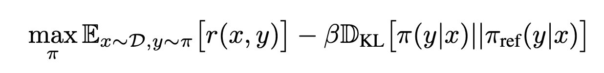

其中 max 下面的 π 表示对所有可能的策略求最大值，π 在强化学习里专门表示策略，E 是期望，下标 x~D 表示 prompt 从数据集 D 里取，y~π 表示回答由当前策略生成；中括号中的 r(x,y) 是回答 y 相对于问题 x 拿到的奖励；π(y|x) 是给定 prompt x 时模型生成回答 y 的概率；π_ref 是冻结的参考模型（通常就是 SFT 之后的那个模型）生成回答的概率。注意这个目标就是上一篇「最终奖励 = 奖励模型分数 - β × KL」的另一种写法，那里说的是一条回答的奖励怎么算，这里说的是训练要优化的总目标，两者是同一回事。

**第二步，求这个目标的最优解**。经过一顿猛如虎的推导操作，这个目标的最优策略可以直接写成公式，也就是一个闭式解：

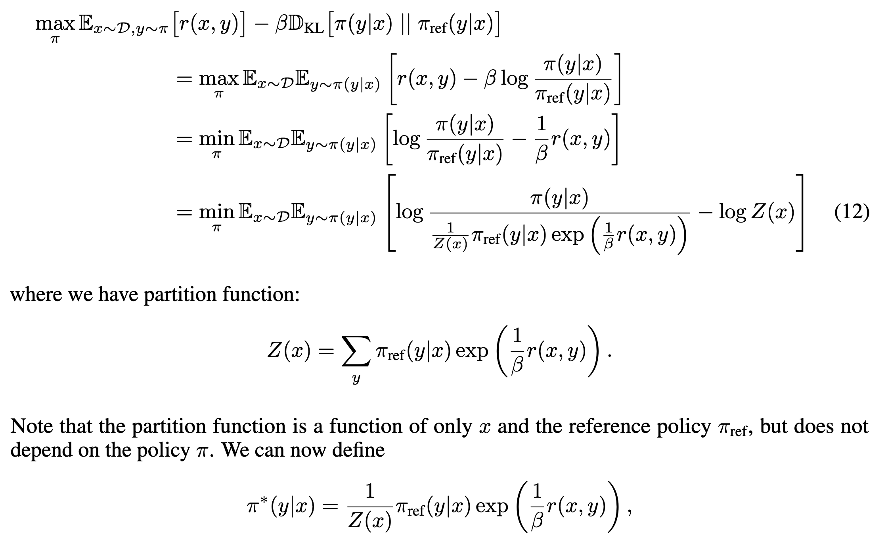

最后一行的 π* 是数学里的惯用记号，表示**最优策略**，也就是第一步那个最大化问题的解。从公式可以看出，使用最优策略生成回答 y 的概率，等于参考模型的概率乘上一个随奖励指数增长的权重，再除以一个归一化系数 Z(x)。直觉上就是按奖励高低重新分配概率，奖励越高的回答，概率被抬得越多。Z(x) 保证所有回答的概率加起来等于 1，它只跟 prompt 有关，算起来很麻烦，不过马上就会看到，它根本不用真的算出来。

> 闭式解（closed-form solution）指能用有限个基本运算直接写出表达式的解，套进公式就能算出答案。中学里一元二次方程的求根公式就是闭式解；和它相对的是数值解，方程太复杂写不出公式时，只能靠迭代一步步逼近。这里说最优策略有闭式解，就是它和奖励函数之间可以直接写成公式互相换算，不需要额外训练一个模型去拟合这个关系。

**第三步，把式子反过来解出奖励**。对第二步的公式两边取对数再移项，log 是 exp 的逆运算，两者正好抵消，奖励就能用策略表示出来：

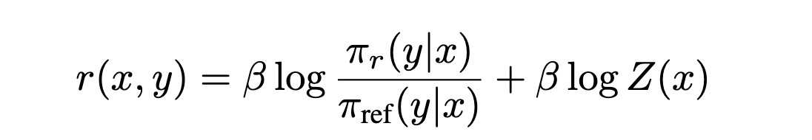

也就是说，奖励等于两个模型的对数概率比值，再加一个只跟 prompt 有关的常数。语言模型本身就能当奖励模型用，论文标题里那句话说的就是这个。

**第四步，代回上一篇奖励模型的损失函数**。上一篇讲过，奖励模型用 Bradley-Terry 模型训练，损失函数是让 chosen 胜过 rejected 的概率尽量大：

```text
loss = -log σ( r_chosen - r_rejected )
```

论文里写的是 sigmoid 的分数形式，y1 胜过 y2 的概率是：

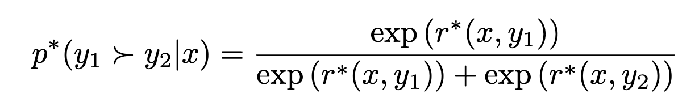

两者其实是一个东西，可以互相转换：

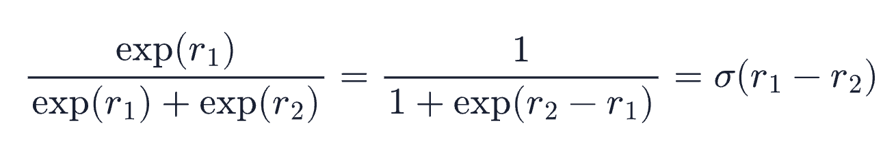

接下来把第三步的奖励表达式代进去，关键的事情发生了：chosen 和 rejected 是同一个 prompt 下的回答，两者的 Z(x) 是同一个数，分子分母正好抵消，偏好概率只用 π* 和 π_ref 就能写出来：

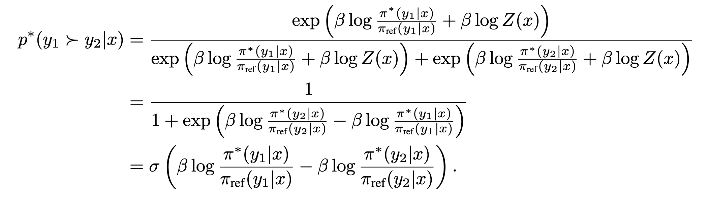

到这一步，奖励模型从公式里彻底消失了，难算的归一化系数也抵消了，剩下的只有我们要训的策略模型和一个冻结的参考模型。

训练目标就是让标注员选中的那些偏好概率尽量大。对所有偏好数据求负对数似然，并把式子里的 π* 换成正在训练的模型 π_θ（θ 是它的参数），DPO 的损失函数就出来了：

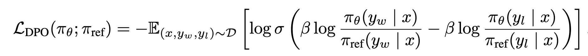

可以看到，它和上面的奖励模型的损失函数几乎是一个模子，只是把里面的奖励换成 β 倍的对数概率比值，也就是把 r 换成了 β × log( π_θ(y|x) / π_ref(y|x) )，其中 **β** 是 DPO 的专属超参数，控制训练后的模型允许偏离参考模型的程度，β 越大，约束越强，模型贴着 SFT 模型不敢走远，β 越小，模型可以更放开地往偏好方向走；**log( π_θ(y|x) / π_ref(y|x) )** 是两个模型对同一个回答的概率之比取对数，可以看成模型相对参考模型对这个回答的偏好增量。

拆开看这个损失实际做的就是，让 chosen 的偏好增量尽量大于 rejected 的偏好增量。sigmoid 里面是两者的差，差越大，log σ 越接近 0，损失越小。也就是说，DPO 把对齐问题变成了一个**分类问题**：给一对回答，把好的那个排到坏的那个前面。整个训练过程和普通的监督微调几乎没有区别，稳定、好调，不需要在训练中反复采样生成回答。

更实际的好处是显存。PPO 要四个模型，DPO 只需要两个：一个训练的，一个冻结的参考模型。

两者对比如下：

| 对比项 | PPO（RLHF） | DPO |
| ---- | ---- | ---- |
| 显存中的模型数 | 4 个（策略、参考、奖励、价值） | 2 个（策略、参考） |
| 是否需要奖励模型 | 需要，先单独训一个 | 不需要 |
| 训练方式 | 在线强化学习，需要反复采样生成 | 离线监督训练，类似 SFT |
| 稳定性 | 较差，容易训崩 | 较好，和常规微调相当 |
| 专属超参数 | KL 系数、clip 范围等多个 | 主要是 β 一个 |
| 数据要求 | 偏好数据用来训奖励模型 | 偏好数据直接拿来训策略 |

两条路线放在一起对比，差异一目了然：

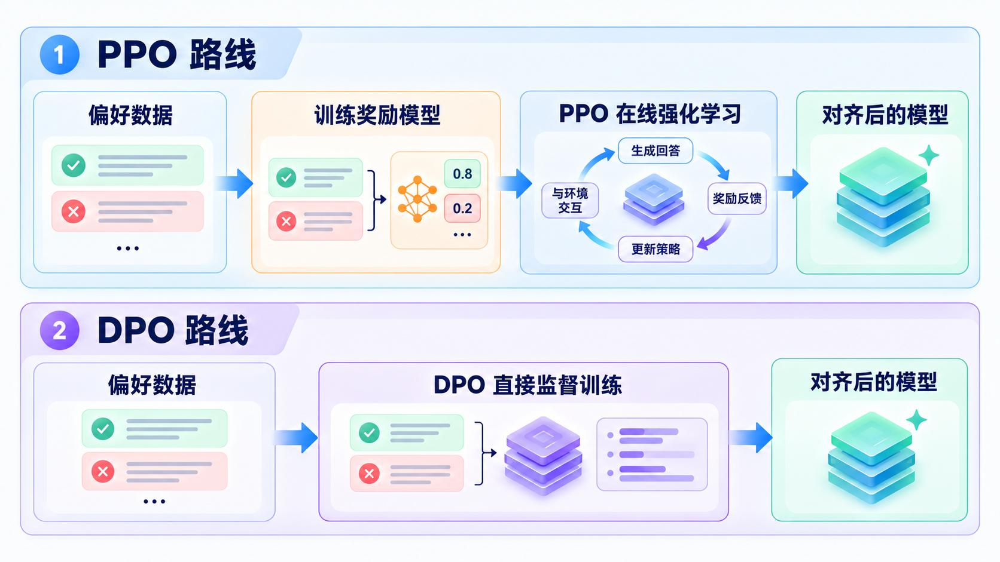

可以看到，DPO 在工程上几乎是全方位的简化，这也是它发布之后迅速成为开源社区对齐训练默认方案的原因。不过要客观地说，DPO 并非全面碾压：PPO 这类在线方法可以不断用模型当前的新生成交互学习，2024 年有一篇实证研究 [Is DPO Superior to PPO for LLM Alignment?](https://arxiv.org/abs/2404.10719) 做过系统对比，结论是 PPO 的效果上限更高，DPO 简单稳定的代价是上限存在争议，对这个话题感兴趣的读者可以去翻这篇论文。

### 实战 TRL 的 DPOTrainer

Hugging Face 的 [TRL](https://github.com/huggingface/trl) 库提供了 `DPOTrainer`，数据格式就是三个字段的 JSON：

```json
{"prompt": "天空为什么是蓝色的？", "chosen": "因为太阳光中的蓝光波长短，在大气中散射得更厉害，这是瑞利散射现象。", "rejected": "因为天空本来就是蓝色的。"}
{"prompt": "1 加 1 等于几？", "chosen": "1 加 1 等于 2。", "rejected": "这个问题太难了，我不会。"}
```

每一行一条偏好对，`prompt` 是问题，`chosen` 和 `rejected` 是两个候选回答。TRL 还支持对话格式，三个字段的值换成 OpenAI 风格的 messages 列表即可。

训练代码只需要几行配置：

```python
from datasets import load_dataset
from transformers import AutoModelForCausalLM, AutoTokenizer
from trl import DPOConfig, DPOTrainer

model_id = "Qwen/Qwen3-0.6B"
model = AutoModelForCausalLM.from_pretrained(model_id, dtype="auto", device_map="cuda")
tokenizer = AutoTokenizer.from_pretrained(model_id)

# 加载上面那种 prompt/chosen/rejected 格式的数据
train_dataset = load_dataset("json", data_files="preference.jsonl", split="train")

training_args = DPOConfig(
    beta=0.1,                          # 控制偏离参考模型的程度
    learning_rate=5e-7,                # DPO 学习率通常比 SFT 小一个量级
    per_device_train_batch_size=2,
    num_train_epochs=1,
    max_length=1024,
)

trainer = DPOTrainer(
    model=model,
    args=training_args,
    train_dataset=train_dataset,
    processing_class=tokenizer,
)
trainer.train()
```

这里有几个值得注意的点：

1. **参考模型不用自己传**：`DPOTrainer` 在不传 `ref_model` 参数时，会自动把传入的模型复制一份并冻结，作为 π_ref
2. **β 的常用取值在 0.1 附近**：太小容易把模型训跑飞，太大则学不到多少偏好
3. **学习率要比 SFT 小**：DPO 是在已经对齐过一轮的 SFT 模型上继续微调，步子大了容易破坏已有能力

`DPOConfig` 里还有很多进阶选项，比如换损失类型的 `loss_type`（原版 DPO 之外还有 IPO、SimPO 等变体），这里不再展开。详细的字段说明可以看 [TRL 的 DPO 文档](https://huggingface.co/docs/trl/dpo_trainer)。

## GRPO：把价值模型也砍掉

DPO 用监督训练的办法解决了偏好对齐问题，代价是把奖励模型和强化学习一起扔掉了。但强化学习有它不可替代的地方：模型能在训练中不断生成新回答、现场拿奖励，突破离线数据的上限。想保留这条路线又想降低成本，下一个该砍的部件只能是四个模型里剩下的那个**价值模型（critic）**了，它的职责是估计当前状态的价值，给 PPO 计算**优势（Advantage）** 提供基线。

2024 年 2 月，DeepSeek 在 [DeepSeekMath](https://arxiv.org/abs/2402.03300) 这篇论文里提出了 **GRPO（Group Relative Policy Optimization，组相对策略优化）**。价值模型估计的基线，本质上就是这个问题的回答平均能拿多少分。既然要平均，那就直接采样一组回答，用组内的真实平均分当基线，不就不需要学一个价值模型了吗？

具体做法是对同一个问题，用当前策略采样 G 个回答，每个回答算一个奖励，然后做组内归一化：第 i 个回答的优势等于它的奖励减去组内奖励的均值，再除以组内奖励的标准差。比平均分高的回答得到正优势，参数更新时提高它的概率；比平均分低的得到负优势，压低它的概率。整个过程只需要策略模型、参考模型和一个算奖励的东西，价值模型那份显存和训练开销全省了，而且用真实采样均值当基线比学出来的价值模型更稳。

GRPO 的组内比较过程如下图所示：

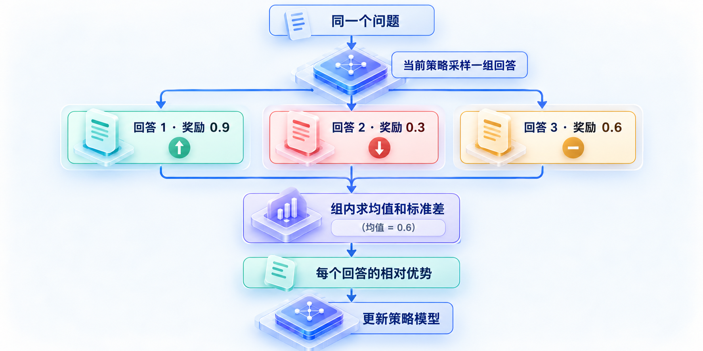

论文里还有一张 PPO 和 GRPO 的对比图，对照起来看更直观：

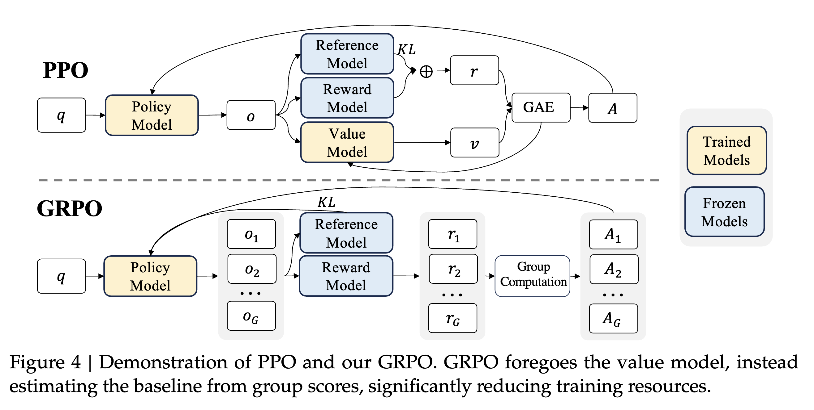

上半部分的 PPO 里，价值模型负责提供基线，配合 GAE 算优势；下半部分的 GRPO 里它整个消失了，基线改由组内分数直接算出来。图中黄色是参与训练的模型，蓝色是冻结的模型。

DeepSeekMath 用这个方法把 7B 模型的 MATH 榜单成绩做到了 51.7%，逼近了当时 GPT-4 的水平，GRPO 也因此一战成名。不过真正让它出圈的，是第二年 DeepSeek-R1 把它和另一类奖励搭配在了一起，这就是 RLVR。

## RLVR：奖励不用学，程序判对错

GRPO 砍掉了价值模型，但奖励模型还在，它训起来贵、还会被攻击。**RLVR（Reinforcement Learning with Verifiable Rewards，可验证奖励的强化学习）** 的做法是：有些任务的答案对错可以程序自动判定，根本不需要学一个奖励模型。

> RLVR 这个叫法最早出现在 Allen AI 的 [Tulu 3 报告](https://arxiv.org/abs/2411.15124)里，后来由 DeepSeek-R1 发扬光大。

典型的可验证奖励的任务有三类：

* **数学题**：有标准答案。模型输出最终答案后，用字符串匹配或 sympy（Python 的符号计算库，可以判断两个数学表达式是否等价）之类的工具和标准答案比对，对了给 1，错了给 0
* **代码题**：能跑测试。把模型生成的代码丢进沙箱执行单元测试，全过给 1，挂了给 0
* **格式要求**：比如要求模型把思考过程放在 `think` 标签里、最终答案放在 `answer` 标签里，正则一检查就知道有没有遵守

程序判分的好处是又快又准，而且没有钻空子的可能：答案对不对是客观的，模型没法讨好一个正则表达式。代价是适用范围受限，只有数学、代码、逻辑谜题这类有客观对错的任务才能这么玩。

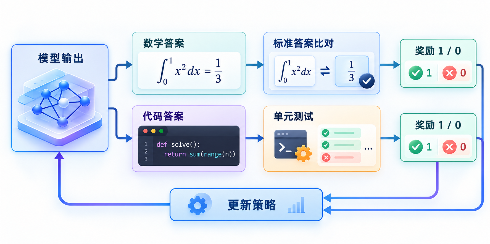

2025 年 1 月发布的 [DeepSeek-R1](https://arxiv.org/abs/2501.12948) 就是 GRPO 加 RLVR 的组合。它的中间产物 **DeepSeek-R1-Zero** 更能说明这套方法的潜力：直接在基座模型上做纯强化学习，不做任何 SFT，模型竟然自己涌现出了反思、自我验证、延长思考链这些推理行为。论文里记录了训练中出现的一个 aha moment：模型在解题中途停下来，自言自语地说道 "Wait, wait. Wait. That's an aha moment I can flag here"，然后回头重新检查自己之前的思路。没有任何人教过它这么做，这是 RL 训练中自发涌现的行为。

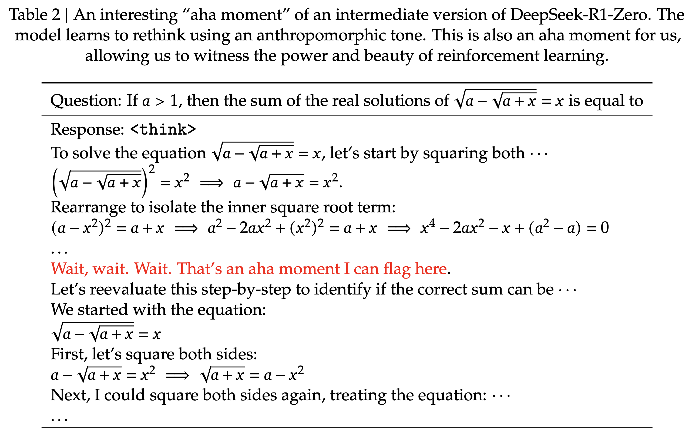

从 OpenAI o1 到 DeepSeek-R1，再到现在各家会思考的推理模型，背后都是类似的方法：在有标准答案的任务上，用可验证奖励做大规模强化学习。想亲手复现的话，Philipp Schmid 的博客上有一篇 [Mini-R1 教程](https://www.philschmid.de/mini-deepseek-r1)，用 GRPO 在一个倒计时数字游戏上重现了类似的涌现过程。

> 倒计时数字游戏（Countdown）的规则是：给几个数字和一个目标值，用加减乘除把数字凑出目标，每个数字最多用一次。答案对不对程序一算便知，正好是可验证奖励的场景。

## 三条路线的演进

到这里，偏好对齐这几年的演进脉络就清楚了：从 PPO 出发，一条走向简化的 DPO，一条走向推理强化的 GRPO 加 RLVR。一张图总结：

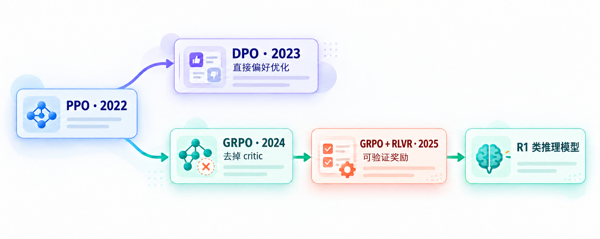

两条线的定位不同：**DPO 向简**，把对齐变成监督训练，适合大多数开源团队做偏好对齐；**GRPO 加 RLVR 向强**，保留并改造强化学习，专攻可验证任务，训出了推理能力。今天的开源模型发布时，常常是两者都用：SFT 之后先来一轮 DPO 对齐人类偏好，再用 GRPO 在数学代码上做强化。

工程落地方面，做这类 RL 训练目前主流的开源框架有字节的 [veRL](https://github.com/volcengine/verl) 和社区的 [OpenRLHF](https://github.com/OpenRLHF/OpenRLHF)，它们都支持 PPO、GRPO 等算法。由于这类在线强化学习每一轮都要用当前模型现场生成大量回答，生成速度直接决定训练快慢，所以它们还集成了 [vLLM](https://github.com/vllm-project/vllm) 或 [SGLang](https://github.com/sgl-project/sglang) 等高吞吐的推理引擎来加速这个环节，再用 Megatron 或 DeepSpeed 做分布式训练。TRL 里也有现成的 `GRPOTrainer`，小规模实验可以从它入手。

## 小结

今天我们学习了偏好对齐在 PPO 之后的三次演进：

1. **DPO**：利用偏好数据和最优策略之间的闭式关系，跳过奖励模型和强化学习，把对齐变成分类式的监督训练；只需策略模型加冻结的参考模型，一个 β 超参控制偏离程度，TRL 的 `DPOTrainer` 几行代码就能跑起来
2. **GRPO**：出自 DeepSeekMath 论文，保留强化学习但砍掉价值模型，对同一问题采样一组回答，用组内奖励均值当基线算相对优势，省掉了价值模型的显存和训练开销
3. **RLVR**：数学、代码这类任务的对错可以程序自动判定，奖励不需要奖励模型；GRPO 加 RLVR 训出了 DeepSeek-R1，训练中还出现了模型自发反思的 aha moment，现在的很多推理模型都是这个路线
4. **框架**：大规模 RL 训练看 veRL 和 OpenRLHF，小规模实验用 TRL

到这里，从数据、预训练、微调到对齐，大模型训练的理论部分我们就学完了。纸上得来终觉浅，明天我们来收个尾：把前面学过的所有东西串起来，动手训练一个属于自己的小模型。

## 参考

* [DPO 论文：Direct Preference Optimization](https://arxiv.org/abs/2305.18290)
* [DPO 与 PPO 对比研究：Is DPO Superior to PPO for LLM Alignment?](https://arxiv.org/abs/2404.10719)
* [DeepSeekMath 论文：GRPO 的出处](https://arxiv.org/abs/2402.03300)
* [DeepSeek-Math GitHub 仓库](https://github.com/deepseek-ai/DeepSeek-Math)
* [DeepSeek-R1 论文](https://arxiv.org/abs/2501.12948)
* [Tulu 3 论文：RLVR 概念的出处](https://arxiv.org/abs/2411.15124)
* [TRL GitHub 仓库](https://github.com/huggingface/trl)
* [TRL 官方文档：DPOTrainer](https://huggingface.co/docs/trl/dpo_trainer)
* [veRL GitHub 仓库](https://github.com/volcengine/verl)
* [OpenRLHF GitHub 仓库](https://github.com/OpenRLHF/OpenRLHF)
* [vLLM GitHub 仓库](https://github.com/vllm-project/vllm)
* [SGLang GitHub 仓库](https://github.com/sgl-project/sglang)
* [Mini-R1 教程：复现 aha moment](https://www.philschmid.de/mini-deepseek-r1)
