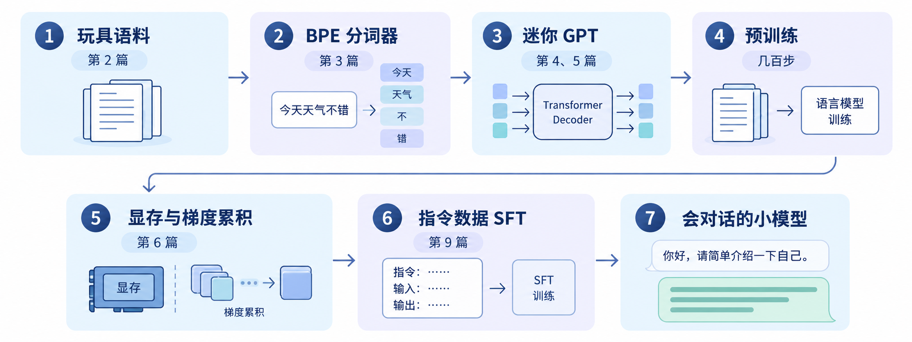
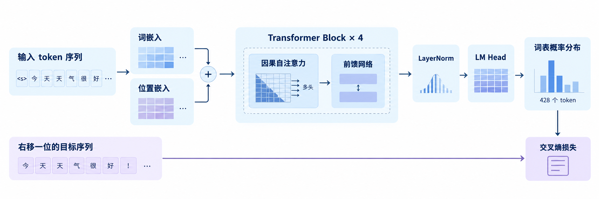
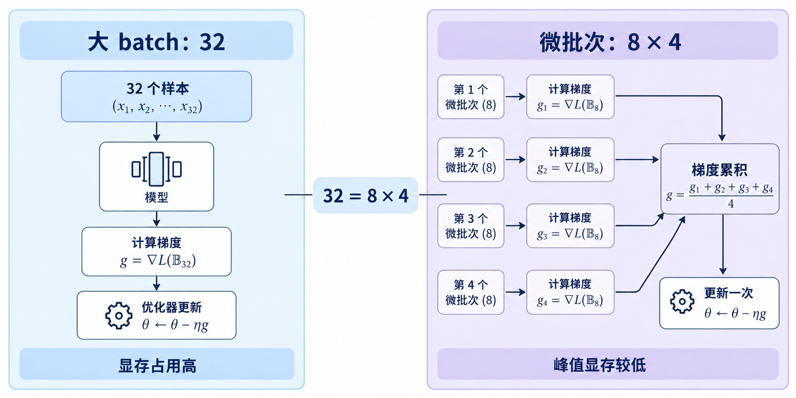
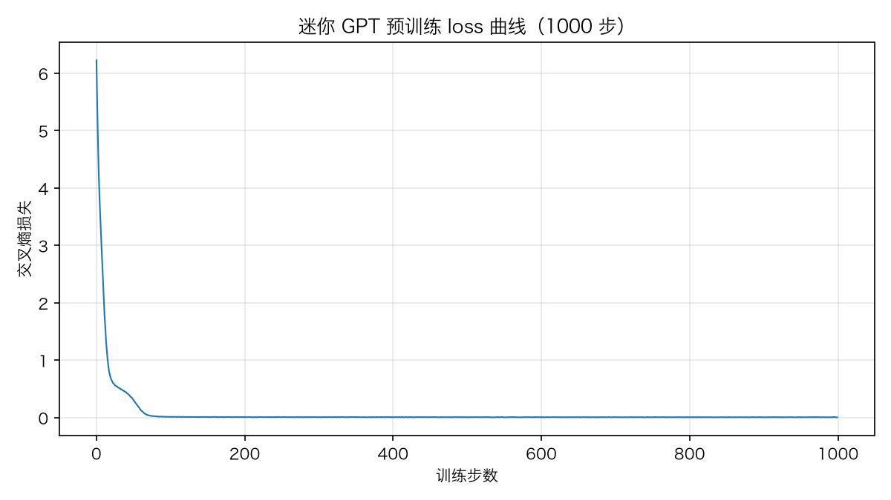
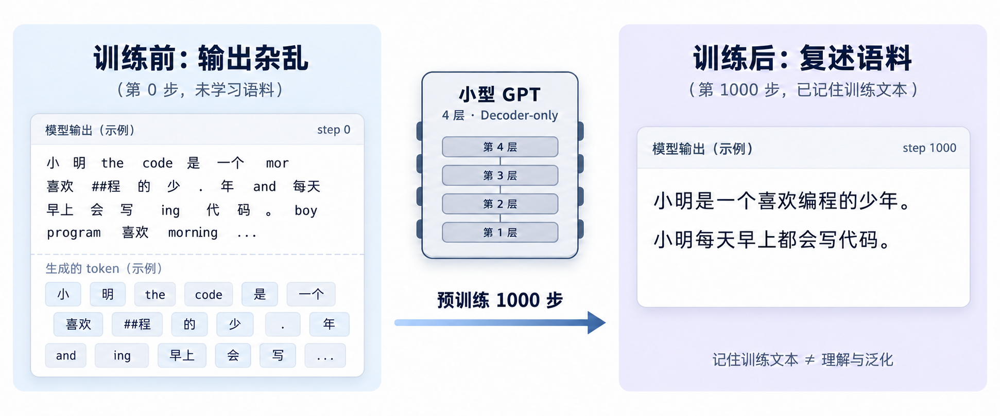

# 大模型训练系列收官：动手训一个属于自己的小模型

上一篇我们学习了偏好对齐的两条路线：DPO 跳过奖励模型和强化学习，直接用偏好数据对模型做监督式训练；GRPO 则用组内相对优势替代价值网络，让强化学习变得更轻。至此，从数据清洗、分词器训练、目标函数、反向传播与优化器、显存与混合精度、分布式并行，到预训练工程、SFT、RLHF 与 DPO，大模型训练的完整链路我们已经逐个拆开看过了一遍。

不过，光看不练总归隔了一层。今天是本系列的收官篇，我们不再拆新概念，而是亲自动手，用几百行代码从零训练一个小模型，把前面十一篇讲过的每个环节都跑一遍。跑完之后你会看到，loss 从接近随机猜的水平断崖式下降，模型的输出从乱码变成整段复述语料，再喂给它十几条指令数据，它就能回答你的问题了。

## 标杆项目

自己从零训模型这件事其实并不新鲜，社区里已经有好几个公认的标杆：

* **Karpathy 的系列项目**：[nanoGPT](https://github.com/karpathy/nanoGPT) 号称用最精简的代码复现 GPT 的训练，核心只有 `model.py` 和 `train.py` 两个文件，在小莎士比亚数据集上就能训出一个会写莎士比亚风格台词的字符级 GPT；[build-nanogpt](https://github.com/karpathy/build-nanogpt) 手把手带着复现 GPT-2 的完整训练流程；2025 年 10 月发布的 [nanochat](https://github.com/karpathy/nanochat) 更进一步，把分词器、预训练、SFT 到 GRPO 强化学习的完整流程写进一个约八千行的代码库，8 张 H100 跑 4 小时、花大约 100 美元，就能训出一个 561M 参数的聊天模型，和我们今天的路线图几乎一样，只是规模放大了几个量级
* **minimind**：中文社区的[这个仓库](https://github.com/jingyaogong/minimind)把门槛压到了最低，号称用普通显卡几个小时就能从零训出一个几十 M 参数、会简单对话的小模型，配套教程非常完整
* **Happy-LLM**：Datawhale 出品的[系统教程](https://github.com/datawhalechina/happy-llm)，从 Transformer 原理讲起，手写 LLaMA2，再把预训练、SFT、GRPO 一路走完
* **train-llm-from-scratch**：覆盖最全的[个人项目](https://github.com/FareedKhan-dev/train-llm-from-scratch)，从原始文本到预训练、SFT、奖励模型，再到 PPO、DPO、GRPO，全部手写，不依赖 transformers 和 trl
* **LLMs-from-scratch**：Sebastian Raschka《从零构建大模型》的[配套代码](https://github.com/rasbt/LLMs-from-scratch)，从分词到指令微调逐章推进，有中译本，适合喜欢跟书学的同学

本文借鉴这些项目的思路，但代码全部自己写，并且尽量精简。我们的目标不是训出多强的模型，而是让每个概念都能在手上跑起来。

## 整体路线

今天的完整路线如下图所示，每一步都对应着前面某一篇文章：



可以看到，这条路线就是整个系列的缩影。分布式并行和 RLHF 在这个玩具规模上用不上，我们就不强行演示了。

## 步骤一：准备玩具语料

第一步是数据。第 2 篇我们讲过，真实的大模型预训练要用 TB 级的互联网文本，并且要花大量精力做清洗、去重和配比。我们今天要训练的模型不大，只用一小段玩具语料就够了。

用小数据的原因有两个。一是我们的目标不是模型能力，而是把训练流程跑通，小语料几分钟内就能训出肉眼可见的效果；二是小模型配大数据会**欠拟合（Underfitting）**，也就是模型容量装不下数据里的规律，学不充分；反过来小模型配小数据，恰好能让 loss 降得漂亮，生成效果也更直观。这也符合缩放定律的直觉。

我们准备一段中英文混合的小文本，存成 `toy_corpus.txt`，内容围绕一个虚拟人物展开，句式反复出现，方便模型快速学到规律：

```text
小明是一个喜欢编程的少年。小明每天早上都会写代码。
Xiaoming is a boy who loves programming. He writes code every morning.
编程让小明感到快乐。Programming makes Xiaoming happy.
大模型是一种会说话的程序。A large language model is a program that can talk.
训练一个小模型需要数据、算力和耐心。Training a small model needs data, compute and patience.
...
```

实际演示时，我们把这段语料复制了 4000 遍，一共 8 种句式，总量 314 KB。

> 如果想更接近真实一点，也可以换成开源的小语料，比如 nanoGPT 自带的小莎士比亚数据集。思路完全一样，只是文本风格不同。

## 步骤二：训练 BPE 分词器

语料有了，接下来把它变成 token。第 3 篇我们学过，大模型不直接处理字符，而是先把文本切成 token 序列，最常用的切分算法是 **BPE（Byte-Pair Encoding，字节对编码）**，它从字节出发，反复合并最高频的相邻对，学出一个固定大小的词表。

真实模型的分词器词表动辄十几万，比如 GPT-3.5 和 GPT-4 使用的 `cl100k_base` 编码，词表就是 10 万出头（OpenAI 官方分词器库 [tiktoken](https://github.com/openai/tiktoken) 里有明确记录）。我们的语料小、模型也小，词表没必要大，定 `vocab_size=2048` 就够了。用 Hugging Face 的 [tokenizers](https://github.com/huggingface/tokenizers) 库训练一个属于自己的分词器，只需要几行代码：

```python
from tokenizers import Tokenizer, models, trainers, pre_tokenizers

# 从字节级 BPE 开始，任何字符（包括中文和 emoji）都能先拆成字节再编码，不会出现未知字符
tokenizer = Tokenizer(models.BPE())
# ByteLevel 预分词器负责把文本转成字节序列
tokenizer.pre_tokenizer = pre_tokenizers.ByteLevel(add_prefix_space=False)

# 词表大小 2048 是上限，语料小的话实际学不满
# 三个特殊 token：文本结束符，以及留给 SFT 阶段的对话角色标记
trainer = trainers.BpeTrainer(
    vocab_size=2048,
    special_tokens=["<|endoftext|>", "<|user|>", "<|bot|>"],
)
# 在语料文件上训练分词器
tokenizer.train(["toy_corpus.txt"], trainer)
# 训练好的分词器保存成 JSON，后面随时加载
tokenizer.save("mini_tokenizer.json")
```

可以看到，除了普通的文本 token，我们还额外注册了三个特殊 token：`<|endoftext|>` 表示文本结束，`<|user|>` 和 `<|bot|>` 留给后面 SFT 阶段标记对话角色。训练好后验证一下：

```python
from tokenizers import Tokenizer, decoders

# 加载训练好的分词器
tokenizer = Tokenizer.from_file("mini_tokenizer.json")
# 字节级 BPE 要配上对应的解码器，不然中文解码出来是乱码
tokenizer.decoder = decoders.ByteLevel()
# 编码：文本变成 token id 序列
ids = tokenizer.encode("小明喜欢编程").ids
print(ids)
# 解码：token id 序列还原回文本
print(tokenizer.decode(ids))
```

输出如下：

```text
[115, 253, 305]
小明喜欢编程
```

一句话被切成了 3 个 token，解码回去分毫不差。

> 值得注意的是，虽然配置里词表定的是 2048，但玩具语料一共只有 8 种句式，BPE 把所有能合并的都合并完，最终也只学到 428 个 token，词表的实际大小就是 428。后面模型的参数量和初始 loss 都按 428 这个真实词表来。

到这里，文本和张量之间的桥梁就搭好了。用同样的方法把整个语料编码成一个长长的 token 序列，一共 4.6 万个 token，按 9:1 切成训练集和验证集，存成 `train_ids` 和 `val_ids` 备用。

## 步骤三：手写一个迷你 GPT

核心环节来了。第 4 篇讲过语言模型的目标是预测下一个 token，第 5 篇讲过反向传播和优化器如何驱动参数更新。现在我们把它们落成一个真正的模型。

我们的迷你 GPT 结构是教科书式的：**词嵌入（Token Embedding）** 加 **位置嵌入（Positional Embedding）**，后面堆 4 层 Transformer Block，最后过一层 LayerNorm 和 **语言模型头（LM Head）** 输出词表上的概率分布。每个 Block 内部是带因果掩码的多头自注意力加一个前馈网络，都是第 4 篇讲过的零件。

> 注意这里的位置嵌入用的是 GPT-2 时代的可学习位置嵌入，而不是正弦位置编码或 RoPE 旋转位置编码，它本质是一张查表表，每个位置存一个向量，随模型一起训练学出来。选它是因为最简单，两行代码就完事。

代码如下，做了精简，只保留主要部分：

```python
import torch
import torch.nn as nn
import torch.nn.functional as F

# 一个 Transformer Block：自注意力 + 前馈网络，各配一个残差连接
class Block(nn.Module):
    def __init__(self, d, n_head, max_len):
        super().__init__()
        # 多头自注意力，batch_first=True 表示输入形状是 [batch, 序列长度, 维度]
        self.attn = nn.MultiheadAttention(d, n_head, batch_first=True)
        # 前馈网络：先把维度扩到 4 倍，过 GELU 激活，再压回 d
        # 扩展再压缩是 Transformer 的固定套路，让模型有更大的中间空间做非线性变换
        self.ffn = nn.Sequential(nn.Linear(d, 4 * d), nn.GELU(), nn.Linear(4 * d, d))
        # 两个 LayerNorm，分别用在注意力和前馈网络之前
        self.ln1, self.ln2 = nn.LayerNorm(d), nn.LayerNorm(d)
        # 因果掩码：一个上三角矩阵，上三角为 True 的位置表示不允许注意力看到
        # 这样位置 t 只能看到前 t 个 token，看不到未来，这就是单向注意力
        mask = torch.triu(torch.ones(max_len, max_len), diagonal=1).bool()
        # 掩码是固定常量，不参与训练，但要跟着模型一起保存和搬设备
        # register_buffer 就是把它登记成模型的非训练状态，用普通属性赋值则不会跟随模型
        self.register_buffer("mask", mask)

    def forward(self, x):
        # x 的形状是 [batch, 序列长度, d]，维度从 0 开始数，第 1 维就是序列长度
        # 实际序列长度可能小于 max_len，掩码切出对应大小
        T = x.size(1)
        # 先做 LayerNorm，再进注意力（Pre-Norm 结构，训练更稳定）
        h = self.ln1(x)
        # 三个 h 分别是 query、key、value，自注意力就是自己和自己做注意力
        # 最后加上残差连接：输出 = 原始输入 + 注意力结果，梯度可以直通
        x = x + self.attn(h, h, h, attn_mask=self.mask[:T, :T])[0]
        # 前馈网络同样先 LayerNorm，再加残差
        return x + self.ffn(self.ln2(x))

class MiniGPT(nn.Module):
    def __init__(self, vocab, d=384, n_head=6, n_layer=4, max_len=128):
        super().__init__()
        self.max_len = max_len
        # 词嵌入：把 token id 查表变成 d 维向量，词表大小是 vocab
        self.tok_emb = nn.Embedding(vocab, d)
        # 位置嵌入：把位置编号（0、1、2……）也查表变成 d 维向量
        self.pos_emb = nn.Embedding(max_len, d)
        # 堆叠 n_layer 个 Transformer Block
        self.blocks = nn.Sequential(*[Block(d, n_head, max_len) for _ in range(n_layer)])
        # 收尾的 LayerNorm
        self.ln_f = nn.LayerNorm(d)
        # 语言模型头：把 d 维向量投影成 vocab 维的 logits，每个位置一个分布
        self.head = nn.Linear(d, vocab, bias=False)

    def forward(self, idx, target=None):
        T = idx.size(1)
        # token 向量和位置向量相加，得到第一层的输入
        x = self.tok_emb(idx) + self.pos_emb(torch.arange(T, device=idx.device))
        # 过完所有 Block 和 LayerNorm，再过语言模型头
        # 输出 logits 的形状是 [batch, T, vocab]，每个位置一个概率分布的原始打分
        logits = self.head(self.ln_f(self.blocks(x)))
        loss = None
        # 传入了目标序列，就顺带算交叉熵损失；不传则只返回 logits，生成时用
        if target is not None:
            loss = F.cross_entropy(logits.view(-1, logits.size(-1)), target.view(-1))
        return logits, loss
```

配置是隐藏维度 384、6 个注意力头、4 层、上下文长度 128。打印参数量验证一下：

```python
# vocab 用词表的真实大小
model = MiniGPT(vocab=tokenizer.get_vocab_size())
# numel 是每个参数张量的元素个数，全部加起来除以 1e6 就是百万级的参数量
print(sum(p.numel() for p in model.parameters()) / 1e6, "M")
```

```text
7.48 M
```

约 7.5M 参数。对比一下，GPT-2 最小档是 124M，GPT-3 是 175B，我们的模型只有它们的零头，但结构上一模一样，该有的零件一个不少。模型的整体结构如下图所示：



接下来是训练循环，把第 5 篇的几样东西全部用上：**交叉熵损失（Cross-Entropy Loss）** 衡量预测分布和真实下一个 token 的差距；**AdamW** 是目前训练 Transformer 的标配优化器，在 Adam 的基础上把权重衰减和梯度更新解耦；**余弦退火（Cosine Annealing）** 让学习率随训练进程按余弦曲线平滑下降；**梯度裁剪（Gradient Clipping）** 把梯度范数限制在 1.0 以内，防止个别 batch 的梯度过大炸掉训练。

```python
import math

# 有显卡用显卡，没有就退回 CPU
device = "cuda" if torch.cuda.is_available() else "cpu"
model = model.to(device)
# AdamW 优化器，lr 是学习率，weight_decay 是权重衰减（一种正则化）
opt = torch.optim.AdamW(model.parameters(), lr=3e-4, weight_decay=0.1)
# 余弦退火调度器：学习率按余弦曲线从 3e-4 平滑降到 0，T_max 是总步数
sched = torch.optim.lr_scheduler.CosineAnnealingLR(opt, T_max=1000)

# 从 token 序列里随机切出 batch_size 段，每段 block_size 个 token
def get_batch(ids, batch_size=32, block_size=128):
    ix = torch.randint(len(ids) - block_size - 1, (batch_size,))
    # 输入是第 i 到 i+128 个 token
    x = torch.stack([ids[i:i + block_size] for i in ix])
    # 目标是输入右移一位，也就是每个位置的下一个 token
    y = torch.stack([ids[i + 1:i + block_size + 1] for i in ix])
    return x.to(device), y.to(device)

for step in range(1000):
    x, y = get_batch(train_ids)
    # 前向传播，算出交叉熵损失
    logits, loss = model(x, y)
    # 清空上一步的梯度，再反向传播算出这一步的梯度
    opt.zero_grad()
    loss.backward()
    # 梯度裁剪：梯度范数超过 1.0 就按比例缩小，防止个别 batch 炸掉训练
    torch.nn.utils.clip_grad_norm_(model.parameters(), 1.0)
    # 用梯度更新参数，再让学习率调度器走一步
    opt.step()
    sched.step()
    # 每 50 步打印一次日志，最后一步也打
    if step % 50 == 0 or step == 999:
        print(f"step {step:4d} | loss {loss.item():.2f} | lr {sched.get_last_lr()[0]:.2e}")
```

注意 `get_batch` 里输入和目标的构造：目标序列就是输入序列右移一位，这正是下一个 token 预测的训练方式，模型在位置 t 看到前 t 个 token，要猜出第 t+1 个。

## 步骤四：观察显存，打开梯度累积

训练跑起来之前，先看看第 6 篇的主角，显存。在训练循环里插两行：

```python
# 每 100 步打印一次显存峰值（CUDA 显卡适用）
if step % 100 == 0:
    used = torch.cuda.max_memory_allocated() / 1024 ** 2
    print(f"step {step} | 显存峰值 {used:.0f} MiB")
```

7.5M 的模型，实测也就一百二十 MiB 上下，任何一张显卡甚至 CPU 都绰绰有余。但显存里的东西一样不少：权重一份、梯度一份、AdamW 的一阶二阶动量两份，再加上随 batch 和序列长度增长的激活值。有兴趣的同学可以把 `batch_size` 和 `block_size` 调大几倍，看着显存峰值按比例上涨，和第 6 篇的公式对一对。

batch 调大之后如果显存吃紧，办法就是 **梯度累积（Gradient Accumulation）**：不每步都更新参数，而是把一个大 batch 拆成若干个 **micro-batch（微批次）** 逐个小步跑，梯度累积若干次再统一更新一次。效果等价于大 batch，显存占用却还是小 batch 的水平。

```python
# 每 4 个 micro-batch 更新一次参数，等效 batch 放大 4 倍
ACCUM = 4

for step in range(1000):
    # 每个 step 开头清零梯度，内层 4 个 micro-batch 的梯度会依次累加
    opt.zero_grad()
    for micro in range(ACCUM):
        # micro-batch 只有 8，显存占用是小 batch 的水平
        x, y = get_batch(train_ids, batch_size=8)
        logits, loss = model(x, y)
        # loss 除以累积步数再反向传播，保证梯度尺度和直接跑大 batch 一致
        (loss / ACCUM).backward()
    # 4 个小步的梯度攒够了，裁剪、更新，进入下一轮
    torch.nn.utils.clip_grad_norm_(model.parameters(), 1.0)
    opt.step()
    sched.step()
```

可以看到，关键在于两处：loss 要除以累积步数再反向传播，否则等效学习率会跟着放大；`zero_grad` 放在每个 step 的开头，梯度在 4 个 micro-batch 之间累加，更新一次之后下一轮重新清零。

改造后的训练循环如下：



## 步骤五：看 loss 下降，看模型开口说话

一切就绪，开始训练。训练日志如下：

```text
step    0 | loss 6.23 | lr 3.00e-04
step   50 | loss 0.31 | lr 2.98e-04
step  100 | loss 0.01 | lr 2.93e-04
step  200 | loss 0.01 | lr 2.71e-04
step  300 | loss 0.01 | lr 2.38e-04
step  400 | loss 0.01 | lr 1.96e-04
step  500 | loss 0.00 | lr 1.50e-04
step  600 | loss 0.01 | lr 1.03e-04
step  700 | loss 0.01 | lr 6.15e-05
step  800 | loss 0.01 | lr 2.84e-05
step  900 | loss 0.01 | lr 7.20e-06
step  999 | loss 0.01 | lr 0.00e+00
```

这里先做一个**健全性检查（Sanity Check）**，也就是用一个理论上必然成立的数值来验证实现有没有写错。这个检查不用写代码，直接拿日志第 0 步的 loss 和理论值对照就行：模型还没学的时候等于瞎猜，词表的实际大小是 428，随机猜一个 token 的交叉熵就是 ln(428) ≈ 6.06。日志里初始 loss 是 6.23，正好停在这个数附近，说明实现没有明显问题；如果明显偏离这个数，比如 12 或者 0.5，那十有八九是哪里写错了。

再往下读，我们发现 loss 到第 50 步时直接就掉到了 0.31，到 100 步之后基本归零。可以从**困惑度（Perplexity）**的角度来理解，它是交叉熵的指数，e^0.01 ≈ 1.01，可以粗略理解为模型对下一个 token 已经十拿九稳了。把 loss 画成曲线，能清楚看到这个断崖式的下降：



> 我们后面会看到，这其实不是模型学出了什么泛化能力，而是把 8 句语料整个背了下来，玩具语料的训练本来就是一场背诵演示。

loss 只是数字，真正的验收是让模型开口。写一个最简单的生成函数，每次从概率分布里采样下一个 token，循环往复：

```python
# no_grad 关掉梯度计算，生成时不需要反向传播，省显存也更快
@torch.no_grad()
def generate(idx, max_new=40, temperature=0.8):
    for _ in range(max_new):
        # 序列可能超过上下文长度，只取最后 max_len 个 token 喂给模型
        logits, _ = model(idx[:, -model.max_len:])
        # 只取最后一个位置的分布，除以温度后过 softmax 变成概率
        probs = F.softmax(logits[:, -1, :] / temperature, dim=-1)
        # 按概率随机采样下一个 token，拼到序列末尾
        idx = torch.cat([idx, torch.multinomial(probs, 1)], dim=1)
    return idx
```

这里的 `temperature` 是**温度系数**，控制采样的随机程度，小于 1 会让分布更尖锐、输出更保守，这和我们在《大模型推理》系列里讲的采样参数是同一个东西。给模型一个开头，对比训练前后的输出：

```text
# 训练前（第 0 步）
输入: 小明喜欢
输出: 小明喜欢小明每ery到快乐 mode loiteaner但 textw的箕 isgu代码orning……

# 训练后（第 1000 步）
输入: 小明喜欢
输出: 小明喜欢。The small model can talk.
小明是一个喜欢编程的少年。小明每天早上都会写代码。
Xiaoming is a boy who loves programming. He writes code every morning.
编程让小明感到快乐。Programming makes Xiaoming happy.……
```

训练前的输出是纯乱码，特殊字节、英文字母和汉字胡乱拼接。训练一千步之后，输出变成了通顺的句子，而且就是语料里的原句，一句接一句往下背。模型没有真正理解小明是谁，它只是把这段文本的概率规律记得滚瓜烂熟，这和上面 loss 降到零互为印证。



## 步骤六：SFT，让它学会回答问题

到这一步，模型只会续写文本，还不会对话。你问它问题，它会把问题当开头接着往下编。第 9 篇我们学过，从续写模型到对话模型之间的桥梁是 **SFT（Supervised Fine-Tuning，监督微调）**：用一批指令和回答配对的数据继续训练，让模型学会按对话格式回应。

先构造指令数据，格式和预训练文本不同，用上了注册分词器时预留的角色 token：

```python
sft_data = [
    "<|user|>你是谁？<|bot|>我是小迷你，一个刚训练好的小模型。<|endoftext|>",
    "<|user|>小明喜欢什么？<|bot|>小明喜欢编程，他每天早上都会写代码。<|endoftext|>",
    "<|user|>训练模型需要什么？<|bot|>需要数据、算力和耐心。<|endoftext|>",
    # ... 再写十来条类似的问答，一共十二条
]
```

训练方式和预训练几乎一样，还是下一个 token 预测、还是交叉熵，只是数据换成了对话格式，学习率调小一点（1e-4）。注意每条数据末尾的 `<|endoftext|>` 很关键，它是模型学会停止的信号。我们实际跑了 300 步，loss 从 8.5 左右降到 0.2 上下：

```python
# SFT 阶段学习率调小一个量级，步子小一点，避免破坏预训练学到的语言规律
opt = torch.optim.AdamW(model.parameters(), lr=1e-4, weight_decay=0.1)

# 12 条数据循环取用，跑 300 步，相当于每条问答被反复训练 25 遍
for step in range(300):
    text = sft_data[step % len(sft_data)]
    ids = tokenizer.encode(text).ids
    if len(ids) < 2:
        continue
    # 和预训练一样右移一位：输入去掉最后一个 token，目标去掉第一个 token
    x = torch.tensor(ids[:-1], device=device).unsqueeze(0)
    y = torch.tensor(ids[1:], device=device).unsqueeze(0)
    _, loss = model(x, y)
    opt.zero_grad()
    loss.backward()
    opt.step()
```

> 真实项目的 SFT 还会做 loss 掩码，也就是只在回答部分计算损失、问题部分不参与，避免模型把精力浪费在学提问上。我们数据少、每条都短，这里就简化掉了，感兴趣的同学可以翻一翻 [TRL](https://github.com/huggingface/trl) 库里 `SFTTrainer` 的实现。

微调完之后，生成函数还要加一个小改动：采到 `<|endoftext|>` 就停下来，不然模型答完了还会继续往下续写。改完之后问它一次：

```text
输入: <|user|>小明喜欢什么？<|bot|>
输出: 小明喜欢编程，他每天早上都会写代码。<|endoftext|>
```

可以看到两个变化：一是它不再续写问题，而是直接给出回答；二是生成到 `<|endoftext|>` 就自然停住了。一个会接话的小模型，至此成型。当然，它只会答语料里有的东西，问超纲的问题就会胡诌。比如我们问「今天天气怎么样？」，它的回答是「我会说中文模型」这种从训练数据里拼凑出来的片段。

## 小结

今天我们没有学任何新概念，而是把整个系列讲过的环节亲手跑了一遍。整个流程对算力的要求很低，分词器训练和语料编码是纯 CPU 活，7.5M 模型的训练在一台普通开发机上就能跑完，不需要什么大算力。最后，我们再来总结一下今天的内容：

1. **语料**：我们准备了一段中英文混合的玩具语料，8 种句式复制 4000 遍凑出 314 KB，对应第 2 篇讲的数据工程
2. **分词器**：用 Hugging Face 的 tokenizers 库训练了一个 BPE 分词器，词表配置的是 2048，实际只学到 428 个 token，对应第 3 篇
3. **模型与训练**：手写了一个 4 层、7.5M 参数的迷你 GPT，训练循环里用上了交叉熵损失、AdamW、余弦学习率和梯度裁剪，对应第 4、5 篇
4. **显存**：观察了训练时的显存峰值，也演示了显存吃紧时梯度累积的改法，对应第 6 篇
5. **生成**：loss 从初始的 6.23 一路降到接近 0，模型把整个玩具语料背了下来，输出从乱码变成了整段复述
6. **SFT**：用 12 条指令数据微调了 300 步，模型学会了按对话格式回答问题、答完自动停下，对应第 9 篇

至此，我们对大模型训练的探索之旅也就告一段落了。回望这个系列，我们从一堆互联网文本出发，途经分词、目标函数、反向传播、优化器、显存管理、并行策略、预训练、SFT 和偏好对齐，最终抵达一个会对话的模型，今天我们又用几百行代码亲手把它完整的跑了一遍。

希望这个系列的文章能帮助你建立起对大模型训练的完整图景：每一个看似神秘的能力背后，都是一环扣一环的朴素工程。训练炼出模型，推理解放模型，这个训练系列和之前的《大模型推理》系列拼在一起，就是我目前对大模型技术栈的完整学习记录，也欢迎把两个系列放在一起读。

写这两个系列的过程，其实也是我自己学习大模型的过程。我自己就是个初学者，一开始对大模型的原理什么都不懂，一边看网上的教程和论文，一边让 Claude Code 教我，遇到不懂的就追着问，再挑能跑的例子自己动手验证。就这样一点一点往前挪，但真要把每个环节讲清楚，才发现到处都有似懂非懂的地方。啃论文是最花时间的，比如 DPO 那几行推导，第一遍看完全不知所云，后来在纸上推了很久，才看懂 Z(x) 为什么能消掉，那一刻的畅快，是看多少二手解读都换不来的。也有不少地方到现在也不敢说真的懂了，PPO 的完整实现，TRL 的源码翻来覆去读，至今仍是一知半解。

**费曼学习法里说，教是最好的学**，把一个东西讲给别人听，最能暴露自己哪里没懂。这个系列就是我实践这个方法的过程，从 8 月份什么都不懂开始，边学边写，至今已写了 3 个月。文章中难免有讲得不到位甚至讲错的地方，欢迎读者指出来，我们一起交流讨论，你们的指正也是我继续学习的材料。

## 参考

* [nanoGPT GitHub 仓库](https://github.com/karpathy/nanoGPT)
* [build-nanogpt：复现 GPT-2 训练](https://github.com/karpathy/build-nanogpt)
* [nanochat GitHub 仓库](https://github.com/karpathy/nanochat)
* [minimind GitHub 仓库](https://github.com/jingyaogong/minimind)
* [Happy-LLM GitHub 仓库](https://github.com/datawhalechina/happy-llm)
* [train-llm-from-scratch GitHub 仓库](https://github.com/FareedKhan-dev/train-llm-from-scratch)
* [LLMs-from-scratch：《从零构建大模型》配套代码](https://github.com/rasbt/LLMs-from-scratch)
* [Hugging Face tokenizers GitHub 仓库](https://github.com/huggingface/tokenizers)
* [OpenAI tiktoken GitHub 仓库](https://github.com/openai/tiktoken)
* [TRL GitHub 仓库](https://github.com/huggingface/trl)
* [PyTorch 官方入门教程](https://pytorch.org/tutorials/beginner/basics/quickstart_tutorial.html)
